# ETA 2824 train-wheel counts (28,800 bph)

Peter Hudson supplied six microscope photographs on 2026-10-19, identified
as an ETA 2824-2 component set. The photographs give a **600-second third
wheel**, **5-second escape wheel**, and **21,114.027149-second barrel**.
The second/intermediate wheel takes **3,553.846154 seconds**, slightly less
than an hour. The separate cannon wheel takes exactly one hour.

## Counts and periods

| Component | Wheel teeth | Pinion leaves | Seconds per revolution |
| --- | ---: | ---: | ---: |
| Barrel drum | 101 | — | 4666200/221 ≈ 21114.027149 |
| Second/intermediate wheel | 77 | 17 | 46200/13 ≈ 3553.846154 |
| Third wheel | 90 | 13 | 600 |
| Fourth wheel | 108 | 9 | 60 |
| Escape wheel | 20 | 9 | 5 |
| Cannon wheel / cannon pinion assembly | 78 | 16 | 3600 |

All eleven counts are visible in the supplied photographs. The fourth
pinion is partly obscured by its pivot shoulder, but nine tips can be
identified; its numbered enlarged crop makes this count reviewable.
The barrel period describes the running drum, not the winding arbor or
power reserve. Decimal values in the database retain the fractional
ratios rather than rounding the second wheel to an hour or barrel to six.

## Ratios and the cannon-wheel connection

For a driving wheel with Z teeth and driven pinion with z leaves,
`T_driven = T_driver × z/Z`. Wheel and pinion on a rigid arbor share a period.
Eight beats per second and two beats per escape tooth give:

```text
T_escape = 20 × 2 / 8 = 5 s
T_fourth = 5 × 108 / 9 = 60 s
T_third  = 60 × 90 / 9 = 600 s
T_second = 600 × 77 / 13 = 46200/13 s
T_barrel = (46200/13) × 101/17 = 4666200/221 s
T_cannon = 600 × 78 / 13 = 3600 s
```

The original description said the second pinion drives the cannon wheel.
That proposed mesh does **not** reconcile the counts: it would give
`(46200/13) × 78/17 ≈ 16305.882353 s` for the cannon wheel. The **third
pinion** driving the cannon wheel gives exactly one hour. This connection
is a ratio-derived identification, consistent with the assembly layout;
Peter has not separately confirmed this mesh at the bench.

The [ETA family technical communication](https://www.phfactor.net/wtf/ETA/29_ETA2801.2-ETA2836.2.pdf)
identifies the intermediate wheel (203), third wheel (210), seconds wheel
(227) and cannon pinion with driver (242). Here “second wheel” means the
second member of the going train, ETA's intermediate wheel; ETA's
“seconds wheel” is the fourth wheel. The database's established `centre
wheel` slot stores the second/intermediate wheel even though it is off
centre. The separate `cannon pinion` slot stores the one-hour assembly,
with 78 driver-wheel teeth and 16 cannon-pinion leaves.

## Applicability and coverage audit

Only the supplied ETA set was photographed. Peter reports applicability
to 28,800 bph ETA 2824 variants and clones. Transfers below are explicitly
labelled **INFERRED family transfer** in each wheel's basis; they are not
claims that every factory's wheels have been photographed or that the
linked manuals publish these tooth counts. The complete list of 39
updated or added rows and their lookup aliases is in
[coverage.json](assets/train-wheels/2824/coverage.json).

| Group | Covered entries | Basis beyond the photographs |
| --- | --- | --- |
| ETA | 2824-2, 2834-2, 2836-2, 2801-2, 2804-2, 2826-2 | Family manuals and contributor applicability |
| Sellita standard automatic | SW200/SW200-1, SW220/SW220-1, SW240/SW240-1 | Classic 2824-family transfer |
| Sellita manual | SW210-1, SW215-1 | Manufacturer identifies SW210 as manual SW200 family |
| Sellita automatic derivatives | SW260-1, SW261-1, SW266-1, SW290-1, SW221-1, SW280-1, SW285-1, SW288-1, SW270-1, SW279-1 | Catalogue family membership; base train transfer only |
| Sellita manual derivatives | SW216-1, SW219-1, SW261-1 M, SW266-1 M, SW220-1 M, SW240-1 M, SW221-1 M, SW280-1 M, SW285-1 M, SW288-1 M, SW270-1 M, SW279-1 M | Catalogue family membership; base train transfer only |
| Sellita enlarged base | SW400-1, SW461-1 | Catalogue's SW200-derived enlarged family |
| Seagull | ST2130/TY2130, ST2100/TY2100, ST2108/TY2108 | Published 28,800 frequency; ST21xx base-train inference |
| Other identified 2824 alternatives | HK Precision PT5000, STP1-11, Soprod P024, Hangzhou/CTK6300, Valanvron VAL24 | Published specifications plus contributor's clone-family applicability |
| Decorated homage | SH31xx (ETA 2824 base), qualified SH3135 alias | Contributor-reported construction; qualification is required |

The [Sellita catalogue](https://www.sellita.ch/images/documents/Catalogue2024_ENG.pdf)
groups these derivatives and specifies their frequencies. Complication
gears and relocated seconds mechanisms are not counted here. Separate
rows preserve the small-seconds versus centre-seconds distinction. New
complication rows leave lift angle unspecified rather than inheriting it
from gear ratios. The [SW210 technical manual](https://www.cousinsuk.com/pdf/categories/8190_sellita%20sw210_1.pdf)
and [ETA 2826-2 manual](https://www.cousinsuk.com/PDF/categories/1470_ETA2826.2.pdf)
provide additional family and specification evidence.

Other specification sources are the
[Seagull ST2130](https://en.seagullwatch.com/products/hands-date-movement-ty2130-st2130),
[ST2100](https://en.seagullwatch.com/products/hands-date-movement-ty2100-st2100) and
[ST2108](https://en.seagullwatch.com/products/multifunction-moon-phase-movement-ty2108-st2108) pages,
[Geckota's PT5000 manual](https://www.nejpanskehodinky.cz/user/related_files/geckota_manual_2020_%281%29.pdf),
[STP's specification sheet](https://www.boschett-timepieces.com/docu/Boschett-Cave-Dweller-B03-3-03.pdf),
[Soprod's P024 specification](https://watchguy.co.uk/tmp/automatique_soprod_p024_especificaciones_tecnicas.pdf),
[CTK's Hangzhou 6300 catalogue](https://www.gl-branding.com/news/wp-content/uploads/2015/05/CTK-catalogue-2015.pdf), and
[the VAL24 supplier listing](https://sourcing.hktdc.com/en/Product-Detail/Swiss-Made-Automatic-Watch-Movement-1X09EEAK).
These establish identities/specifications, not independent counts of the
transferred trains. STP's sheet explicitly specifies **52°**; ETA's manuals
specify **50°**. Equal train counts do not imply equal lift angles.

### Explicit exclusions and unresolved names

- **All 21,600 bph / 3 Hz variants**, including the separately named old
  ETA 2824, and Powermatic 80/C07 derivatives. Existing historical rows
  retain their original specifications.
- **Sellita SW200-2 Power+**, despite 4 Hz: [Sellita describes a redesigned
  train](https://www.sellita.ch/index.php/en/). It does not inherit SW200-1 counts.
- SW300/ETA 2892, other unrelated 4 Hz movements, and historical 28xx
  numbers without an established matching train. A shared frequency or
  number prefix alone is insufficient.
- Sellita S/AJ skeleton revisions, newer STP variants and other redesigned
  derivatives await specific train confirmation; family styling alone is
  not enough to assert the barrel and intermediate gearing are unchanged.
- Unqualified **SH3135**, SH32xx and VR/Rolex/DD/Jinghe trains do not inherit
  these measurements. The pre-existing SH3135 catalogue description is
  ambiguous relative to the contributor's ETA-based homage; a new,
  explicitly qualified ETA-base entry prevents conflating the two.
- Brand rebadges with multiple possible suppliers or generations are not
  indiscriminate aliases. Select their identified base calibre. This is
  an explicit coverage audit, not a claim to enumerate every trade name.

## Original photographs and numbered evidence

The six [original JPEGs](assets/train-wheels/2824/originals/) are unchanged
2592 × 1944 files. The [manifest](assets/train-wheels/2824/originals/manifest.json)
records source names and SHA-256 hashes. Eleven numbered figures preserve
the photograph pixels, resized or cropped for inspection, with one marker
per tooth. Perimeter detection was checked visually; pinions and escape
teeth were marked manually. The 101-tooth barrel was independently checked
using its annular colour signal. All eleven final figures were inspected.
[Coordinates](assets/train-wheels/2824/tooth-tip-coordinates.json) use a
1824 × 1368 rendition before any crop or added title band. No teeth were
reconstructed or generated.

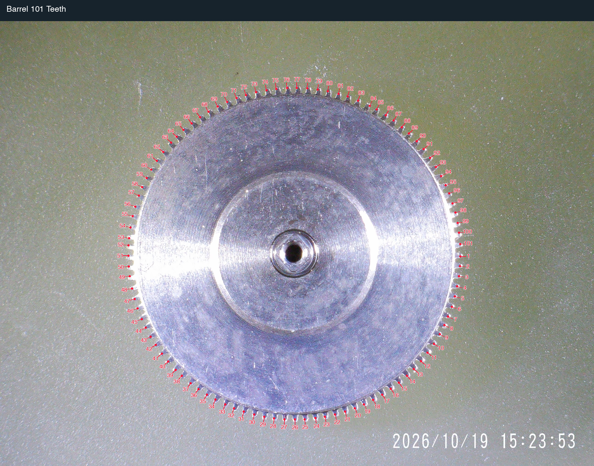

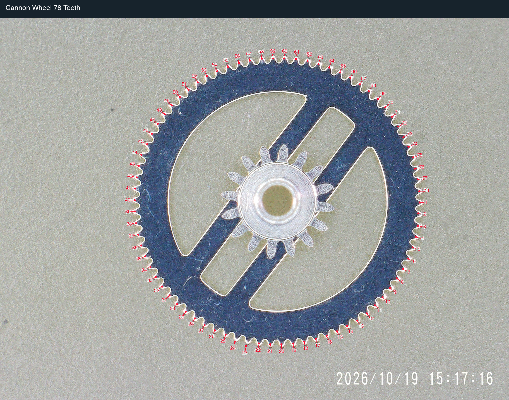

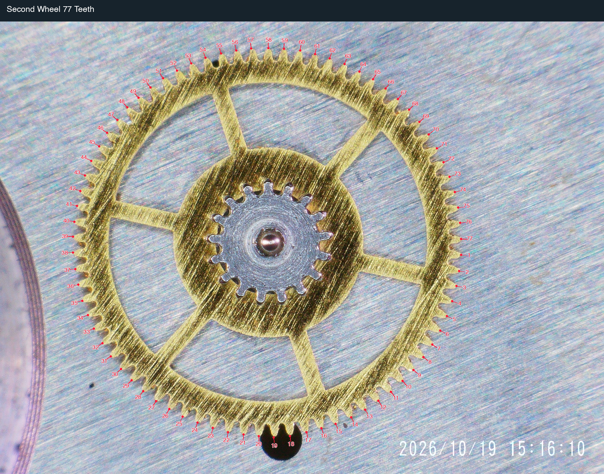

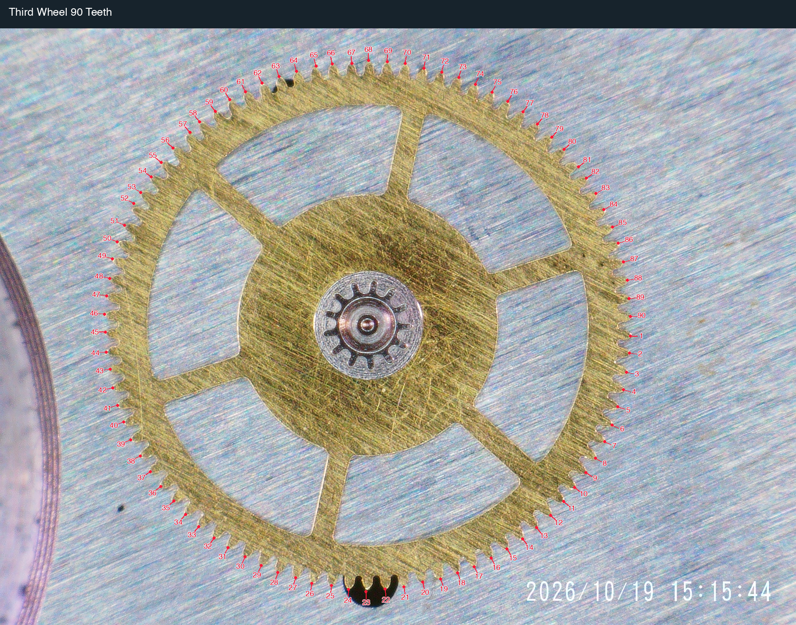

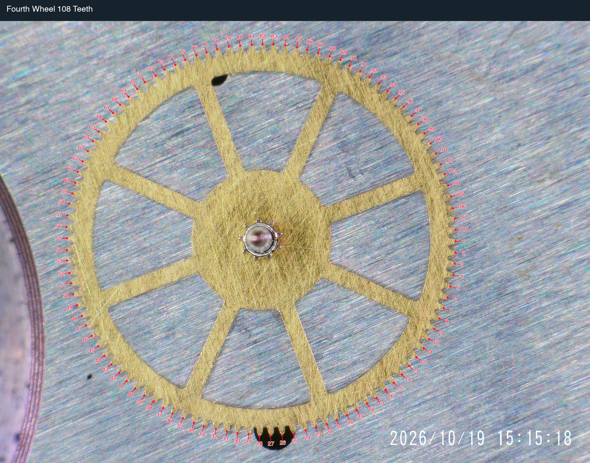

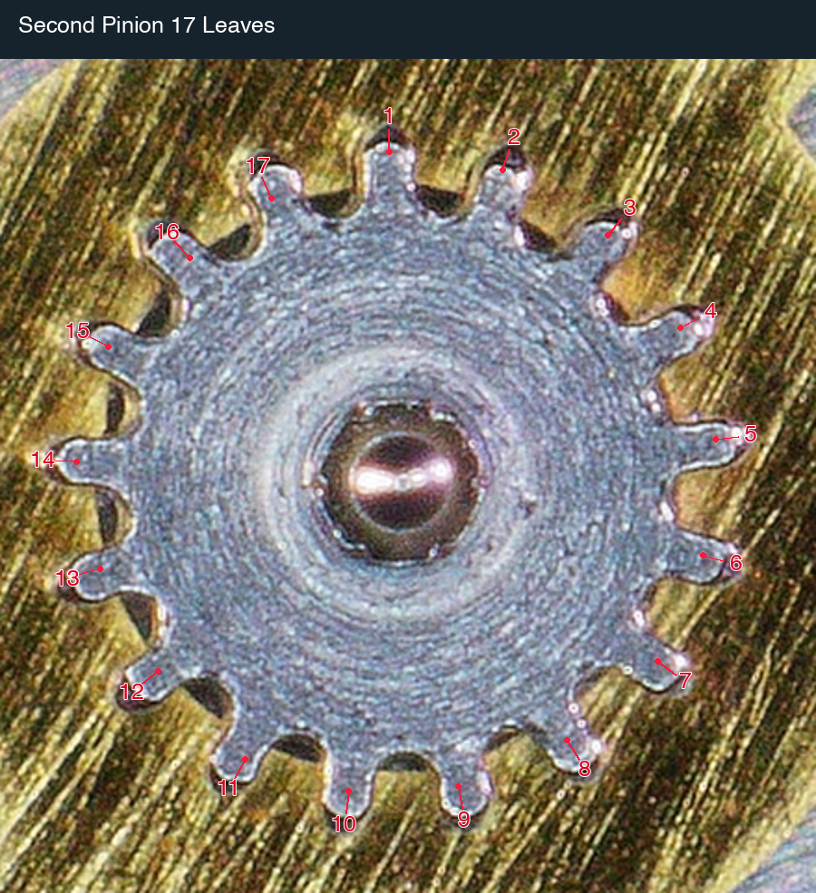

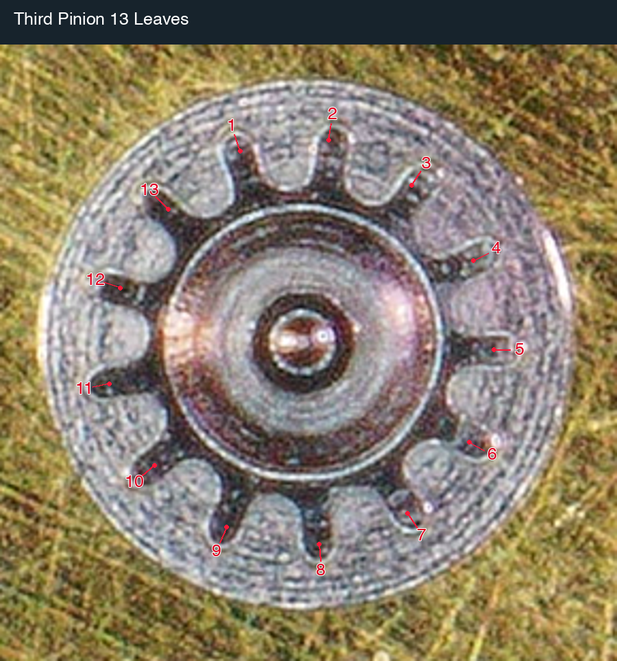

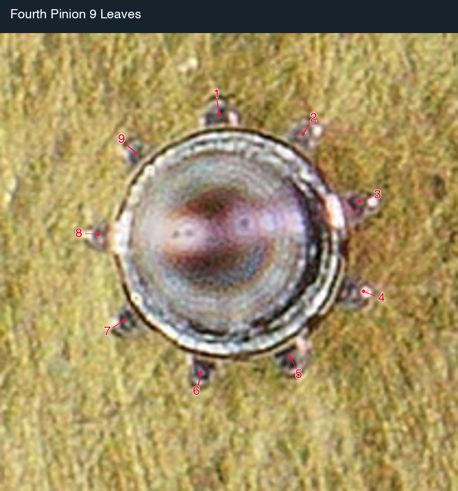

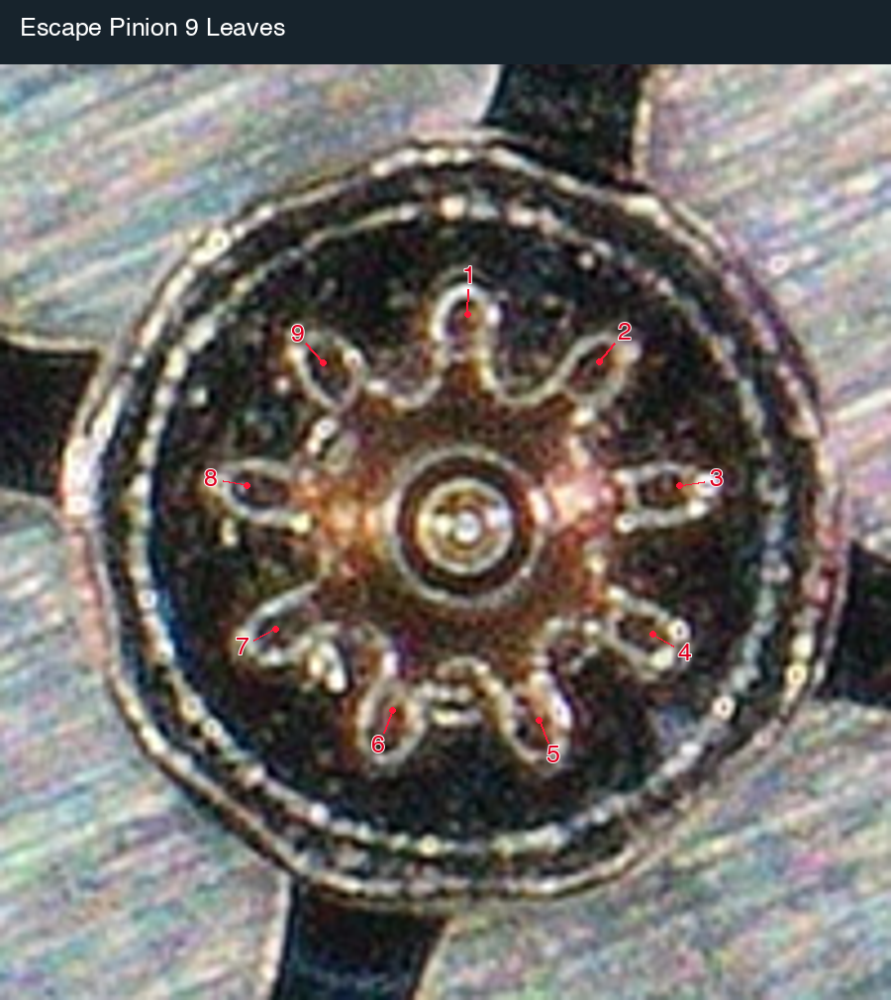

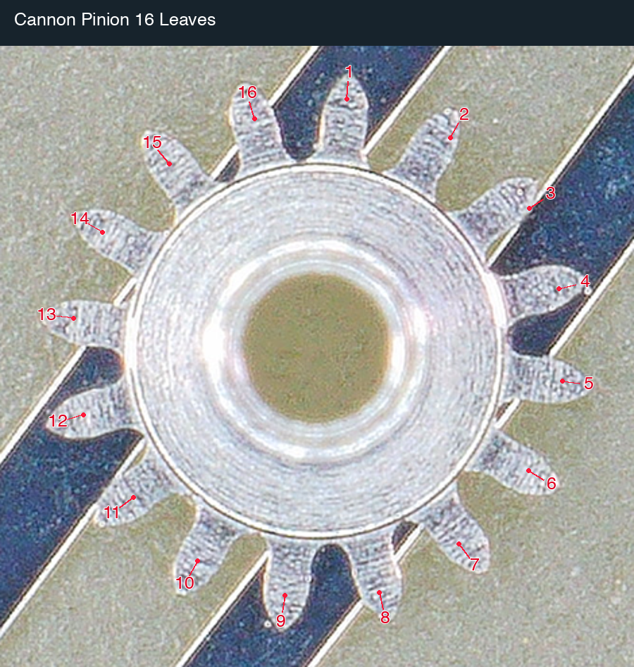

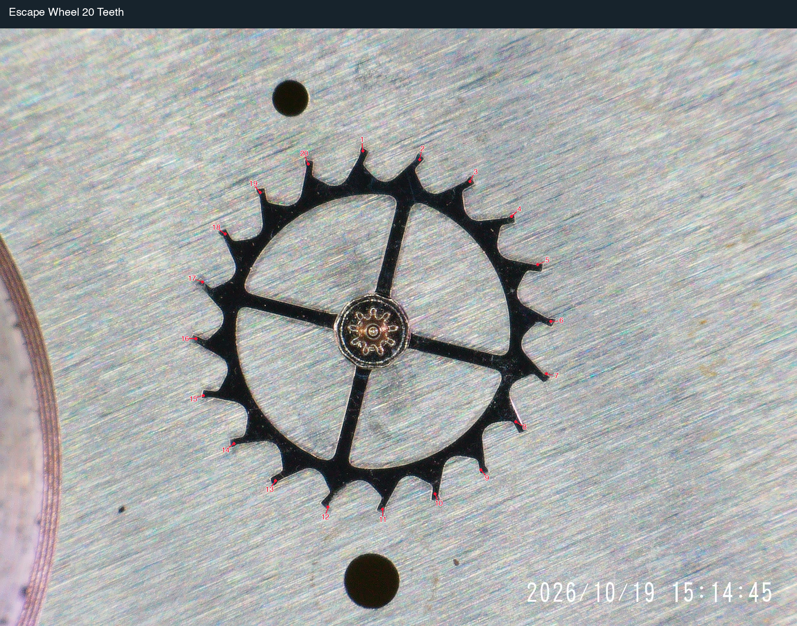

