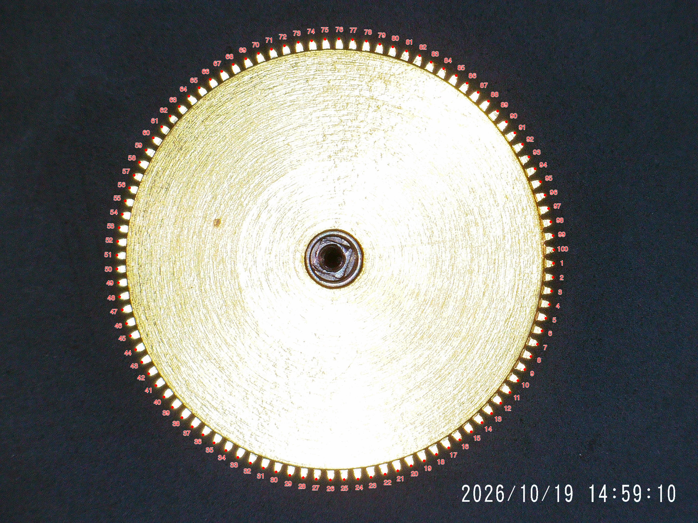
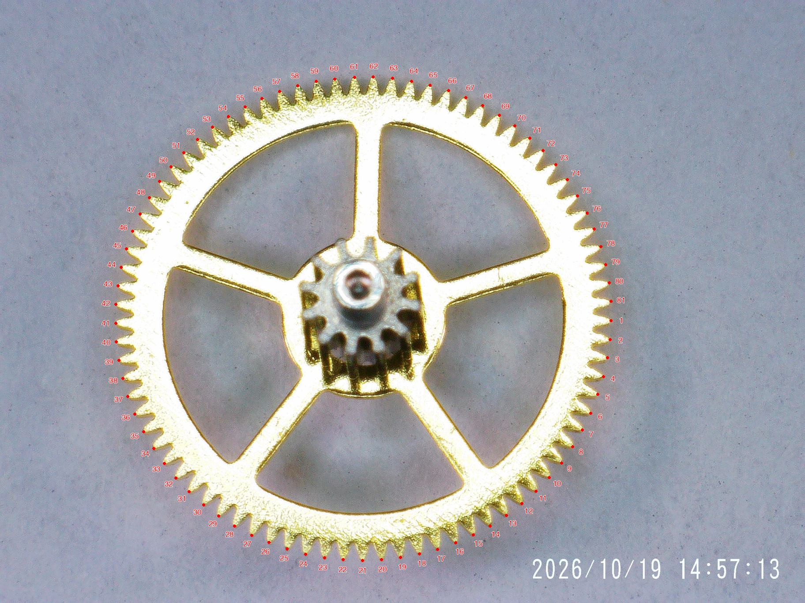
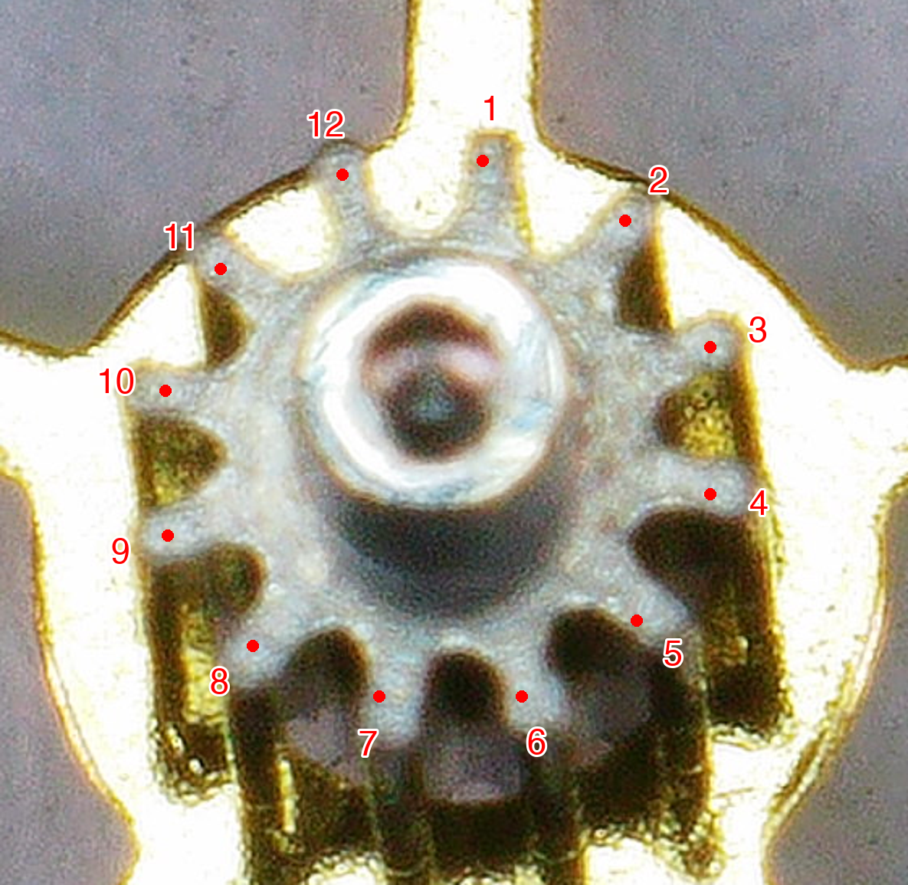
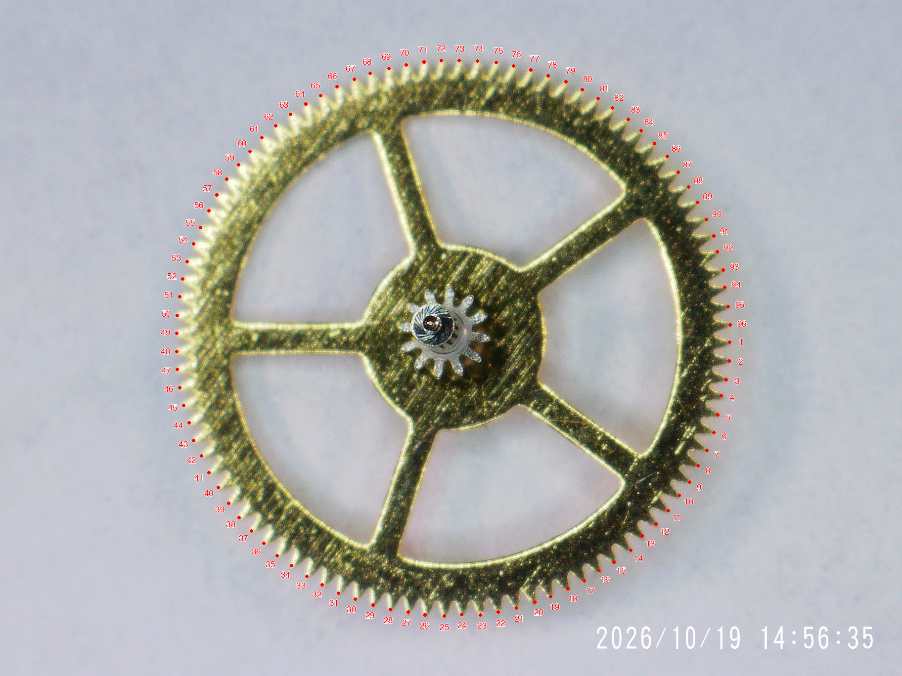
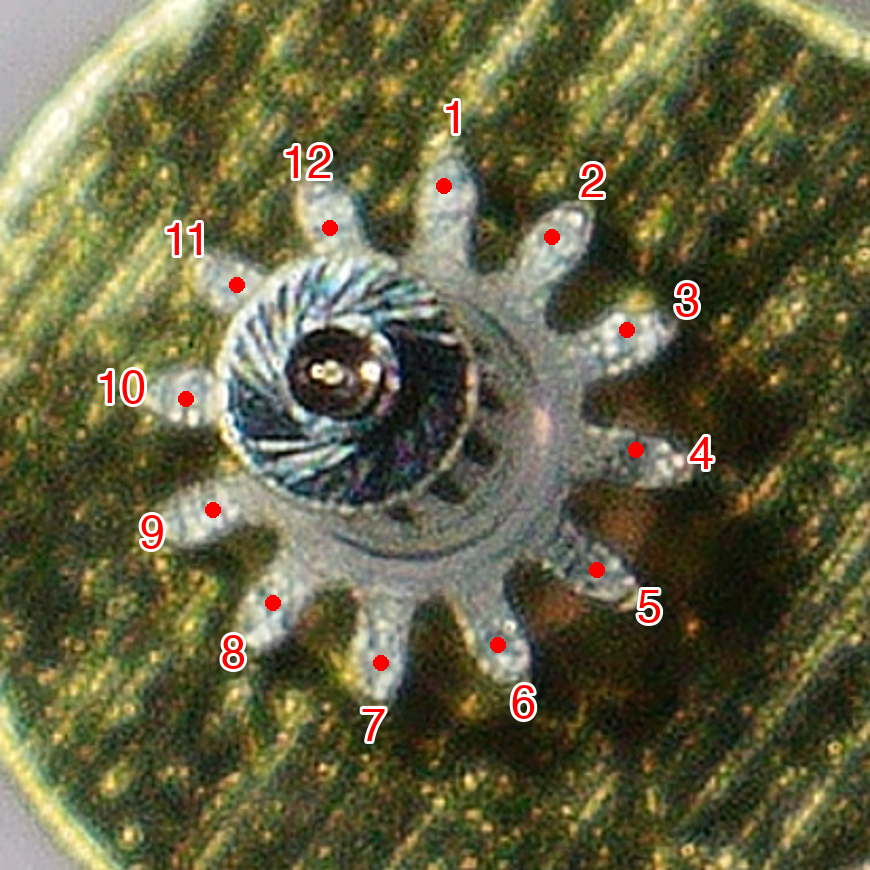
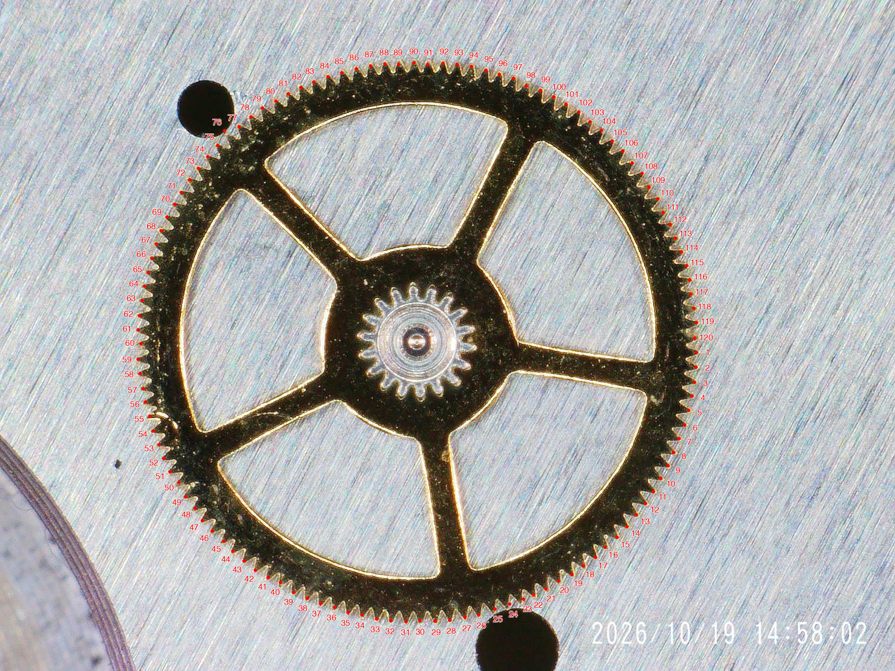
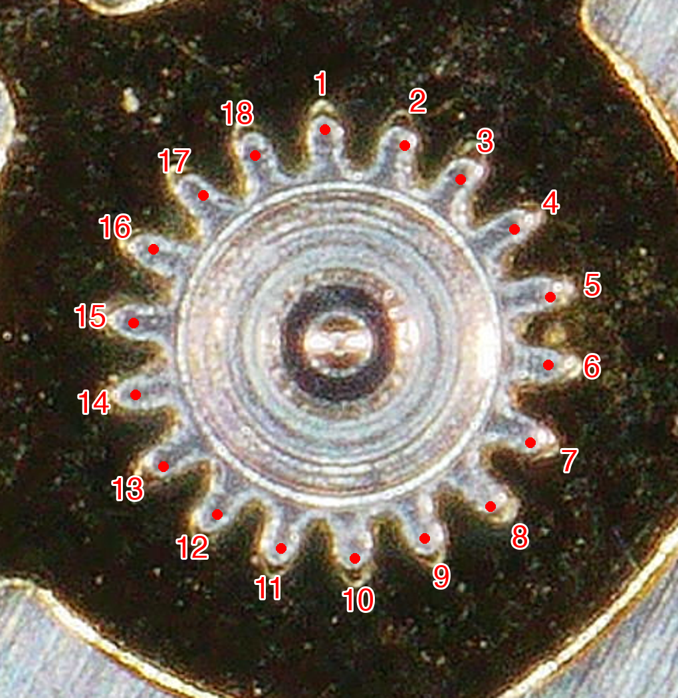
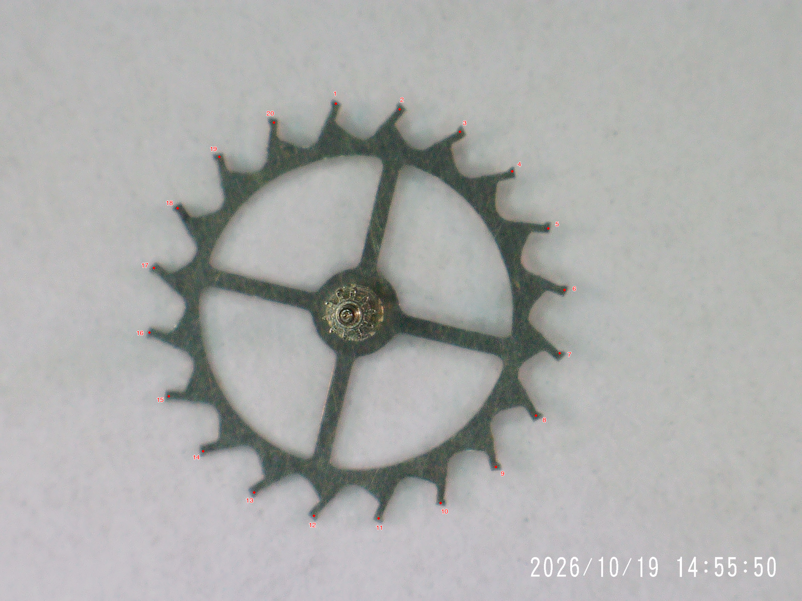
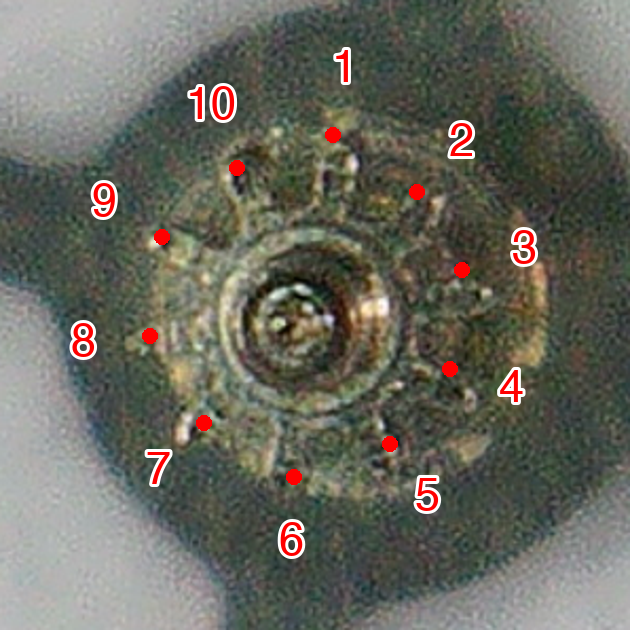

# 31xx train-wheel counts

Peter Hudson supplied five microscope photographs in the **VR31xx Train
Wheels** set on 2026-10-19. The counted train gives a **320-second third
wheel, 5-second escape wheel and 18,000-second (5-hour) barrel** at
28,800 bph. The photographed second wheel turns in **2,160 seconds
(36 minutes)**, not one hour. The cannon pinion remains a separate
one-hour component.

## Counts and periods

| Component | Wheel teeth | Pinion leaves on the same arbor | Period per revolution |
| --- | ---: | ---: | ---: |
| Barrel drum | 100 | — | 18,000 s (5 h) |
| Second wheel | 81 | 12 | 2,160 s (36 min) |
| Third wheel | 96 | 12 | 320 s (5 min 20 s) |
| Fourth wheel | 120 | 18 | 60 s |
| Escape wheel | 20 | 10 | 5 s |
| Cannon pinion (not photographed) | Not counted | Not counted | 3,600 s (1 h) |

All nine wheel/pinion counts are from visible teeth. The escape pinion is
the least sharp detail; ten tips are marked in its enlarged photograph.
The periods are calculated from the counts and beat rate. Wheel and
pinion on a rigid arbor share a period. The barrel period is the drum's
running period, not the winding-arbor period or the power reserve.

## Applicability

Peter reports that these counts and periods apply to **all genuine Rolex
31xx and Dandong/DD/VS and VR clones of that family**, explicitly including
**3130, 3135, 3186 and 3187**. His initial reference to 3120 was corrected
to 3130. The photographs document one component set; coverage of the
other manufacturers and variants is contributor-reported applicability,
not an independent photographic measurement of each variant.

The catalogue updates the existing Rolex 3135 family (3130, 3135, 3155,
3175, 3185, 3186, with 3187 added), the separate Rolex 3131 entry, and
VR3135 (VR3130, VR3186, with VR3187 added). It adds **Dandong 3135** with
DD, VS and Dandong aliases for 3130, 3135, 3186 and 3187. Family aliases
are explicitly qualified: `Rolex 31xx`, `Dandong 31xx`, `DD31xx`, `VS31xx`
and `VR31xx`.

**SH31xx is excluded.** Its existing database entry is unchanged; these
photos do not establish its train counts or underlying construction.
No 32xx or 413x entries receive these counts. Matching tooth counts do
not establish component interchangeability, tooth form or lift-angle
equivalence. Existing Rolex and VR lift settings remain. No lift angle
is inferred for the new DD/VS entry from these photos.

## Derivation and the 36-minute second wheel

For a driver with `Z` teeth and a driven pinion with `z` leaves,
`T_driven = T_driver × z / Z`. Each external mesh reverses direction;
these periods are positive magnitudes.

```text
barrel 100 → second pinion 12
second wheel 81 → third pinion 12
third wheel 96 → fourth pinion 18
fourth wheel 120 → escape pinion 10
```

At 28,800 bph there are eight beats per second. A lever escape wheel
advances one tooth pitch in two beats. Working back through the train:

```text
T_escape = 2 × 20 / 8       =     5 s
T_fourth = 5 × 120 / 10     =    60 s
T_third  = 60 × 96 / 18     =   320 s
T_second = 320 × 81 / 12    = 2,160 s
T_barrel = 2,160 × 100 / 12 = 18,000 s
```

The second-to-fourth speed increase is `(81 / 12) × (96 / 18) = 36`.
Assuming a one-hour second wheel would instead produce a 100-second
fourth wheel and an 8⅓-second escape wheel, inconsistent with this
20-tooth escapement at 28,800 bph and a one-minute seconds hand.
The one-hour second-wheel constraint used for the earlier 32xx and 4130
sets therefore must not be carried over to this train.

The cannon pinion still turns once per hour because it carries the minute
hand. These photographs do not show the intervening motion-work gearing,
so no tooth counts for that gearing are inferred. The required speed
ratio between second wheel and cannon pinion is `3600 / 2160 = 5 / 3`.

The [Rolex technical information for 3135 and related calibres](https://giacatwatch.com/wp-content/uploads/2024/03/CALIBER-3135-3155-3175-3185-TECHNICAL-INFORMATION-1.pdf)
independently lists **28,800 bph and a 52° lift angle for genuine 3135**
in its technical characteristics. The tooth counts and 36-minute result
here come from the photographs and calculation, not a claim that the
manual publishes this full train. The five-hour barrel also agrees with
the catalogue's earlier barrel-period value.

## Database representation

The established `centre wheel` database slot represents the second wheel
in this going train; the label is not a claim about the arbor's physical
location. It now stores **2160 s and 81/12**, replacing the previous
3600-second assumption in Rolex 3135 and VR3135. A separate **cannon
pinion: 3600 s** entry preserves the minute-hand period. The third wheel
is **320 s**, and all five going-train wheels carry their counted teeth
and pinions. Existing user overrides continue to take precedence over
shipped values.

The separate Rolex 3131 row receives the train under the contributor's
all-Rolex-31xx coverage. Its existing 52° lift setting is retained. The new
DD/VS row deliberately leaves lift angle unspecified; it can be supplied
from separate escapement evidence.

## Evidence and counting method

The barrel, second, third and fourth wheel outlines were measured using
image-based tooth-tip detection and visually checked for one numbered
marker per tooth. Three visible fourth-wheel teeth beside a dark hole in
the metal background were marked manually where outline detection merged
them with the background. The escape-wheel perimeter and all four pinions
were marked by visual inspection. All nine numbered figures were reviewed.

The labels are measurement annotations on the supplied pixels, with no
reconstruction of teeth. Whole-wheel figures use 1824 × 1368 renditions
of the 2592 × 1944 originals; pinion figures are enlarged crops. Numbering
runs clockwise from an arbitrary tooth and does not indicate running
direction. [Tooth-tip coordinates](assets/train-wheels/31xx/tooth-tip-coordinates.json)
use the 1824 × 1368 coordinate system.

All five original JPEGs are retained byte-for-byte. The
[manifest](assets/train-wheels/31xx/originals/manifest.json) records original
filenames, dimensions and SHA-256 checksums. The Rolex manual is linked,
not redistributed.

| Supplied filename | Original repository copy |
| --- | --- |
| Barrel.JPG | [Barrel](assets/train-wheels/31xx/originals/barrel.jpg) |
| Second Wheel.JPG | [Second wheel](assets/train-wheels/31xx/originals/second-wheel.jpg) |
| Thrid Wheel.JPG (original spelling) | [Third wheel](assets/train-wheels/31xx/originals/third-wheel.jpg) |
| Fourth Wheel.JPG | [Fourth wheel](assets/train-wheels/31xx/originals/fourth-wheel.jpg) |
| Escape Wheel.JPG | [Escape wheel](assets/train-wheels/31xx/originals/escape-wheel.jpg) |

## Numbered photographs

### Barrel: 100 teeth



### Second wheel: 81 teeth and 12 pinion leaves





### Third wheel: 96 teeth and 12 pinion leaves





### Fourth wheel: 120 teeth and 18 pinion leaves





### Escape wheel: 20 teeth and 10 pinion leaves




