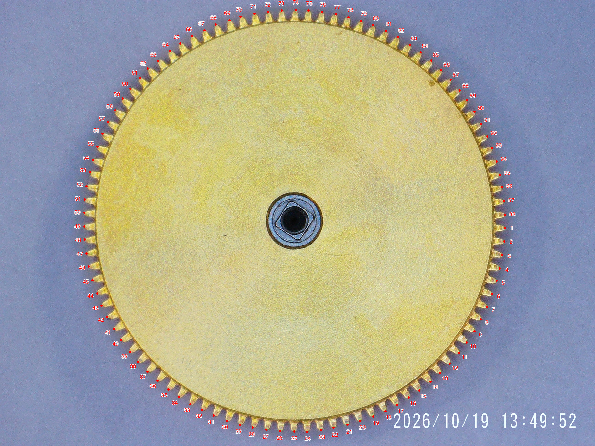
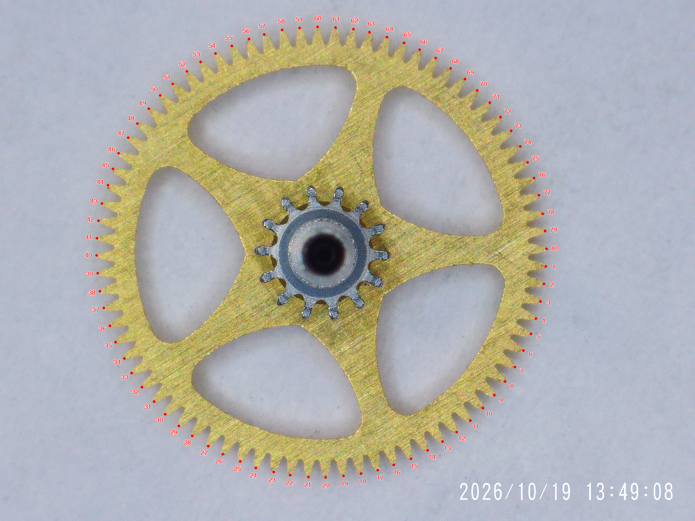
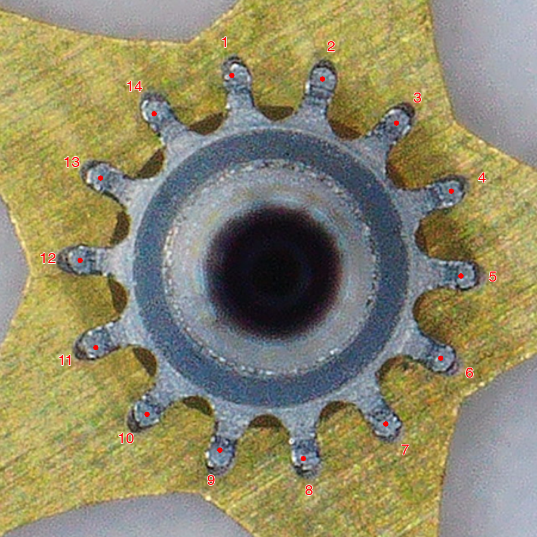
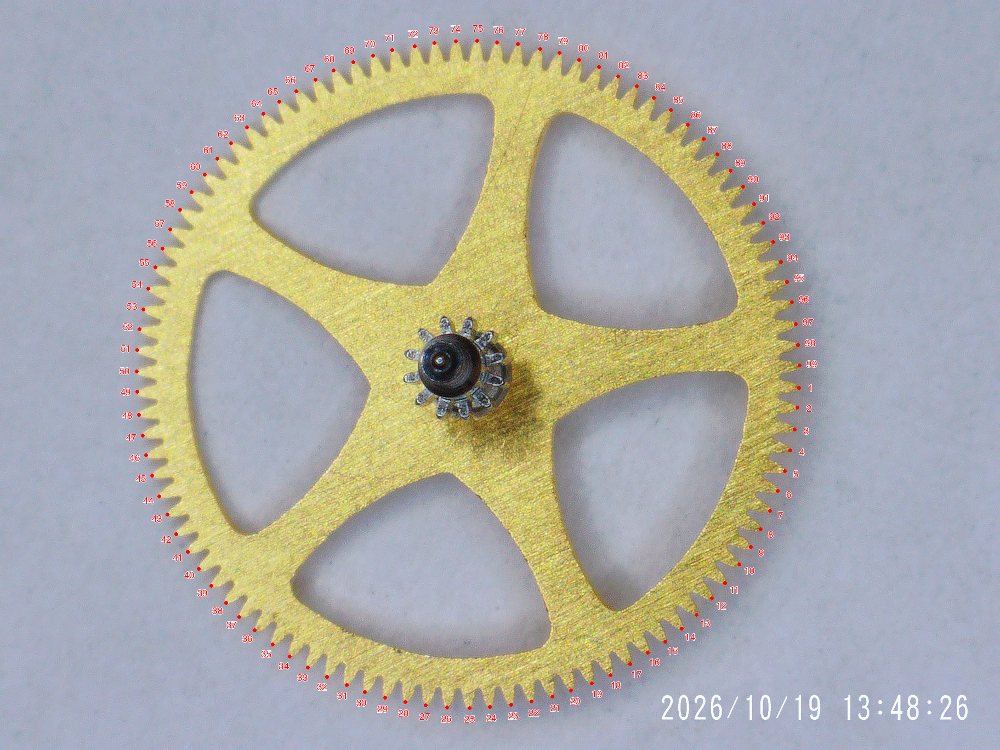
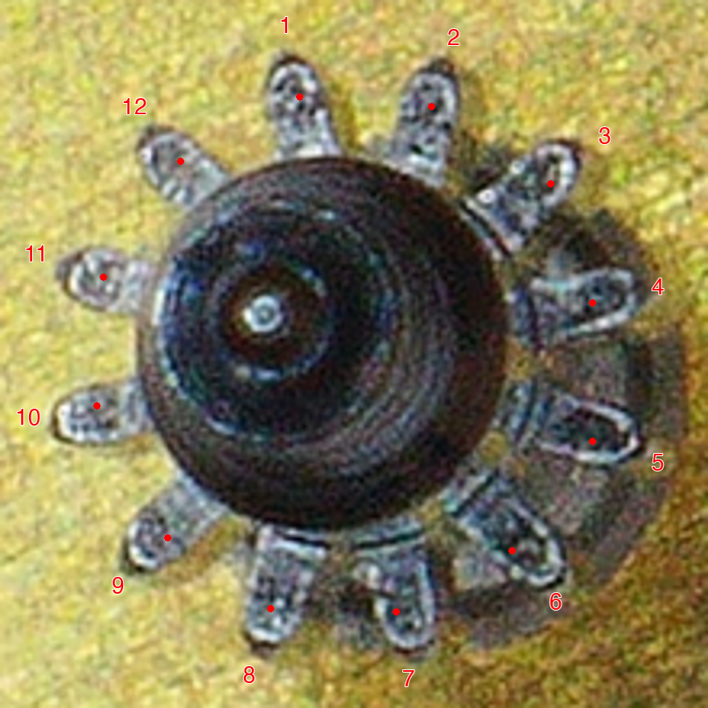
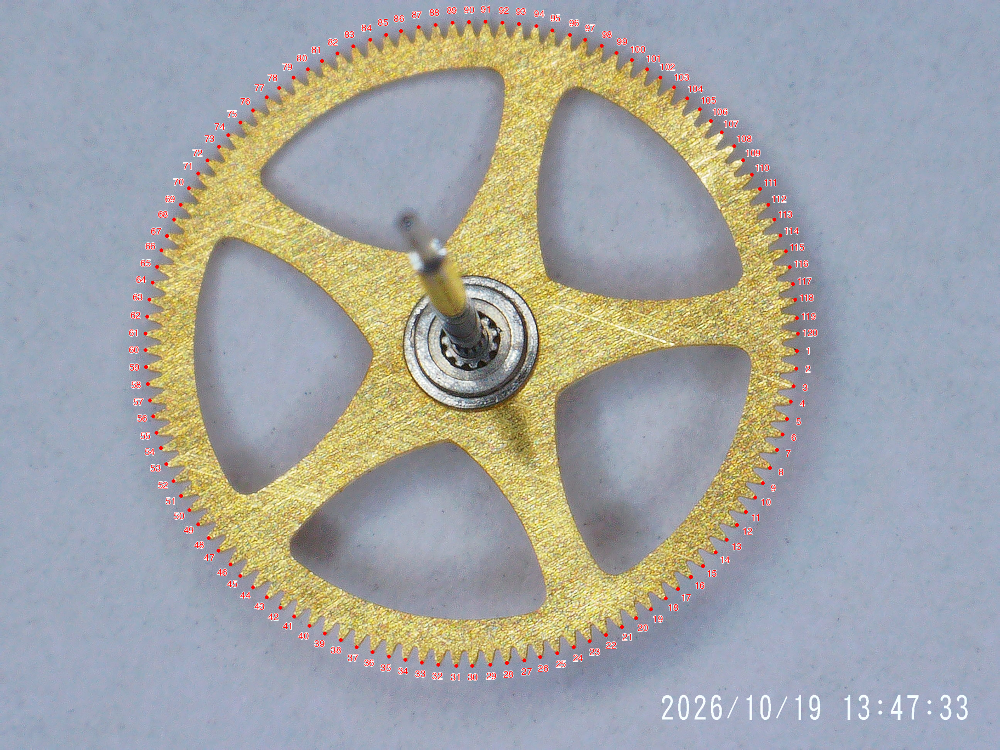
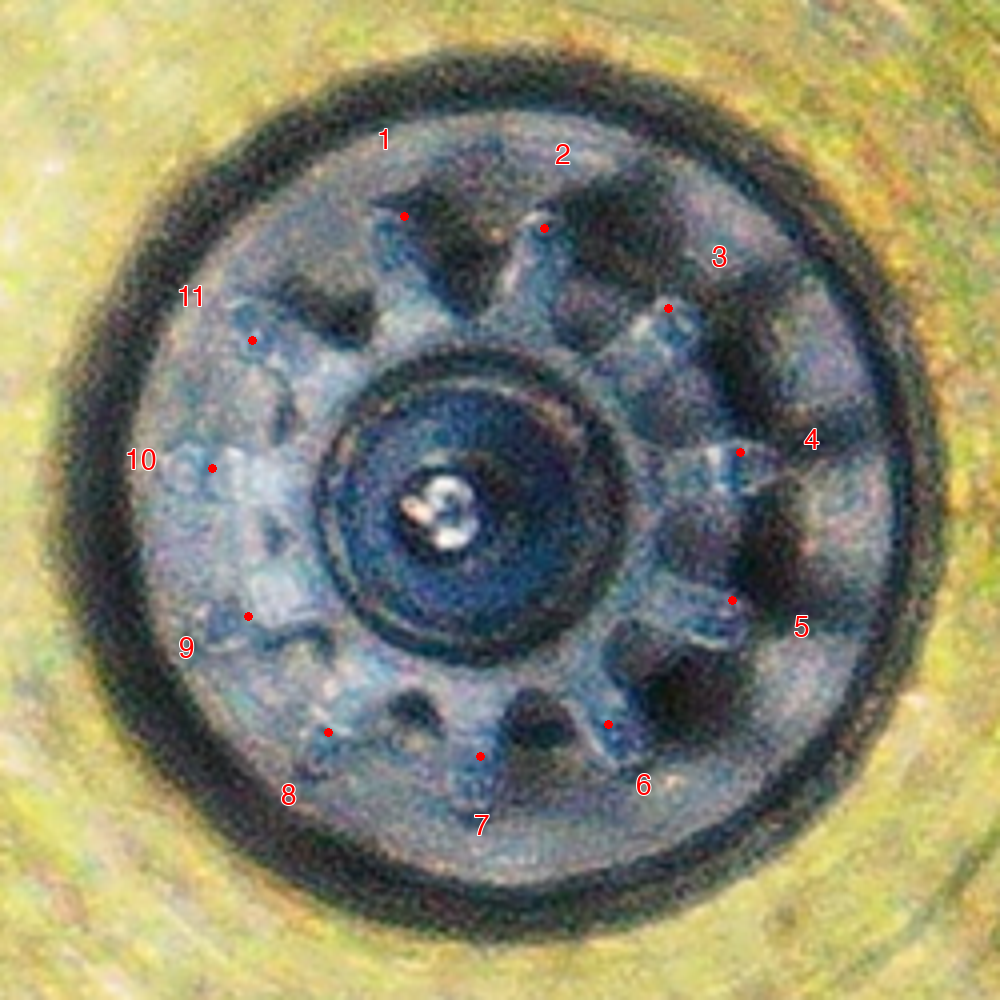
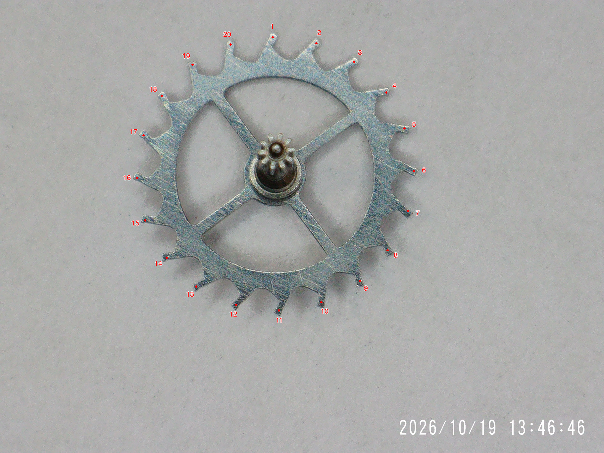
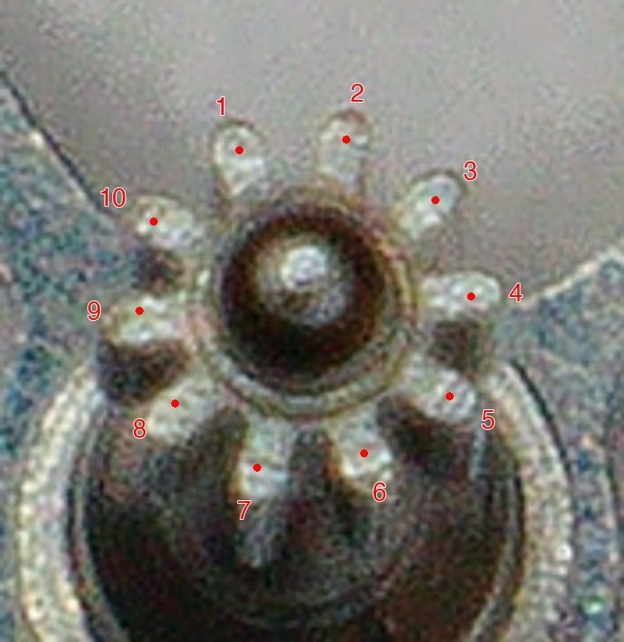

# 32xx train wheel tooth counts

Microscope photographs supplied by Peter on 2026-10-19, from the
`DD32xx Train Wheels` photo set. The photographed train has a **9-minute
third wheel, 5-second escape wheel, and 7-hour barrel** under the supplied
28,800 bph, one-hour second-wheel and one-minute fourth-wheel constraints.

## Counts and periods

The pinion column counts the small teeth (leaves) on the same arbor as
the named wheel. Each wheel and its pinion have the same rotation period.

| Component | Wheel teeth | Pinion leaves | Period per revolution | Period, seconds |
| --- | ---: | ---: | --- | ---: |
| Mainspring barrel | 98 | N/A | 7 hours | 25,200 |
| Second wheel (minute-driving wheel) | 80 | 14 | 1 hour | 3,600 |
| Third wheel | 99 | 12 | 9 minutes | 540 |
| Fourth wheel (seconds wheel) | 120 | 11 | 1 minute | 60 |
| Escape wheel | 20 | 10 | 5 seconds | 5 |

The barrel has no receiving train pinion in this chain. Its centre is the
barrel arbor; the 7-hour figure describes the barrel drum during running,
not the winding rotation of its arbor or the power reserve.

These counts come directly from the photographed components. On 2026-10-19,
Peter Hudson confirmed that the counts and periods apply to **all genuine
Rolex, Dandong and Jinghe 32xx movements**, including 3230, 3235, 3255 and
3285. That family applicability is contributor testimony accompanying
the photographs; the images themselves show one component set.

**VR32xx and SH32xx are excluded.** They have different train configurations
and await their own photographs and counts. The existing VR3235/SH3235
and SH3285/VR3285 catalogue entries retain their previous known periods,
without importing any tooth counts, third-wheel, barrel or escape-wheel
periods from this contribution.

## Derivation and cross-checks

For a driving wheel with `Z` teeth meshing with a driven pinion with `z`
leaves, `T_driven = T_driver × z / Z`. Rotation directions alternate;
the periods below are positive magnitudes.

The train meshes are:

```text
barrel 98 → second pinion 14
second wheel 80 → third pinion 12
third wheel 99 → fourth pinion 11
fourth wheel 120 → escape pinion 10
```

Using the supplied second-wheel period:

```text
T_third  = 3,600 × 12 / 80 = 540 s = 9 min
T_fourth =   540 × 11 / 99 =  60 s
T_escape =    60 × 10 / 120 = 5 s
T_barrel = 3,600 × 98 / 14 = 25,200 s = 7 h
```

The second-to-fourth speed increase is exactly
`(80 / 12) × (99 / 11) = 60`, independently matching the supplied
one-hour and one-minute periods.

A lever escapement takes two beats per escape-wheel tooth pitch: one
full escape-wheel revolution takes `2 × 20 = 40` beats. At
`28,800 / 3,600 = 8` beats per second, this gives `40 / 8 = 5 s`,
independently agreeing with the fourth-to-escape gear ratio. See
[H. R. Playtner, *An Analysis of the Lever Escapement*](https://www.gutenberg.org/cache/epub/21978/pg21978-images.html)
for the two-beats-per-tooth calculation.

The previous catalogue's provisional Rolex 3235 barrel period of
22,050 s used a 98:16 ratio. The photographed second pinion has **14**
leaves, giving 25,200 s. This contribution replaces the old period for
the covered families and adds the previously missing third-wheel period.
The separate Rolex 3235 and 3255 entries with a 53° lift setting receive
the same train; their lift angles remain unchanged.

The database calls the photographed second wheel `centre wheel`, retaining
the established slot name used by analysis, reports and user overrides.
The Dandong and Jinghe rows have explicit manufacturer-prefixed aliases
for all four calibres. Bare numbers such as `3235` still designate Rolex.
The generic `3235 (clone)` alias is removed because it cannot distinguish
DD/JH from VR/SH: saved selections using it must be changed to the actual
manufacturer-specific designation (for example, `DD3235`). It is not kept
as a resolving former name, which would silently retain the ambiguity.

## Counting method and source photographs

The four large brass perimeters were counted by detecting tooth tips
along the image outline, then visually checking one numbered marker
per tooth around the complete circumference. The escape-wheel teeth
and all four pinions were marked from visual inspection. All nine
numbered images were visually reviewed. The fourth pinion is the least
sharp image; its 11 visible leaves are also supported by the exact
second-to-fourth ratio above.

The annotations are ordinary image measurements and labels, with no
generative reconstruction. Full-wheel views are 1824 × 1368 renditions
of the 2592 × 1944 supplied photos; pinion views are enlarged crops.
The numbered PNGs preserve those annotated renditions losslessly. The six
full-resolution original JPEGs are also included for independent recounting,
with their original filenames and SHA-256 hashes in the
[original-image manifest](assets/train-wheels/32xx/originals/manifest.json).
The starting tooth is arbitrary, and numbering runs clockwise in each
image; it is not an assembly-index or rotation-direction mark.

| Original filename | Saved evidence |
| --- | --- |
| [Mainspring.JPG](assets/train-wheels/32xx/originals/barrel.jpg) | Barrel perimeter |
| [Second Wheel.JPG](assets/train-wheels/32xx/originals/second-wheel.jpg) | Second-wheel perimeter and pinion |
| [Thrid Wheel.JPG](assets/train-wheels/32xx/originals/third-wheel.jpg) (original spelling) | Third-wheel perimeter and pinion |
| [Fourth Wheel (bottom).JPG](assets/train-wheels/32xx/originals/fourth-wheel-bottom.jpg) | Fourth-wheel perimeter |
| [Fourth Wheel (top).JPG](assets/train-wheels/32xx/originals/fourth-wheel-top.jpg) | Fourth-wheel pinion |
| [Escape Wheel.JPG](assets/train-wheels/32xx/originals/escape-wheel.jpg) | Escape-wheel perimeter and pinion |

## Numbered photographs

### Barrel: 98 teeth



### Second wheel: 80 teeth, 14 pinion leaves





### Third wheel: 99 teeth, 12 pinion leaves





### Fourth wheel: 120 teeth, 11 pinion leaves





### Escape wheel: 20 teeth, 10 pinion leaves




