# 4130 train and chronograph wheel counts

Peter Hudson supplied ten microscope photographs of a **Dandong 4130**
component set on 2026-10-19. The counts give a **480-second (8-minute) third
wheel, 5-second escape wheel, and 25,200-second (7-hour) barrel**, using the
one-hour second-wheel constraint and 28,800 bph. The fourth wheel turns in
60 seconds. Its hidden receiving pinion is **inferred as 12 leaves**;
all other counts below are from visible teeth.

## Counts and periods

| Component | Wheel teeth | Receiving pinion leaves | Period per revolution |
| --- | ---: | ---: | ---: |
| Barrel drum | 105 | — | 25,200 s (7 h) |
| Second wheel (minute-driving wheel) | 90 | 15 | 3,600 s (1 h) |
| Third wheel supplied for identification | 96 | 12 | 480 s (8 min) |
| Fourth wheel | 120 | **12, inferred** | 60 s |
| Escape wheel | 20 | 10 | 5 s |
| Separate steel clutch-drive gear on fourth arbor | 30 | — | 60 s |
| Vertical clutch bottom/input gear | 30 | — | 60 s while movement runs |
| Vertical clutch top/output wheel | 70 | — | 60 s when engaged |
| Chronograph seconds counter | 70 | — | 60 s when engaged |

Wheel and pinion on a rigid arbor share a period. The clutch input and
output share a period **only when engaged**. A stopped chronograph has no
repeating output rotation period. The barrel period describes the drum
as the movement runs, not the winding arbor or the power reserve.

The escape pinion is the least sharp detail. Ten leaf tips can be
identified in the photograph; its 120:10 mesh also agrees with a
one-minute fourth wheel and the independently calculated escape period.

## What applies to which movement

Peter reports that these counts and periods also match **genuine Rolex
4130 and Shanghai SH4130**, despite differences in component manufacture
and escapement construction. The photographs directly document DD4130;
extension to the other two is contributor-supplied applicability, not
three independently photographed trains. Matching counts do not prove
parts interchangeability, tooth form, material or lift-angle equivalence.

This contribution updates Rolex 4130 and Dandong 4130 and adds SH4130.
It does **not** extend the counts to Rolex/DD/SH4131, Rolex 4030, or
7750-based movements sold as Daytona/4130 homages. Likewise it makes no
changes to the separate 32xx, VR32xx or SH32xx trains.

## Mesh identification and the third-wheel check

The fourth-wheel side view shows three distinct toothed sections:

1. The large brass wheel: **120 teeth**, driving the escape pinion.
2. The narrow fluted receiving pinion between the wheels: hidden from a
   complete end-on count, **12 leaves inferred** from the going-train ratios.
3. The small steel disk gear: **30 teeth**, driving the clutch's bottom
   **30-tooth** gear.

Peter confirmed the physical connections during the count: the middle
section meshes with the third wheel; the bottom steel gear drives the
clutch. In normal running, power passes **from the third wheel into the
fourth pinion**. This resolves the initial suggestion that the hidden
middle pinion drove the clutch.

The [Rolex 4130 technical manual](https://forum.uurwerkherstellers.nl/downloads/rolex4130.pdf),
Technical Information No. 61 (May 2000), printed pages 6–7 (PDF pages 8–9),
shows this clutch arrangement. Its English label “Second wheel” in that
diagram refers to the seconds/fourth wheel; this document uses “second
wheel” for the minute-driving wheel, as in the supplied filenames.

The supplied **96/12** third wheel fits a conventional 12-leaf receiving
pinion on the fourth arbor exactly. There is no numerical evidence here
that it is the wrong intermediate wheel. However, deriving the hidden
pinion from that candidate is a **consistency check, not an independent
proof of the candidate's identity**. A direct count of the hidden pinion
or a documented part identification would provide that independent check.
The database records this limitation in the third- and fourth-wheel basis.

## Derivation

For a driver with `Z` teeth and a driven gear/pinion with `z` teeth,
`T_driven = T_driver × z / Z`. Periods below are positive magnitudes;
each external mesh reverses direction.

```text
Going train:
barrel 105 → second pinion 15
second wheel 90 → third pinion 12
third wheel 96 → fourth receiving pinion 12 (inferred)
fourth wheel 120 → escape pinion 10

Chronograph branch:
fourth-arbor steel gear 30 → clutch bottom 30
clutch engaged: input and output rotate together
clutch top 70 → chronograph seconds counter 70
```

At 28,800 bph there are eight beats per second. A lever escapement advances
one tooth pitch in two beats, so:

```text
T_escape = 2 × 20 / 8 = 5 s
T_fourth = 5 × 120 / 10 = 60 s
T_third  = 3,600 × 12 / 90 = 480 s
z_fourth = 96 × 60 / 480 = 12 leaves (inferred)
T_barrel = 3,600 × 105 / 15 = 25,200 s
```

Working backward from the supplied chronograph seconds period:

```text
T_clutch_top    = 60 × 70 / 70 = 60 s
T_clutch_bottom = 60 s when engaged
Z_fourth_drive  = 30 × 60 / 60 = 30 teeth
```

The last result independently agrees with the directly counted steel gear.
It does not determine the hidden receiving pinion; that inference uses the
going train. The second-to-fourth speed increase is
`(90 / 12) × (96 / 12) = 60`.

The Rolex manual's printed page 5 (PDF page 7) independently specifies
28,800 bph, 20 escape teeth and a seven-hour barrel revolution. It also
publishes a 52° lift angle for genuine 4130. The existing Rolex and Dandong
52° settings remain; no SH4130 lift angle is inferred from matching teeth.

## Database representation

The existing `centre wheel` slot stores the photographed second wheel,
with its one-hour period and 90/15 counts. This is the application's
established going-train slot, not a claim that this arbor is physically
at the movement centre. The existing `cannon pinion` entry remains separate.
The fourth wheel's `pinion: 12` is its receiving pinion; the additional
30-tooth clutch-drive gear is described in its basis and in this evidence.

The clutch and chronograph counter are documented here rather than added
as unconditional runtime wheel periods: the catalogue currently has no
field for engagement state. Their shared 60-second period is already
represented by the continuously running fourth wheel.

The ambiguous `4130 (clone)` alias is removed, without a former-name
fallback. Saved selections using it need an explicit manufacturer, such
as `DD4130` or `SH4130`, so a 7750-based homage cannot silently acquire
this train. Bare `4130` continues to resolve to genuine Rolex.

## Evidence and counting method

Six large toothed perimeters were measured by detecting tooth tips along
the outline and visually checking one numbered marker per tooth. The
small gears, pinions and escape-wheel perimeter were marked by visual
inspection. All twelve numbered figures were visually reviewed. The
hidden fourth pinion has **no numbered count image** because it cannot
be counted directly from this set.

These are measurement annotations over the supplied pixels, with no
reconstruction of teeth. Whole images are 1824 × 1368 renditions of the
2592 × 1944 originals; the small-gear figures are enlarged crops. Numbering
runs clockwise from an arbitrary starting tooth, not an assembly index
or direction-of-rotation mark. [Tooth-tip coordinates](assets/train-wheels/4130/tooth-tip-coordinates.json)
use the 1824 × 1368 coordinate system for independent review.

All ten original JPEGs are retained byte-for-byte, with original filenames
and SHA-256 checksums in the [manifest](assets/train-wheels/4130/originals/manifest.json).
The Rolex manual is linked as a reference, not redistributed with the photos.

| Original filename | Repository copy |
| --- | --- |
| Barrel.JPG | [Barrel](assets/train-wheels/4130/originals/barrel.jpg) |
| Second Wheel.JPG | [Second wheel](assets/train-wheels/4130/originals/second-wheel.jpg) |
| Thrid Wheel.JPG (original spelling) | [Third-wheel candidate](assets/train-wheels/4130/originals/third-wheel.jpg) |
| Fourth Wheel.JPG | [Fourth wheel](assets/train-wheels/4130/originals/fourth-wheel.jpg) |
| Fourth Wheel Side Profile.JPG | [Fourth-wheel side profile](assets/train-wheels/4130/originals/fourth-wheel-side-profile.jpg) |
| Escape Wheel.JPG | [Escape wheel](assets/train-wheels/4130/originals/escape-wheel.jpg) |
| Escape Wheel (pinion).JPG | [Escape pinion](assets/train-wheels/4130/originals/escape-wheel-pinion.jpg) |
| Chrono Seconds Counter.JPG | [Chronograph seconds counter](assets/train-wheels/4130/originals/chrono-seconds-counter.jpg) |
| Vertical Clutch Bottom.JPG | [Clutch bottom](assets/train-wheels/4130/originals/clutch-bottom.jpg) |
| Vertical Clutch Top.JPG | [Clutch top](assets/train-wheels/4130/originals/clutch-top.jpg) |

## Numbered photographs

### Barrel: 105 teeth

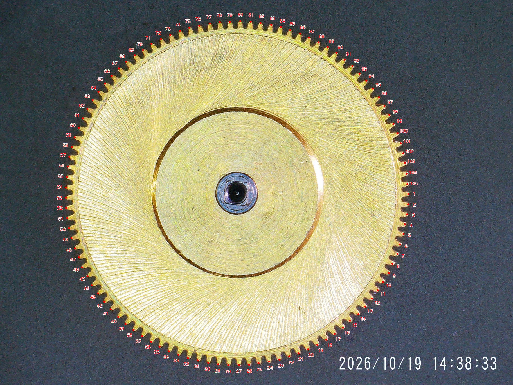

### Second wheel: 90 teeth, 15 pinion leaves

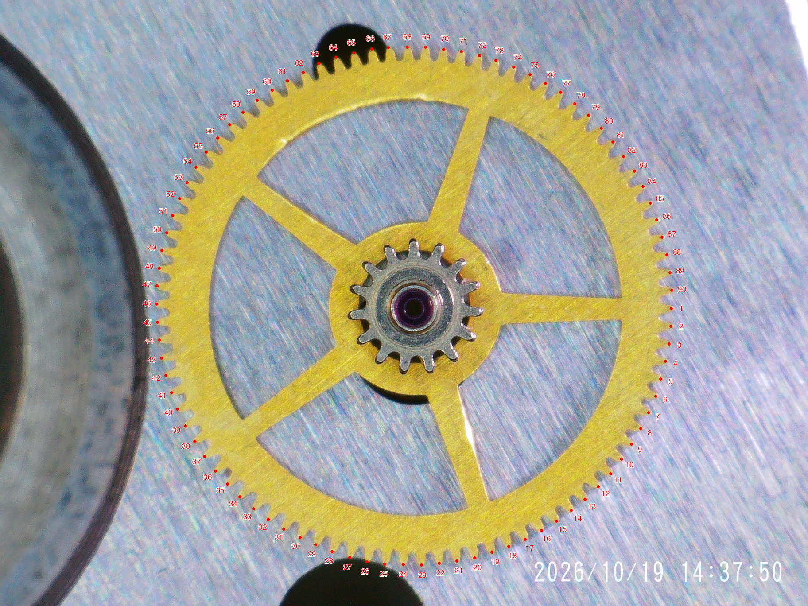

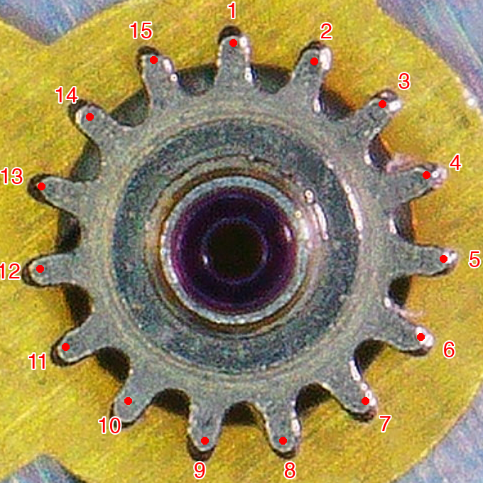

### Third-wheel candidate: 96 teeth, 12 pinion leaves

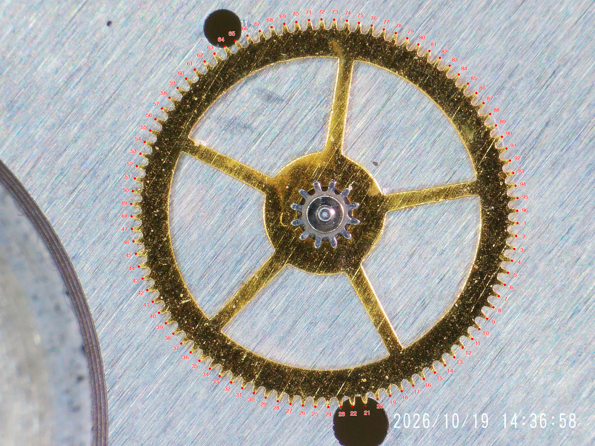

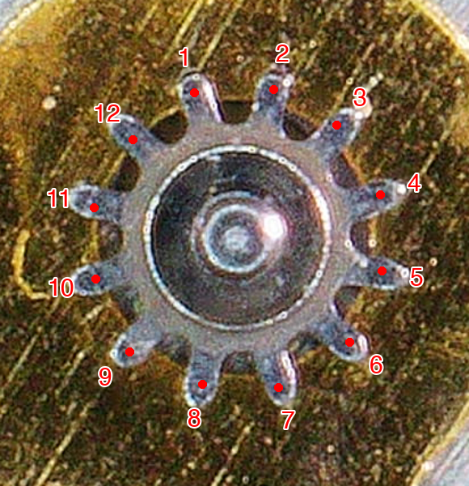

### Fourth wheel: 120 teeth and separate 30-tooth clutch-drive gear

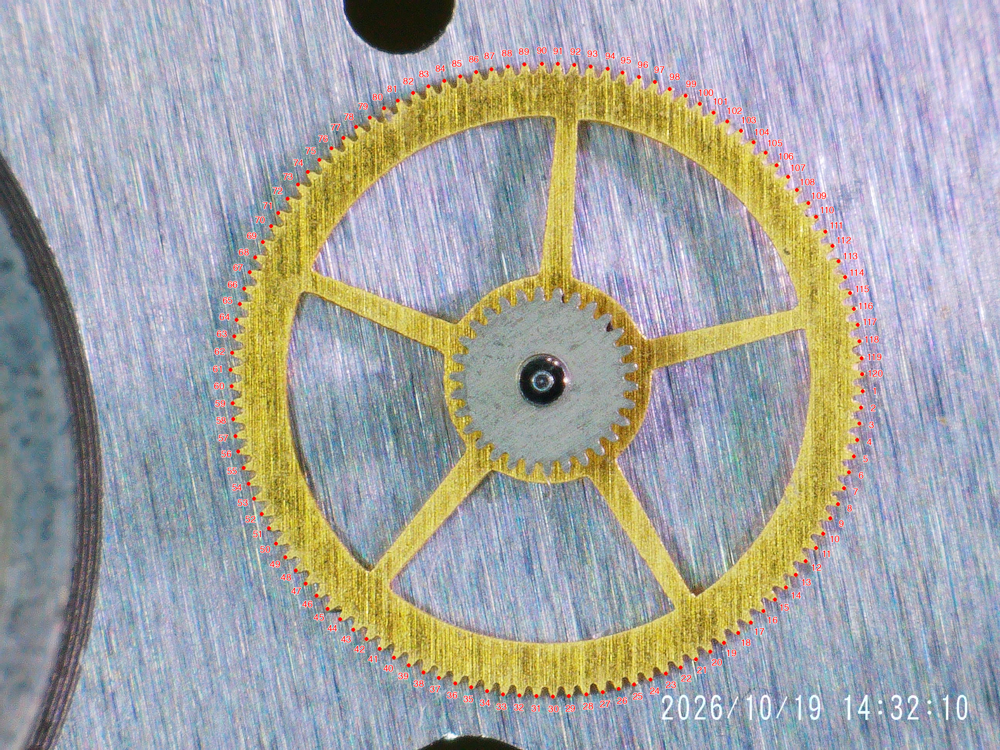

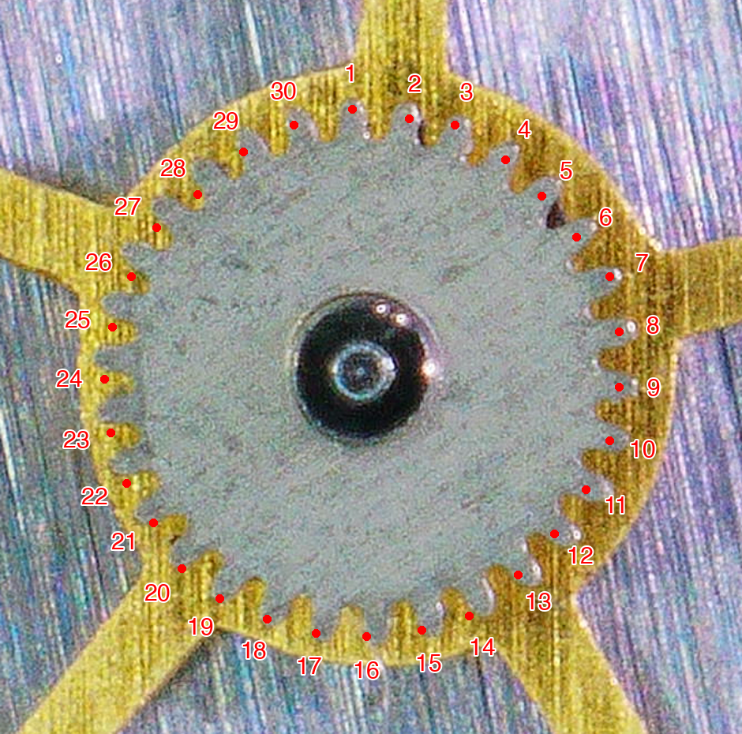

The side profile shows the receiving pinion between these two gears;
its inferred 12 leaves are not directly countable here.

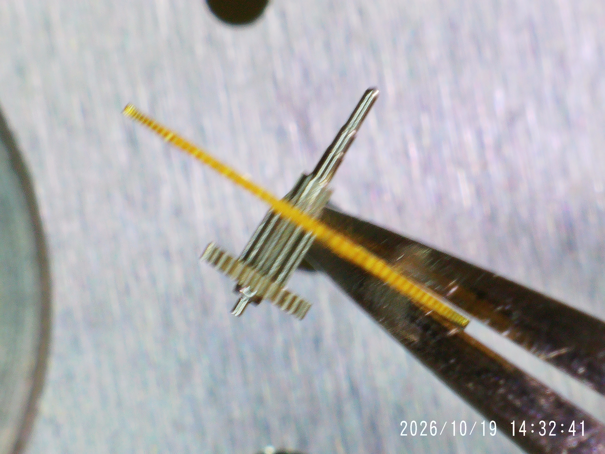

### Escape wheel: 20 teeth, 10 pinion leaves

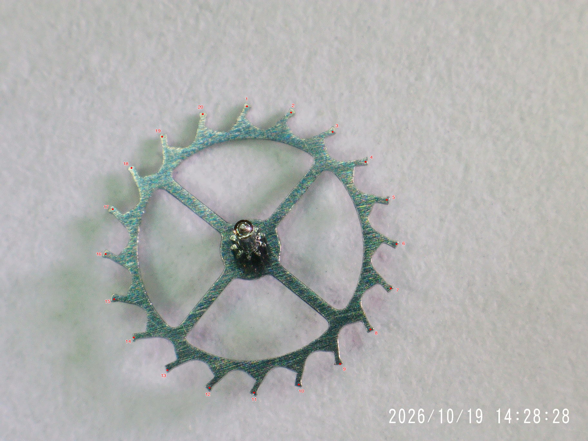

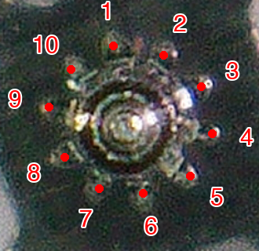

### Vertical clutch: 30-tooth input, 70-tooth output

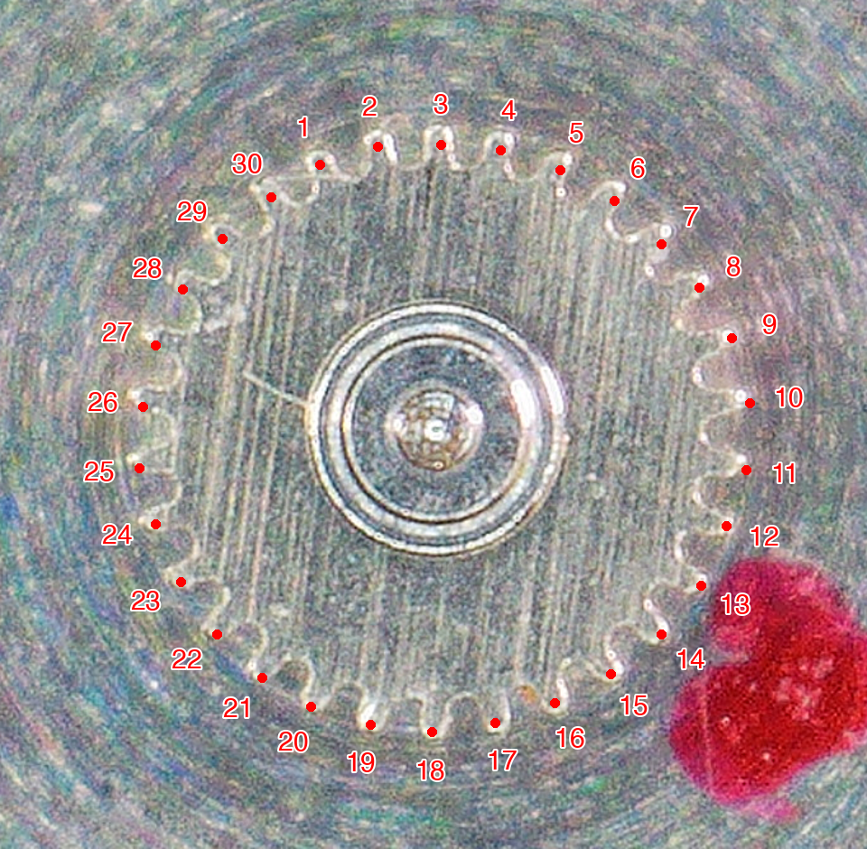

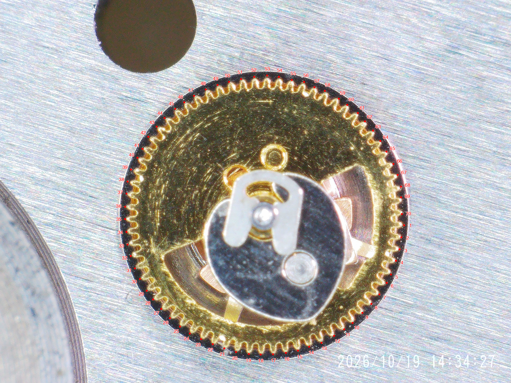

### Chronograph seconds counter: 70 teeth

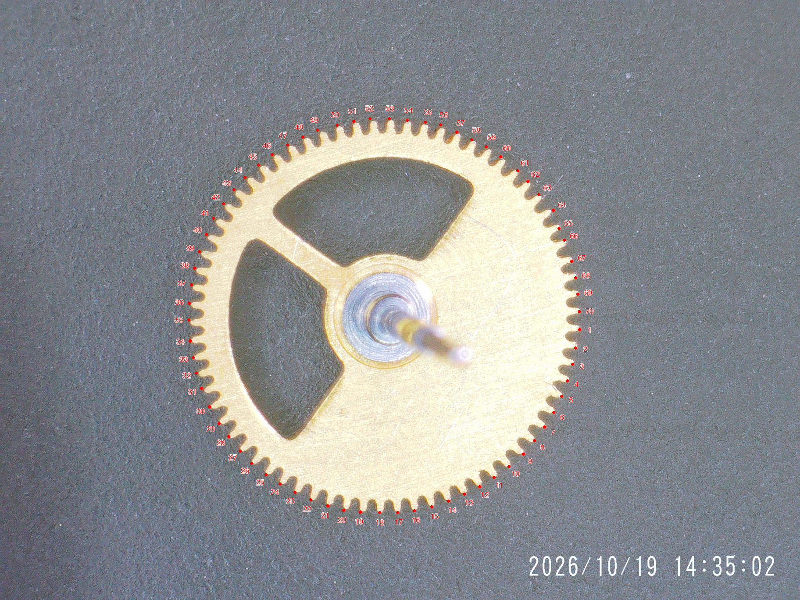
