# AP3120 clone train-wheel counts

Peter Hudson supplied six microscope photographs on 2026-10-21 and confirmed
21,600 beats/hour, a one-hour cannon pinion and a one-minute fourth wheel
carrying centre seconds. He physically checked the intermediate wheel:
**it is a flat wheel with two pivots and no pinion; its brass rim meshes
with the barrel.** The resulting barrel drum period is **eight hours**.

These counts extend the existing **SA3120** record, manufactured by
**Jinghe**, as confirmed by Peter Hudson on 2026-10-21. The catalogue uses
its existing maker name **Shanghai Jinghe (clone)**. APS / ZF remain
marketed aliases rather than movement-manufacturer attributions. No counts are transferred to genuine AP3120 or to older
28,800 bph Miyota 9015-based AP replicas. The existing 53° lift setting
remains sourced to the catalogue's forum guide, not to these photographs.

## Names, counts and periods

| Component | Supplied filename | Rim teeth | Pinion leaves | Period |
| --- | --- | ---: | ---: | ---: |
| Barrel drum | Barrel.JPG | 104 | — | 28800 s (8 h) |
| Intermediate wheel | Second Wheel and Cannon Pinion.JPG, brass wheel | 40 | **None** | 144000/13 s (3 h 4 min 36.923… s) |
| Offset centre / second wheel | Third Wheel.JPG | 80 | 13 | 3600 s |
| Third wheel | Fourth Wheel.JPG | 75 | 10 | 450 s (7 min 30 s) |
| Fourth / centre-seconds wheel | Fifth Wheel.JPG | 81 | 10 | 60 s |
| Escape wheel | Escape Wheel.JPG | 20 | 9 | 20/3 s |
| Minutes-drive pinion carrying the cannon pinion | Second Wheel and Cannon Pinion.JPG, silver pinion | — | 13 | 3600 s |
| Balance, full oscillation | — | — | — | 1/3 s |

The original filenames remain unchanged in the source manifest. The database
uses its established `centre wheel` slot for the offset second wheel and
`cannon pinion` for the one-hour minutes assembly. The 13-leaf count refers
to the visible minutes-drive pinion; it is not a count of another, unseen
motion-works section. The barrel figure is the running drum period, not
power reserve or winding-arbor speed.

The terminology follows the firsthand AP3120 teardown in
[AWCI, Horological Times, November 2006, printed page 12 / PDF page 14](https://www.awci.com/wp-content/uploads/ht/2006/2006-11-web.pdf#page=14):
an offset centre wheel, an intermediate wheel and an indirectly driven
minutes pinion. That genuine-movement article supports the names and
layout, not the clone's tooth counts.

## Meshes and independent checks

```text
barrel rim 104 → intermediate rim 40 → centre input pinion 13
                                    → minutes-drive pinion 13
centre rim 80 → third pinion 10
third rim 75 → fourth pinion 10
fourth rim 81 → escape pinion 9
```

For meshing gears, `T_driven = T_driver × Z_driven / Z_driver`.
A lever escapement advances one tooth pitch per two beats, giving:

```text
T_escape      = 20 × 7200/21600        = 20/3 s
T_fourth      = (20/3) × 81/9          = 60 s
T_third       = 60 × 75/10            = 450 s
T_centre      = 450 × 80/10           = 3600 s
T_intermediate= 3600 × 40/13          = 144000/13 s
T_minutes     = (144000/13) × 13/40   = 3600 s
T_barrel      = (144000/13) × 104/40  = 28800 s
```

Both hand periods independently agree with the photographic counts and
beat rate. The intermediate acts as a simple idler: its 40 teeth cancel
from the overall barrel-to-centre ratio, leaving `104/13 = 8`. Each mesh
reverses rotation, so the two receiving 13-leaf pinions rotate in the same
direction as the barrel.

## Photographic evidence

Rim counts were obtained from radial silhouette peaks, then checked against
numbered photographs. Pinion tips were individually identified and checked
in enlarged views. Ratios provide a separate consistency check.

- [Unchanged originals and SHA-256 manifest](assets/train-wheels/ap3120-clone/originals/manifest.json)
- [Numbered tip coordinates and counting metadata](assets/train-wheels/ap3120-clone/tooth-tip-coordinates.json)

Coordinates use a 1824 × 1368 analysis frame; originals retain 2592 × 1944
pixels. The analysis views are resized and annotated; originals are not edited.

### Barrel: 104

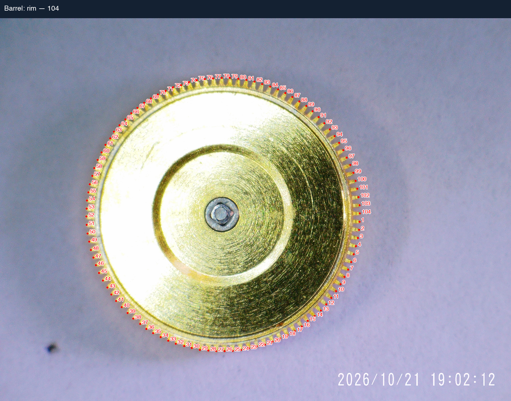

### Intermediate: 40; minutes pinion: 13

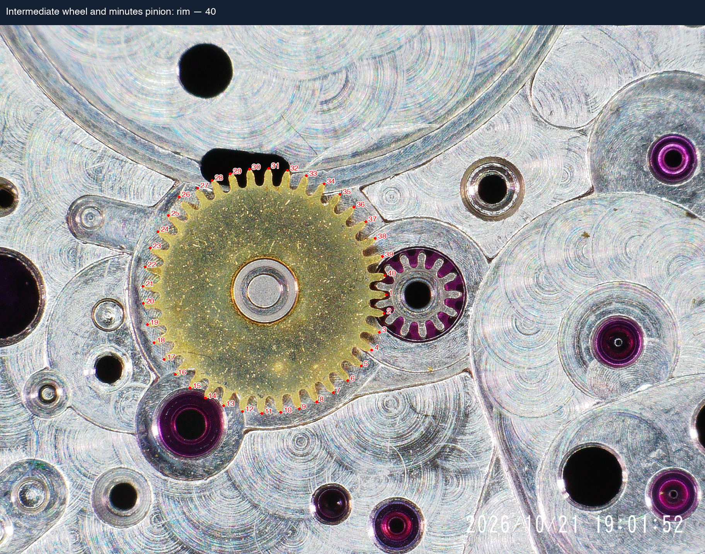
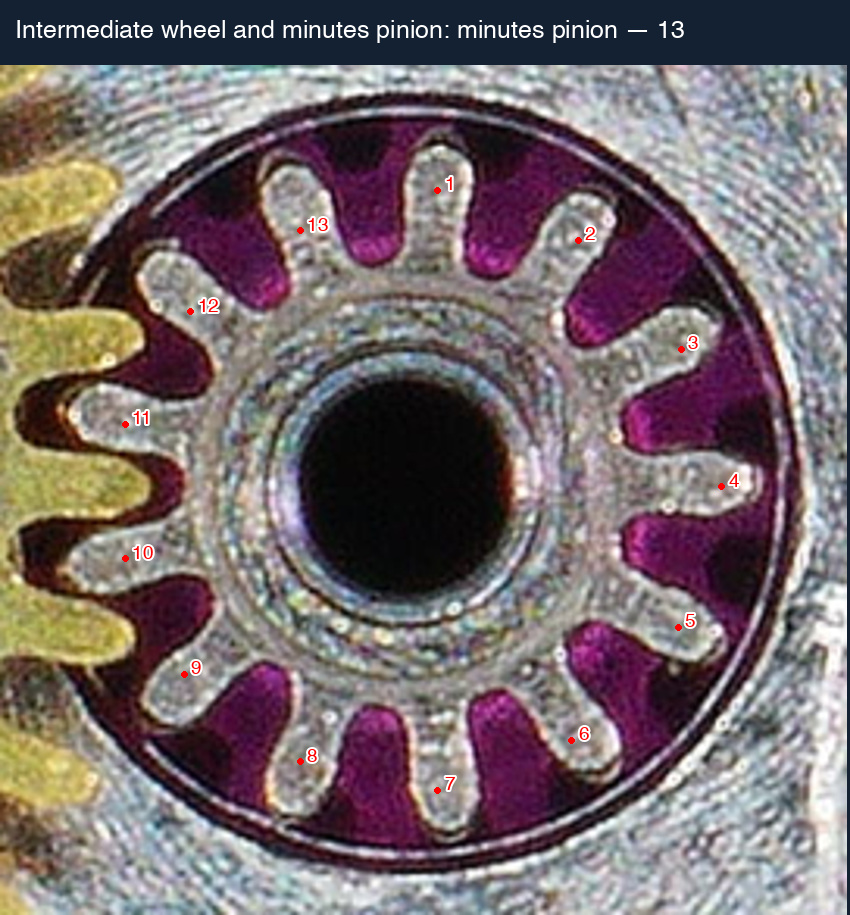

### Centre / second wheel: 80 / 13

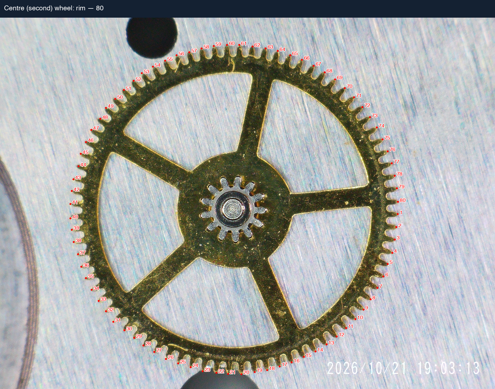
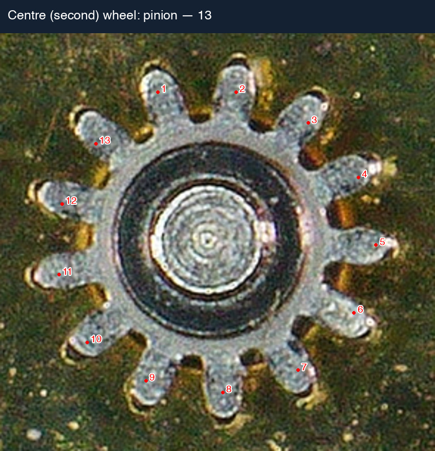

### Third wheel: 75 / 10

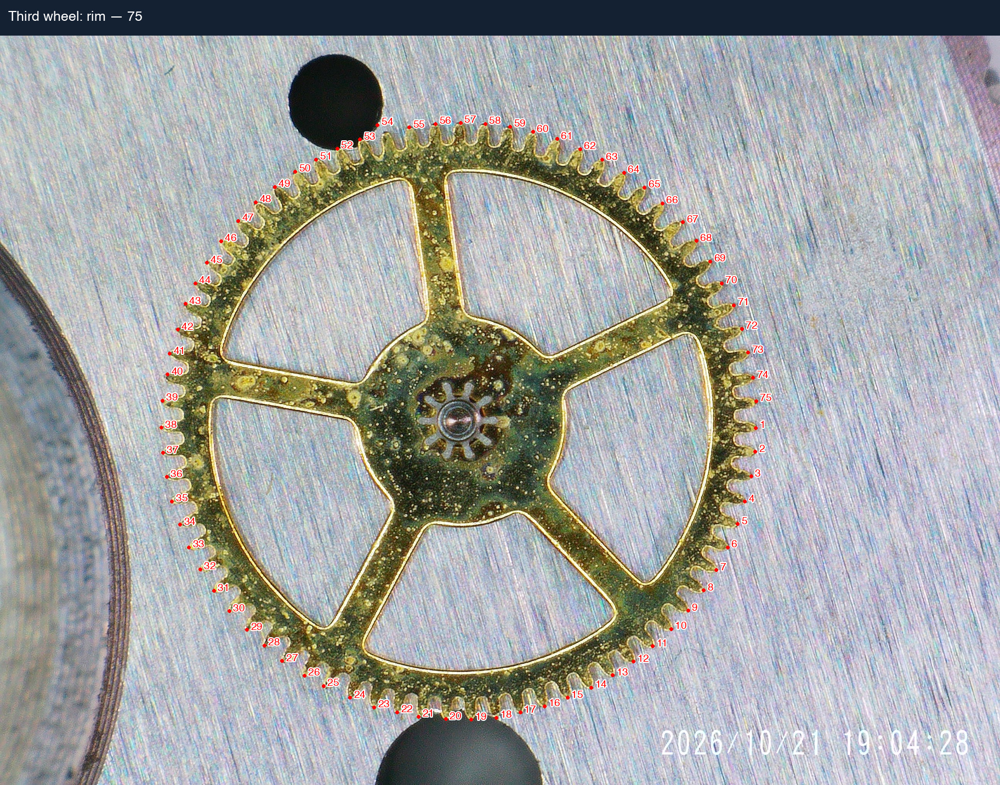
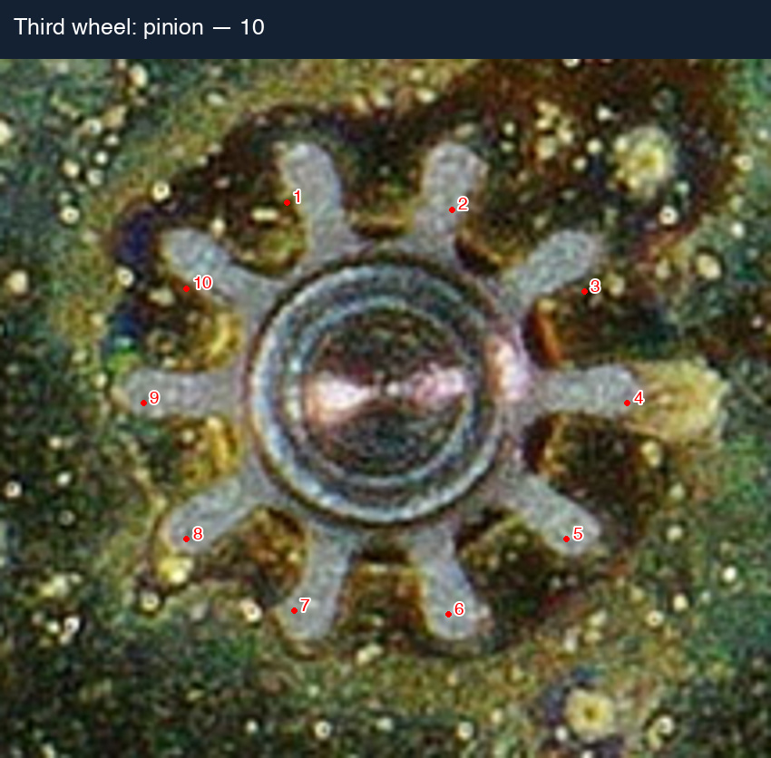

### Fourth wheel / centre seconds: 81 / 10

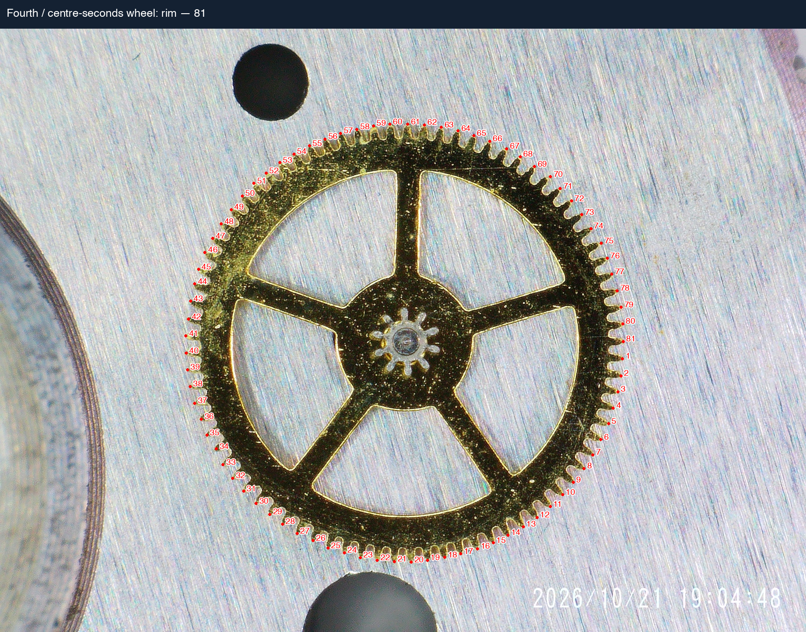
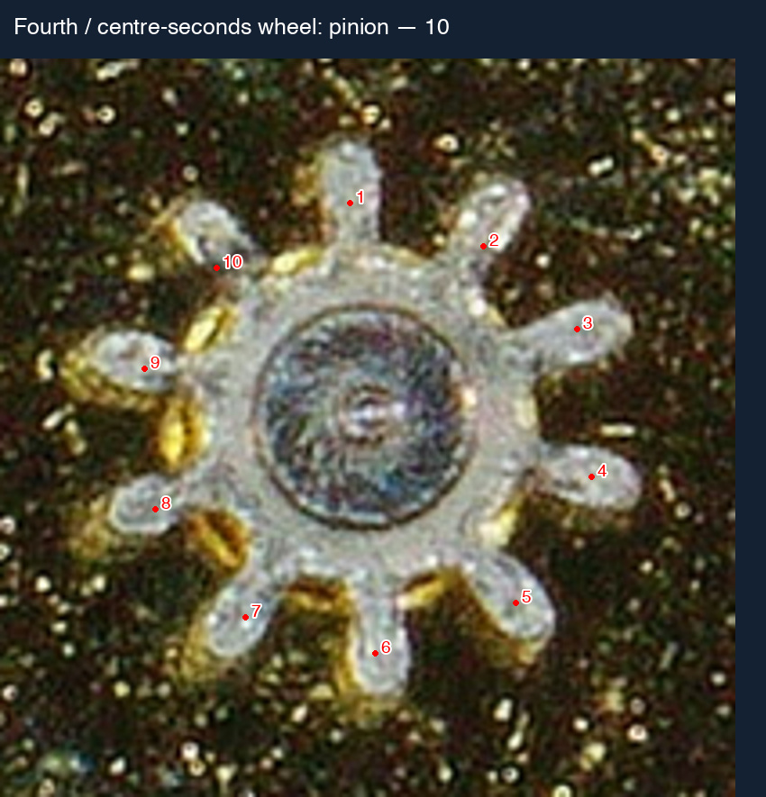

### Escape wheel: 20 / 9

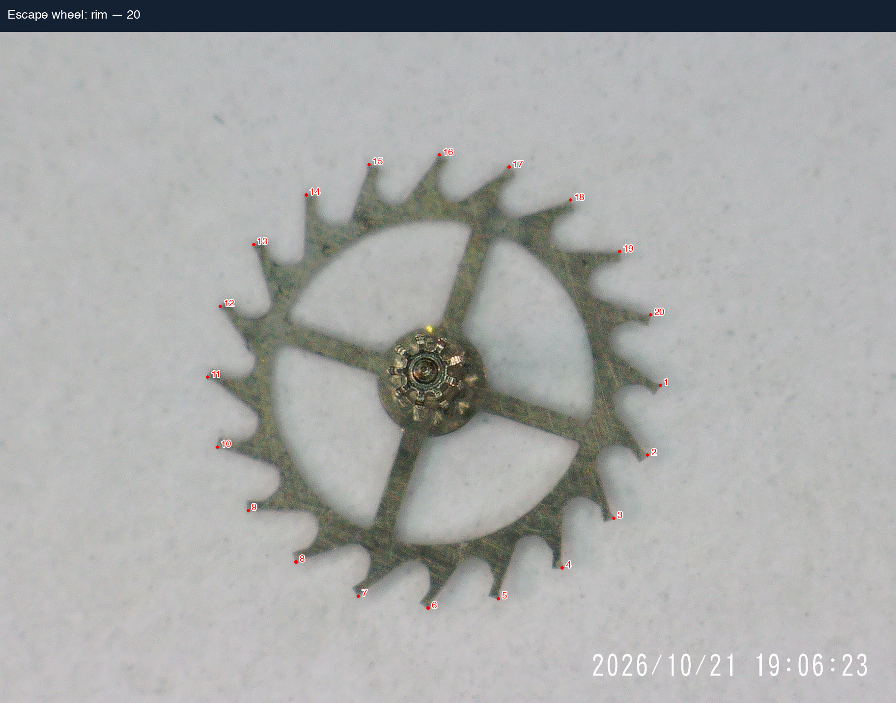
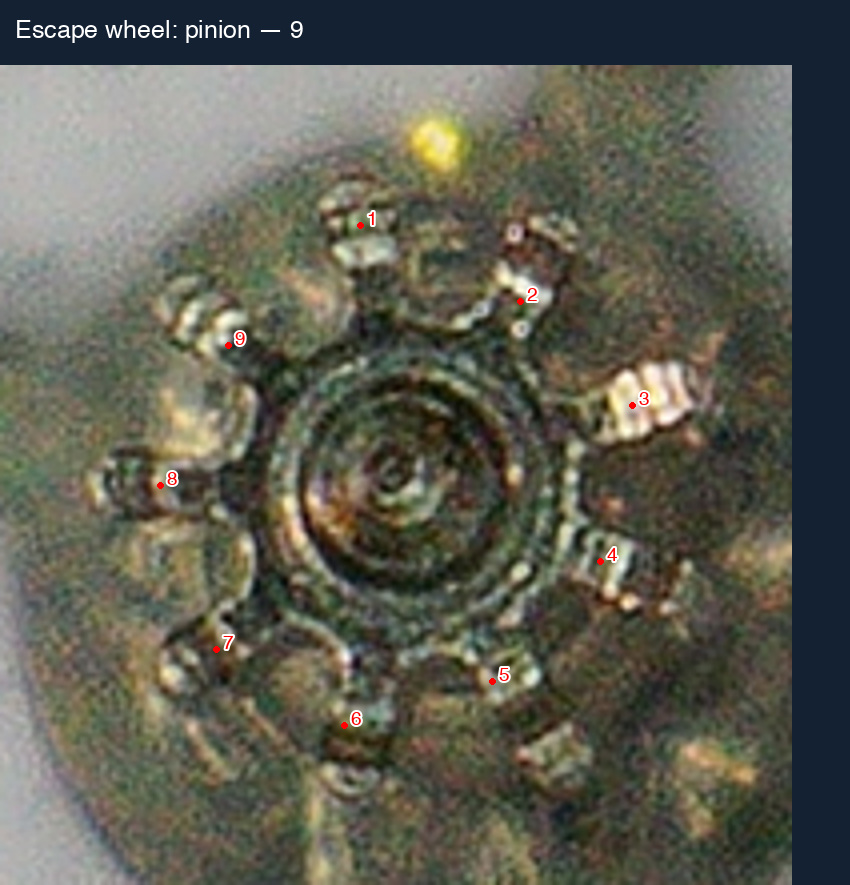
