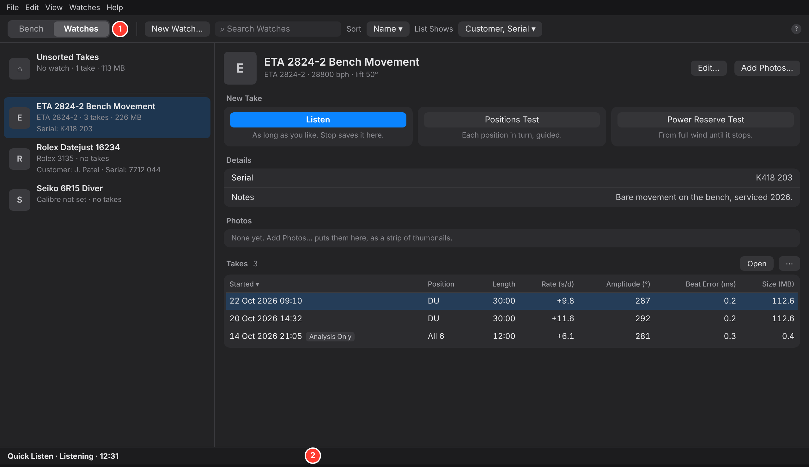
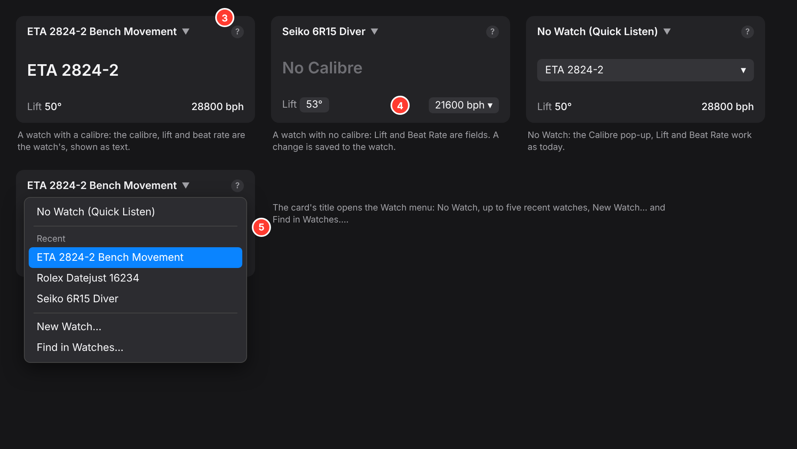

# Timegrapher App Structure

Version 1, 2026-10-25. This is a peer of the [Design Guide](design-guide.md). The guide says how every part of the app looks and behaves. This document says what the parts are, how they nest, and how a user moves between them. Where today's app differs, the app changes. A case that isn't covered here is raised as an issue, and its answer is added here.

**Decided:** Watches is a view of the window, not a pane and not a dialog. A watch's takes do not appear on the Bench in the first version.

---

## 1. The app's two jobs

The app serves two first-class citizens, and its structure follows them:

1. **Quick Listen**, the bench instrument. Open the app, a watch is on the mic, and readings appear: one press, or none with Listen When the App Opens. Everything is about one take.
2. **Watches**, the collector's and watchmaker's history. Define a watch, record takes into it, find them again, compare them, file the ones made without a watch.

Audio files and folders of recordings are second class. They live in the File menu only.

## 2. The levels

From the top down, each level holds the next:

1. **The window.** One menu bar, one mode row, one status bar.
2. **Two views:** **Bench** and **Watches**. They take turns filling the window between the mode switch and the status bar.
3. **Bench layouts.** On the Bench, the panes are arranged for the job at hand: **Live**, **Positions** or **Analysis**, picked by the Layout control on the mode row. They are still being designed.
4. **Panes.** The readings cards, the Paper Strip, Profile and Scope, the analysis panes and the tests. Each pane shows one take, and the Bench has one take at a time.
5. **The take.** Live or opened, it's what every pane on the Bench shows.

Watches sits at level 2 because it's about many takes and many watches, not one take. Giving it a pane on the Bench would put it at level 4, beside things that show a single take. Giving it a dialog would put it outside the window, as if it were a setting.

## 3. The views

### The mode switch

- A two-way segmented control, **Bench | Watches**, at the left of the mode row, under the menu and icon bar (guide, section 2), in every size down to 800 × 600. The rest of the row holds the current view's toolbar.
- ⌘1 (Ctrl+1) shows the Bench and ⌘2 (Ctrl+2) shows Watches. The View menu lists both at its top with those keys. Keys are covered in section 7.
- The Watches icon leaves the pane icon bar, and Watches leaves the pane list in the View menu.
- The app always opens on the Bench.

### What carries across both views

- **The status bar.** It is one line, as the guide sets out. It shows the take's state in both views, so a running take stays in sight while you browse: "Quick Listen · Listening · 12:31". It shows no readings in either view: readings live on the cards, and the cards are one ⌘1 away.
- **The take.** Switching views never stops, pauses or saves a take. Listening, a Positions Test and a Power Reserve Test keep running behind the Watches view.
- **The menus.** File, Edit, Watches and Help are the same in both views. Actions that need the Bench, such as the Paper Strip's commands, are dimmed in Watches, with a hint saying so.

### When the window switches by itself

The window switches to the Bench when an action in Watches has a result there, and nowhere else:

| In the Watches view | The window then shows |
|---|---|
| Open (or a double-click, or Return) on a take | The Bench, with that take open |
| Listen, Positions Test or Power Reserve Test in a watch's New Take group | The Bench, with that watch set and the take started |
| Find in Watches… (the last item of the Watch line's menu on the Calibre card, and also in the menu bar's Watches menu) | Watches, with the search field ready |

Nothing else switches views. Picking a watch in the list, editing it, or filing a take leaves you where you are.

### When a take is already running

The Bench holds one take. When Watches would start or open another:

| What's running on the Bench | Open on a take, or New Take |
|---|---|
| Nothing, or an opened take | Works as above. |
| A Quick Listen take | Works, after today's question about unsaved sound (Keep, Discard, Cancel). The Quick Listen take stops, then the new one opens or starts. |
| A watch's take, a Positions Test or a Power Reserve Test | Disabled, with the hint "Stop the take on the Bench first." Nothing is stopped from the Watches view. |

Picking a row in the list only selects it and shows its details. It never changes the watch on the mic, so browsing during a take can't change that take's watch.

## 4. The Watches view

- **(1)** The mode switch, showing Watches.
- **(2)** The status bar, still showing the take running on the Bench.

The view's content is the redesign in the guide's addendum, "The guide applied to Watches":

- the list beside the watch;
- the New Take group;
- Details and Photos;
- the takes table, with Open and "⋯";
- List Shows, and search that shows which field matched;
- Edit Watch.

The whole window gives it room. At 2560 × 1440 and 1280 × 820, the list and the watch sit side by side. At 800 × 600 the view shows one at a time, with "‹ All Watches".

The view's toolbar sits on the mode row, after the switch: New Watch…, the search field, Sort, List Shows and "?". It is the Watches view's equivalent of a pane toolbar, and the guide's toolbar zones apply.

## 5. The Bench

The Calibre card keeps its name, its 134 pt height and its three rows (guide, section 10). The Watch line takes the title row:

- **(3)** The **Watch line** is the card's title: the watch on the mic, or "No Watch (Quick Listen)", with ▾. It is the one place on the Bench that says which watch a take belongs to. The figure row shows the calibre, and the controls row keeps Lift at the left and Beat Rate at the right, as in #432. Beat Rate still hides first when the card is narrow.
- **(4)** What the rows hold depends on the watch:
  - **A watch with a calibre** (left): calibre, lift and beat rate are the watch's, shown as text, not editable here (the either/or rule, guide addendum mark 43).
  - **A watch with no calibre** (middle), or a calibre whose table entry lacks a figure: that figure is a field here, as in Edit Watch. A change is saved to the watch, and its hint says so: "Saved to Seiko 6R15 Diver."
  - **No Watch** (right): the Calibre pop-up, Lift and Beat Rate work as today.
  - In every state, #432's rule stands: when the heard beat rate differs from the set one, the heard one is kept for the take, as today.
- The card is still the **Calibre card**: its hover and its "?" are titled "Calibre", and the "?" says the title picks the watch and the figure is its calibre.
- When the card is too narrow, Beat Rate hides first, as in #432. For a watch with no calibre, the hidden figure is still set in Edit Watch (Watches view), and Lift's hint says so: "Beat Rate is hidden at this width. Widen the window or set it in Edit Watch."
- **(5)** The title's menu, in this order:
  1. No Watch (Quick Listen)
  2. Recent watches, up to five, most recent first
  3. New Watch…
  4. Find in Watches…

At narrow widths the Watch line shortens to the watch's name, cut with "…". It never leaves the card, because without it a take could go into the wrong watch.

Card order stays as decided: Position, Calibre (now with its Watch line), Listen, Rate, Amplitude, Beat Error.

## 6. A take's life, and where each step happens

| Step | Where | How |
|---|---|---|
| Pick the watch on the mic | Bench | The Watch line's menu. Refused while listening, as today. |
| Pick it while browsing | Watches | Its New Take group starts the take and switches to the Bench (section 3, "When a take is already running"). Picking the row alone changes nothing on the Bench. |
| Listen with no watch | Bench | Listen on the Listen card (Quick Listen). |
| Keep a Quick Listen take | Bench | Save on the Listen card: Keep in a Watch ▸ (recent watches, then New Watch…), Save in a Folder…, or Save…, which files it in Unsorted. |
| A test ends with no watch | Bench | As today: Keep in Unsorted (the default) or throw it away. |
| A watch's take ends | Bench | Saved into the watch on Stop, with no question, as today. |
| File takes from Unsorted | Watches | Unsorted Takes in the list; "⋯" > File Under a Watch ▸. |
| Find an old take | Watches | Search, sort, then Open. The window switches to the Bench. |
| Compare a watch's takes | Watches | The takes table, sorted by any column. |
| Open a recording from outside | File menu | As today: Add to a Watch or Just Open It, then the Bench. |

## 7. What changes in the app

For the Desktop app:

1. The window gets the mode switch and a second top-level view. The status bar is shared by both views.
2. The Watches pane leaves the pane system. Its icon leaves the icon bar, and its entry leaves the View menu's pane list.
3. The Watches view uses the guide's addendum design, laid out for the whole window.
4. The Calibre card gains the Watch line and its menu.
5. Keep in a Watch on the Listen card's Save menu lists recent watches first.
6. The auto-switches in section 3, and nothing else, with the running-take rules beside them.
7. **The menus:**
   - The View menu starts with Bench (⌘1) and Watches (⌘2), then the panes. Watches leaves its pane list.
   - The menu bar's Watches menu drops Show/Hide Watches and its list of every watch (the Watch line's menu already lists recent ones). It also drops Quick Listen (No Watch): the Watch line's menu starts with No Watch (Quick Listen). It keeps New Watch… and Find in Watches…, and its hints stop saying "in the Watches pane". Going to Watches is View > Watches (⌘2) only, so the command lives in one place.
   - In the Watches view the pane icons are hidden; the menus stay, with Bench-only items dimmed.
   - The app always opens on the Bench.
8. **Keys:**
   - The position keys 1 to 6 work only as bare digits: never with ⌘, Ctrl, Alt or Shift held. Today they ignore modifiers (`app.rs` ~13958), so ⌘1 would also move the watch to DU.
   - They are off in the Watches view and while any text field has focus.
   - ⌘1 and ⌘2 pick the view. ⌘⇧1 to ⌘⇧3 are kept for the Bench layouts, once approved.
   - A test proves ⌘1 changes the view and not the position.
9. docs/app.md: the Watches pane section becomes the Watches view, and Quick Listen's description drops "shows Unsorted Takes in the Watches pane".

Unchanged: the library on disk, `watch.toml`, take folders, Unsorted, the CLI and MCP, and every action listed in the addendum's table.

## 8. Open questions

- **Bench layouts** (Live, Positions, Analysis): still being designed.
- **A watch's takes on the Bench**, as an optional pane listing the open take's siblings: left out of the first version. Revisit after use.
