# Timegrapher Design Guide

Version 1, approved 2026-10-25. This guide is the app's visual and interaction language. Every screen, pane, sheet and PR that touches the interface is built to it and checked against it. Where today's app differs, the app changes, not the guide. A case the guide doesn't cover is raised as an issue, and its answer is added here.

Its peer, [App Structure](app-structure.md), says what the app's parts are and how a user moves between them: the Bench and Watches views, the Watch line, and a take's life.

It gathers the rulings made so far (readings cards, the UX survey, Settings style C, the microphone sheet B) into one place. The pictures are of two kinds: specimens drawn for this guide, and screenshots of today's app marked **Don't**. Red numbered marks 1 to 44 run through the whole guide in reading order. Marks added since then (45 onward) sit with their topic, and each number is cited once in the text beside its picture. A number drawn more than once on a picture (13 on the sheet) points at several examples of the same fault. The Calibres example (section 12) is the one pair: 16 to 21 mark each fault on today's page and its fix on the redrawn page.

---

## 1. Principles

- **Facts, not verdicts.** The app states what it measured. No grades, no "good" or "bad", no advice about the watch. Interpretation belongs to the user (or the skill).
- **Two first-class workflows.** Quick Listen (one press, Witschi-like) and a watch in the library (Listen, Positions Test, Power Reserve Test). Audio files are second class and live only in the File menu. A change that slows either workflow is wrong.
- **Nothing moves on its own.** No element appears, disappears or changes size in a way that moves another control. Space for a message, a status or a control is reserved, so it's there whether or not it's in use.
- **One place for each thing.** A fact is shown once, in its home. The status bar never repeats a card. One setting changes one thing everywhere (for example, Average Over is a single setting on the Listen card). Every calculated value comes from one source in core.
- **Icons are for clicking; words are for meaning.** An icon is always a control. Anything you read (a label, a heading, a state) is words.
- **Standard over clever.** Follow macOS conventions first, then the conventions of the tools users know (Photoshop or AutoCAD for tools on a canvas, Excel for table filters). Use the standard icon for a thing (a magnifier, not a loupe).
- **Every feature explains itself.** Every control has a hover hint, and every pane has its "?".
- **Easy to skim.** Short lines, lists, and no text walls.

---

## 2. The window

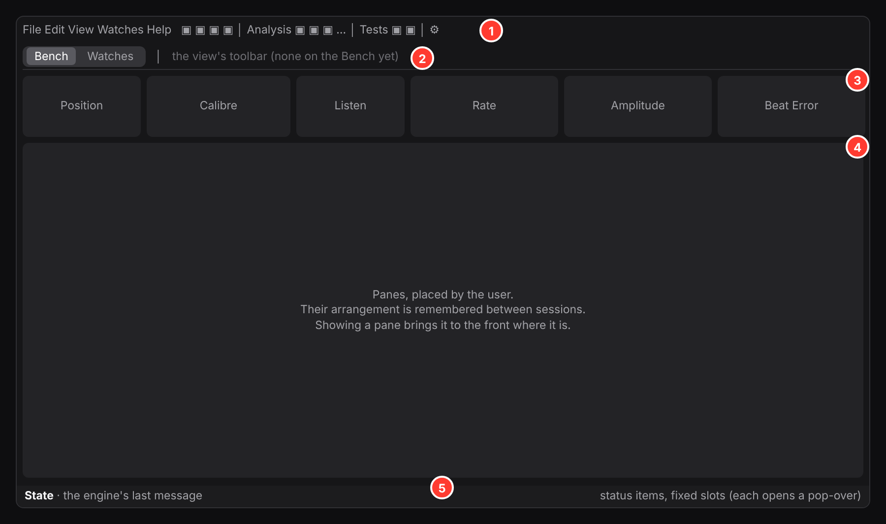

The window has two rows at the top, then the cards, the panes and the status bar:

- **(1) Menu bar and icon bar, one row.** The pane icons belong to the Bench: in the Watches view they are hidden and their space stays empty. The Settings gear stays, in the same place, in both views. The pane icons are grouped as: Readings, Paper Strip, Tick Tock Profile, Scope; then "Analysis" (12 panes); then "Tests" (2 panes); then Settings. The View menu lists the panes in the same order.
- **(2) The mode row.** The **Bench | Watches** switch sits at its left ([App Structure](app-structure.md), section 3). After a separator comes the current view's own toolbar: on the Bench, nothing for now; in the Watches view, New Watch…, search, Sort and List Shows. The row is always there and always one control high, so the cards never move when the view changes.
- **(3) Readings cards.** Six cards of fixed height (134 pt) at every width, left to right: Position, Calibre, Listen, Rate, Amplitude, Beat Error. See section 10.
- **(4) Panes.** The user places them, and the arrangement is remembered between sessions. Showing a pane brings it to the front where it is. (Fixed layouts by task, Live, Positions and Analysis, were drafted and are parked.)
- **(5) Status bar.** It is one line, always the same height:
  - at the left, the state (Listening, Opened, Not Started) and the engine's latest message;
  - at the right, status items in fixed slots, each opening a pop-over with its details and buttons.

**Sizes.** Design at 2560 × 1440. Check every change at 1280 × 820 and at the 800 × 600 minimum. Below a width where something can't fit, it switches to its compact form; it is never cut off without a hover giving the whole of it.

---

## 3. Messages and status

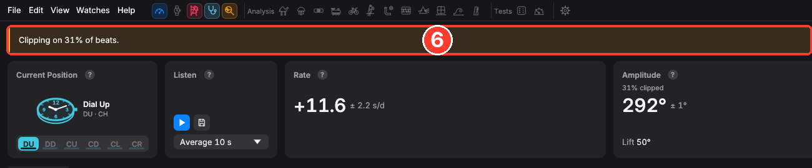

- **(6) No banners, ever.** Before #431, the clipping banner pushed the cards and every pane down by 56 pt when it appeared. Each kind of message has a home instead:
  - **A fact about a reading** (clipping, a short stretch, a default lift) is a **chip** on that reading's card, for example "3% Clipped". Its hover gives the full sentence.
  - **Something that needs an action** (a newer release, a crash last time, an unsaved sound, a recording fault) is a **status item** in the status bar. Clicking it opens a pop-over with the sentence and its buttons.
  - **The engine's progress** ("Analysed the whole recording. Drag the strip to look back.") is the status bar's message.
  - **An error inside a sheet** goes in the sheet's own status line, which is always reserved (see section 10).
- **Never repeat.** A message never shows what a card already shows (beat rate, position, take name).
- **Tone.** Say what happened, then what the user can do, in two short sentences at most. Don't guess ("probably"). Put the system's own words, if needed, in the hover or the pop-over, not on the face.

---

## 4. Spacing, sizes and stability

- **Spacing scale:** 4, 8, 12, 16, 24 pt, and no other gaps.
- **Cards:** padding 16, corner radius 10, 12 between cards.
- **Controls:** every button, pop-up, field and segmented control is 28 pt tall, with corner radius 6. Text starts 10 pt in.
- **Rows:** table and settings rows are 28 pt plus padding. Toolbar items are 8 apart, with 12 between groups and a 1 pt separator.
- **Fixed size, reserved space:**
  - Cards have one height at every width.
  - A word, chip or status that comes and goes has its space kept free when it's absent.
  - A toggle shows its state by lighting up, never by adding a word.

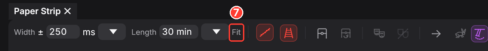

- **(7) Don't add or remove words to show a state.** Before #432, "Fit" appeared only while the strip was fitted, and pushed everything to its right along by 17 pt. Fit is a toggle, so since #432 it is one icon in a fixed place, lit while on.

---

## 5. Type

| Style | Font and size | Colour | Used for |
|---|---|---|---|
| Heading | Inter SemiBold 17 | text | sheet and window titles |
| Caption | Inter SemiBold 13 | secondary | card titles, pane tabs, section titles |
| Figure | Inter Display SemiBold 32, tabular figures | text | the big readings |
| Body | Inter 13 | text | labels, menu items, button text |
| Secondary body | Inter 13 | secondary | one-line captions under a setting |
| Unit | Inter 15 | secondary | ± and units beside a card's figure, on its baseline |
| Small | Inter 12 | secondary or tertiary | chips, plot keys, axis labels, status bar |

- **Title Case** for every title, button, menu item, tab, label, chip and pop-up option: "Set Up the Microphone", "Keep in Unsorted", "3% Clipped".
- **Sentence case, with a full stop,** for sentences: captions under settings, hover hints, status messages and step text.
- **Names used everywhere:**
  - Tick and Tock (capitalised);
  - Rate, Amplitude, Beat Error;
  - the position codes DU, DD, CU, CD, CL, CR, with the full name on hover.
- **Numbers:**
  - Use a true minus sign (−) and tabular figures wherever numbers line up.
  - Put a space before a unit ("10 s", "0.20 ms"); degrees take none ("292°").
  - ± after a value, giving its uncertainty, takes a space: "+11.6 ± 2.2 s/d" (the cards). ± alone in front of a number touches it, like a minus sign: "±250 ms", "±0.04 ms".

---

## 6. Writing

- **No text walls, anywhere,** including inside "?" pop-ups, hints and the Info panel. Steps are a numbered list, separate facts are bullets, and a paragraph is at most two short sentences.
- **"?" pop-ups follow one shape:**
  - the first line answers "what is this?" in one sentence (hovering shows only this line);
  - then short headed groups, such as **What It Shows**, **Controls** and **Reading It**, each a few bullets;
  - then the toolbar's icon key, where there is one.
  - Today's help (`help.rs`) is paragraphs only, so the help pop-up needs to draw headings and bullets.
- **Hints:** start with the control's name, then what it does, in one or two sentences: "Rescan: Look for microphones again, after plugging one in."
- **Facts only:** "Keep this off. It raises the level between ticks…" states a setting's effect. "Your watch is running well" judges, so it never appears.
- **Say what a number counts:** "179 10 s readings", "2 s windows (897)". Never a bare count above a plot that draws something else.

---

## 7. Colour

**Decided: the clean-slate palette.** Each quantity was given a new colour, chosen by search to sit far from every other one in both modes, for normal and colour-blind vision.

### Why it changed

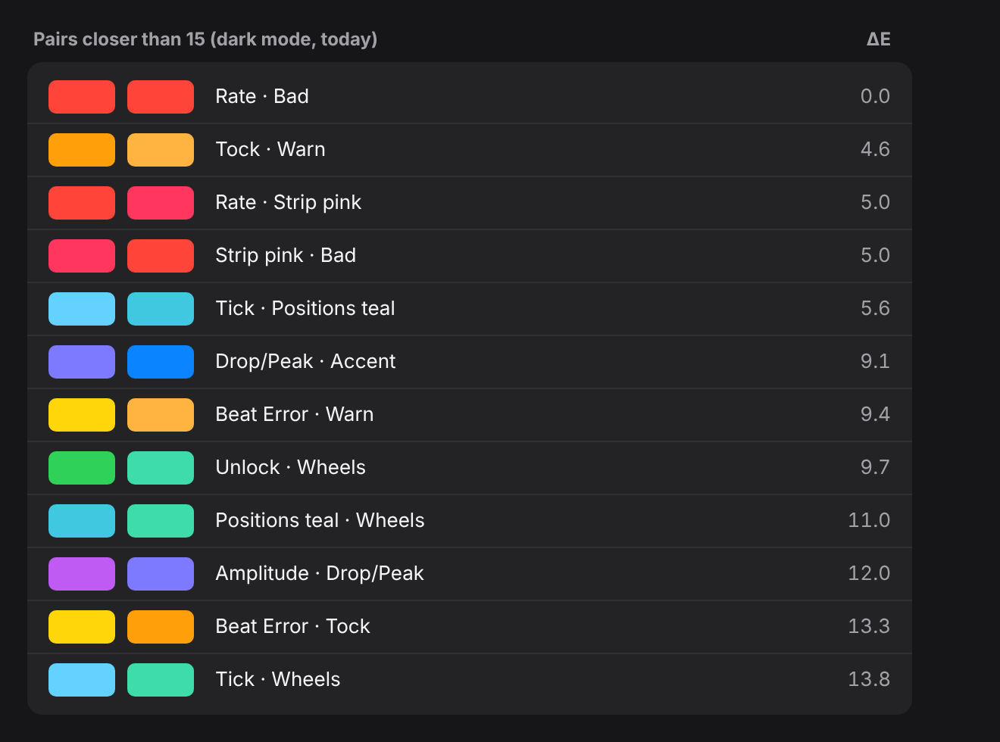

Twelve pairs of today's dark colours are closer than 15 on the usual colour-difference scale (OKLab ΔE × 100). Below 15, people with full colour vision start to confuse two colours. The worst pairs:

- **Rate and Bad: 0.0.** They are the same red.
- **Tock and Warn: 4.6.** A warning reads as Tock.
- **Rate and the Paper Strip's pink: 5.0.**
- **Tick and Positions teal: 5.6.** Tick dots disappear over the position track.
- **Drop/Peak and the accent blue: 9.1.** **Unlock and Wheels: 9.7.** Both are plot marks that look alike.

For colour-blind viewers (protan and deutan), light mode is worst: Rate and Tock come out at 1.9, which is the same colour.

### The six data colours

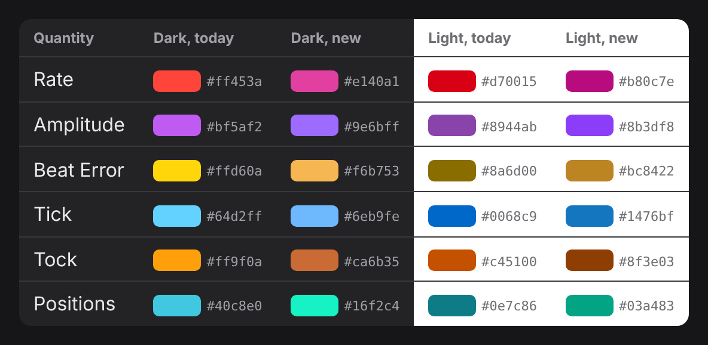

| Quantity | Dark | Light |
|---|---|---|
| Rate | magenta `#e140a1` | `#b80c7e` |
| Amplitude | violet `#9e6bff` | `#8b3df8` |
| Beat Error | amber `#f6b753` | `#bc8422` |
| Tick | blue `#6eb9fe` | `#1476bf` |
| Tock | deep orange `#ca6b35` | `#8f3e03` |
| Positions | teal `#16f2c4` | `#03a483` |

| | Worst pair, normal vision | Worst pair, colour-blind |
|---|---|---|
| Dark, today | 5.6 | 4.8 |
| Dark, new | 18.9 | 12.7 |
| Light, today | 8.9 | 1.9 |
| Light, new | 18.6 | 8.6 |

- Every pair passes 15 for normal vision and 8 for colour-blind viewers, in both modes.
- The status and interface colours were checked against the six too. The closest are Tock and Bad (11.0, dark), Positions and Live (13.7 dark, 10.2 light) and Tick and the accent (9.7, light). None is closer than 8, and none of these pairs is drawn side by side: Bad, Live and the accent never appear on a plot.
- **Tick and Tock are opposite hues,** blue and orange, because their dots interleave.
- **Red is not a data colour.** It means one thing: Bad, on an icon.
- Keys, toggle labels and card titles always name the quantity, so no colour has to be read alone.
- **Small text in light mode:** Beat Error amber (3.25:1 on white) and Positions teal (3.16:1) are for lines, dots and fills only, never for text or a small code. Where a quantity's word or code needs its colour, the word stays in text colour beside a swatch: the Position Brush shows its code in text colour on a small teal swatch.

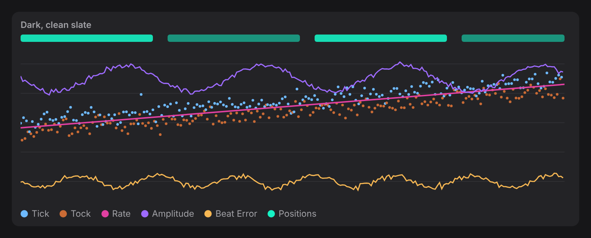

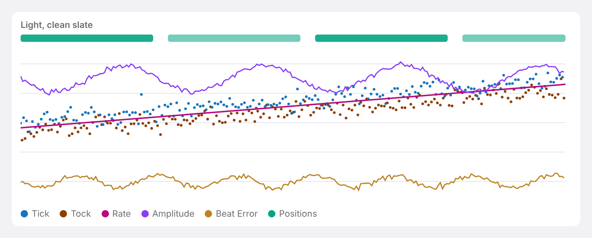

### Everything else

1. **Only the six data colours appear on a plot.** Everything else drawn on a plot is a neutral grey, told apart by line style and a word label:
   - edges (Unlock, Drop, Peak): solid grey lines coming down from their names above the plot;
   - the three sounds: white dots on the curve, each with a dotted grey leader down to its name below the plot (section 11);
   - wheel lines: dotted, in tertiary grey;
   - masks: grey hatching; the grid: separator grey.
2. **Pane icons are neutral grey.** A pane's icon lights in the accent while the pane is shown. The Paper Strip's pink goes, and so does pink.
3. **Status lives on an icon, never on a plot.** The words beside it stay in text colour.
   - **Bad:** red (`#ff453a` dark, `#d70015` light), on a failure icon only.
   - **Live:** green (`#30d158` dark, `#248a3d` light), as the dot beside "Listening to …" only.
   - **Warn:** a warning-triangle icon in text colour. Today's amber Warn sits 1.8 from Beat Error's new amber, which would break "one colour, one meaning", so the shape carries the warning instead.
4. **Accent blue is for interface only:** the default button, a switch that is on, and the selected item. It never marks a quantity.
5. **The time-frequency maps** keep viridis, the same in both modes.

### The position track

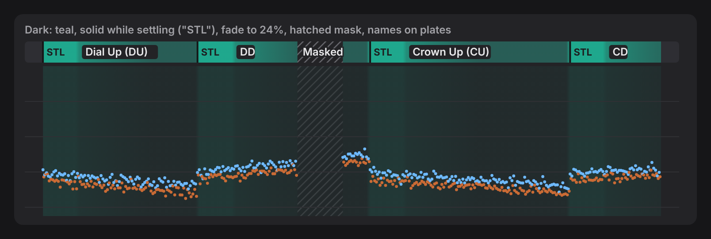

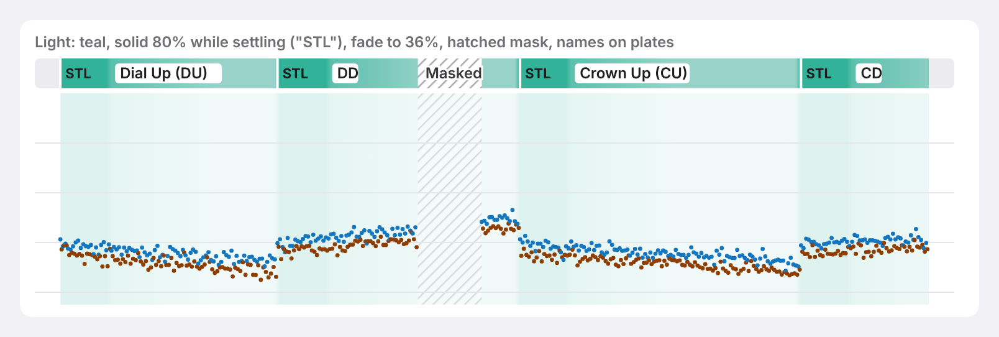

The position track (section 11) uses the Positions teal at three strengths over the card: **solid** while the watch settles, then a 40 s **fade**, then a steady **floor** to the end of the stretch. The same fade runs faintly down the plot (about a sixth as strong), behind the Tick and Tock dots.

| | Solid | Fade starts at | Floor |
|---|---|---|---|
| Today (position card spec) | 62% | 48% | 16% |
| Dark | 62% | 48% | **24%** |
| Light | **80%** | **62%** | **36%** |

The figures meet four tests:

1. **The floor must differ from an unmarked track.** Today's 16% floor is 9.2 from the empty track in dark mode and 7.8 in light, too close to read at a glance. The new floors are 16.5 and 15.5.
2. **The solid start must stand out from the floor,** so every change of position shows: 23.7 in dark mode, 16.6 in light. Light mode needs the stronger solid for this.
3. **The track must not read as Tick.** Teal is 20.2 from Tick blue in dark mode and 18.6 in light, against 5.6 today.
4. **Labels must read wherever they fall.** The solid part lasts only the settling time, so a label usually runs from the solid into the fade. Each label is in text colour on a small card-coloured plate, as "Masked" is: 12:1 or more in both modes. Plain text on the solid would be only 3.2:1 (white, dark mode) or 2.5:1 (white, light mode).

Masks are hatched (section 11), so a masked stretch can't be taken for a faint one. Over the wash, at its strongest (a sixth of the solid), Tick dots are 5.9:1 in dark mode and 4.2:1 in light, and Tock dots 3.4:1 and 6.3:1. All stay above the 3:1 needed for a mark, and the wash is that strong only in the first seconds of a stretch.

### Rules that stay

- **A quantity's colour means that quantity, everywhere and only there.** That covers every icon, line, dot, key and toggle that stands for it.
- **Surfaces:** window, then card, then control, each a step lighter in dark mode. Separators are hairlines. Text has three levels: text, secondary and tertiary.
- **One source.** Every colour has a light-mode pair, and both come from core's `palette.rs`, which the MCP server's charts use too. Teal and pink leave the app's `theme.rs`, and Positions joins core's palette.
- **Measure, don't eyeball.** Any new colour is checked against every other colour, including Bad, Live, the accent and the greys, for normal and colour-blind vision, in both modes, before it lands.

---

## 8. Controls

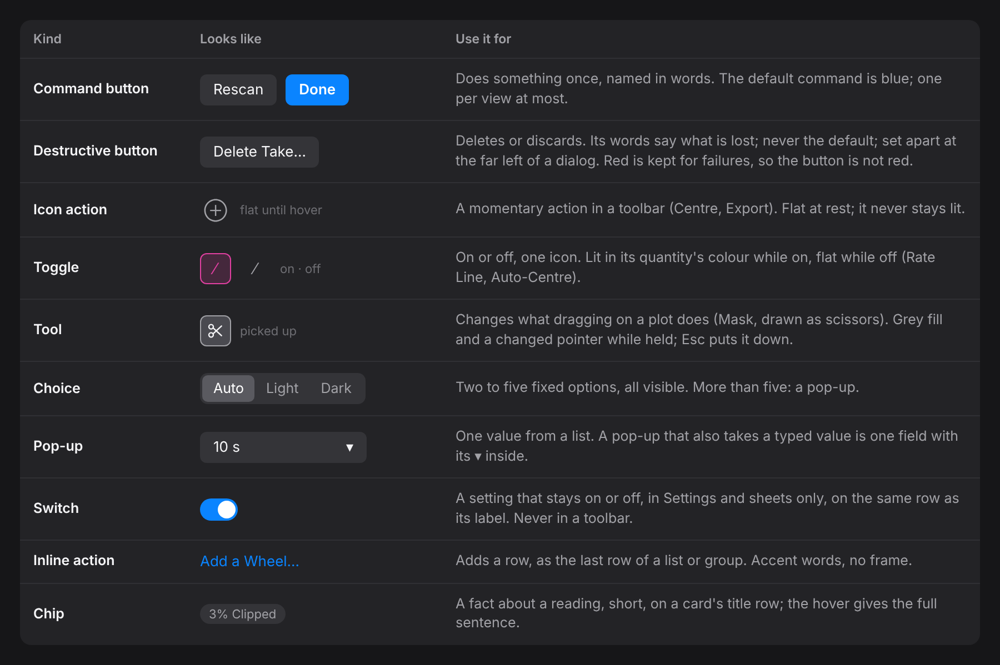

- **Pick the kind by what the control does,** then use that kind's look everywhere:
  - **Command** (do it once): a word button. The default command is blue, one per view at most.
  - **Destructive** (deletes or discards): a word button that says what is lost ("Delete Take…"), never the default, and set apart at the far left of a dialog. It always asks to confirm. It is not red: red is kept for failures (section 7).
  - **Icon action** (momentary, in a toolbar: Centre, Export): flat; it never stays lit.
  - **Toggle** (on or off: Rate Line, Auto-Centre, Fit): **one** icon, lit in its colour while on. Never two icons for one state.
  - **Tool** (changes what dragging does: Mask): looks pressed while held, the pointer changes, and Esc puts it down.
  - **Clear** (removes all of something: Edit > Remove All Masks): a menu item named for what it clears, which asks to confirm. A rare clear-all doesn't get a toolbar button.
  - **Choice** (two to five fixed options, such as Direction: Down or Across): a segmented control. More than five: a pop-up.
    - The selected part is a lighter, raised grey with white text, as in Bench | Watches. The others are flat, with grey text. A choice never uses the default blue. The one exception is the map picker, whose parts are quantities: its selected icon is also lit in that quantity's colour.
  - **Value with presets** (Width, Length, Lift): one field with its ▾ inside, so you can type or pick.
  - **Setting** (stays on or off, in Settings and sheets): a switch on the same row as its label, with the switch at the right.
  - **Inline action** (adds a row to a list or group): accent words with no frame, as the group's last row: "Add a Wheel…", "Add Field ▾".
- **Icons:**
  - An icon is always clickable, and its name is in its hint.
  - Use the standard symbol for a thing.
  - Rabbit, swing and seesaw (Rate, Amplitude, Beat Error) always appear in that order, left to right.
- **Disabled** controls stay in place, greyed out, with a hint saying why.
- **Menus** mark the current item with a ✓. The blue highlight is only for the item under the pointer, as on macOS.

---

## 9. Pane toolbars

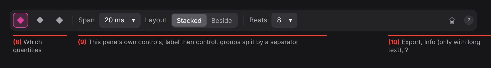

Every pane has one toolbar row, in three named zones that keep their place from pane to pane: **Quantities**, **Pane Controls** and **Actions**. The picture is the Scope's toolbar: Rate lit, the others off ("Rate first", section 11), and no "i", because the Scope has no long text.

- **(8) Quantities:** the Rate, Amplitude and Beat Error toggles, at the left, in panes that plot them.
- **(9) Pane Controls:** this pane's own controls, each a label followed by its control. Groups are split by a separator. When the pane is narrow, this zone folds into "…" from its right end. Quantities and Actions never fold.
- **(10) Actions:** Export, Info and "?", at the right, in that order. Info (the "i") opens the pane's side panel of full text. Today only the nine Steadiness views have one (their headlines and statistics); a pane without long text has no "i".

### The Info panel

A pane whose findings take more than a line gets an Info panel instead of text above its plots.

- **On the plot:** a one-line headline in the plot's title, such as "Rate · repeats every 46 s, 4.0 s/d peak to peak". It comes from core, so the app, CLI and MCP say the same thing.
- **In the panel:** the pane's one-line description, then for each shown series its full findings and its statistics (each starting with what it counts), then the stretch it was tested over. The text is selectable, so it can be copied.
- **Where it is:** a side panel down the right of the pane, 300 pt wide or a third of the pane, whichever is less. Below about 600 pt of pane width, it opens as a pop-over from its button instead.
- **How it opens:** only from the "i" in the Actions zone. One setting covers every pane of a family (all nine Steadiness views), so switching views keeps it open or closed.
- **Who has one:** today, the nine Steadiness views. Any pane that would otherwise print paragraphs above its plot gets one, and a pane with no long text has no "i".

No control appears or disappears with the state of the pane. A control that doesn't apply is disabled, with its reason in its hint.

---

## 10. Cards, forms, Settings and sheets

**Cards** (from the readings cards spec):
- a title row (caption, chip, "?" in the top-right corner);
- a figure row (figure, then ± and unit on its baseline; "—" when there's none);
- a controls row (label, then control);
- one height for all of them.

### Settings

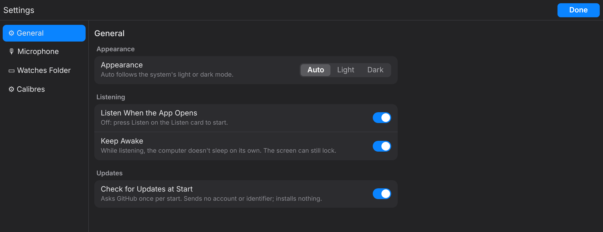

- **Each section is a rounded group, at most 560 pt wide,** with a small grey title above it. Rows are separated by hairlines.
- **Each row has its label at the left, with a one-line caption under it in secondary, and its control at the right of the same row.**
- Sections are ordered by how often they're used.

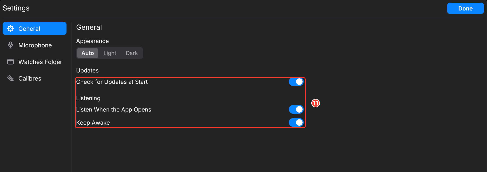

- **(11) Don't** put switches 320 to 410 pt away from their labels with nothing to guide the eye across, and no caption to say what they do.

### Sheets and dialogs

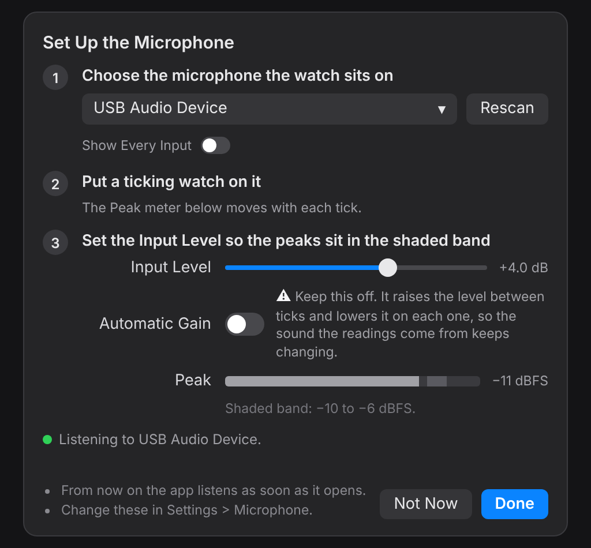

- **A first-run or guided sheet is a numbered list of steps,** each a short heading with its control under it.
- **A fixed status line** sits above the buttons. It is always reserved, so nothing below it moves. It shows one of:
  - "Listening to …", in secondary text, after the green Live dot;
  - an error: the Bad icon, then the words in text colour (text is never red);
  - a warning: the warning triangle in text colour, then the words.
- **A level meter** is a neutral grey fill. Its target band is a grey shading, and its value is in text. Clipping is said in the status line, not by colouring the meter.
- **A sheet the user dismisses with Not Now never comes back by itself.** Not Now means "I'll do this later in Settings", and the sheet's footer says where.
- **Buttons at the bottom right:**
  - The default (blue) is rightmost, with Cancel or Not Now to its left.
  - A destructive choice sits apart at the far left (section 8).
  - Return presses the default, and Escape presses Cancel.
- Notes about what happens afterwards are short bullets to the left of the buttons.

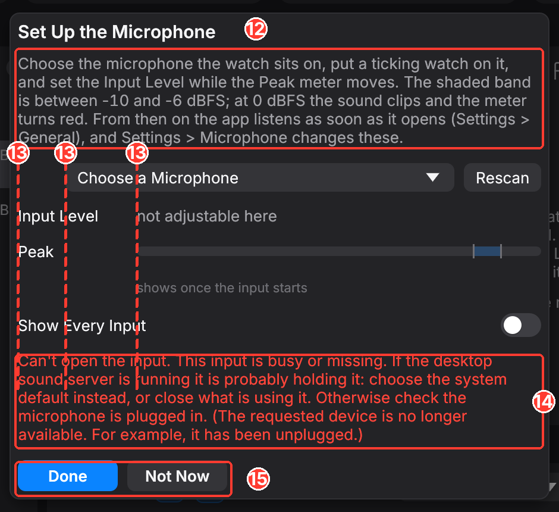

- **(12)** Don't put the steps inside a paragraph.
- **(13)** Don't give one form three left edges.
- **(14)** Don't let an error grow the sheet and push the buttons down.
- **(15)** Don't put the buttons at the left with the default first.

---

## 11. Plots

- **Axes** carry units on their labels ("15 s/day", "0.20 ms"), in Small text. Time runs left to right in minutes and seconds.
- **Log-scale period axes step in watchmaker's units,** never in powers of ten: 1 s, 5 s, 10 s, 30 s, 1 min, 2 min, 5 min, 10 min, 30 min, 1 h, 2 h, 6 h, 12 h. They thin out to the main marks when room is short. Every log axis uses the one source for these marks (core `period_ticks.rs`), so the app, CLI and MCP charts agree.
- **A key inside the top-right corner** names each series of dots or lines and how many there are, in the series colour: "● 10 s readings (179)". Marks named in words beside them, like the profile's edges and sounds, need no key.
- **Say the scale when it isn't shared.** When rows or plots are scaled differently (each Scope row to its own loudest beat), say so in the hint and the docs.
- **Notes on a plot are one line and never cut.** Anything longer goes in the pane's Info panel. A plot's short headline sits in its title line.
- **Give each plot room.** A plot that needs height (wavelet or STFT maps) is shown one at a time, with a choice in the toolbar.
- **Rate first.** Where a pane can plot several measures, it opens with Rate on and Amplitude and Beat Error off. Rate is most of what people look at, Amplitude most of the rest; Beat Error is there for completeness. The three toggles stay in their fixed place at the left of the toolbar.
- **Mark stretches of time in a track above the plot, not with lines on it.** The position track is the model: one row above the plot, one stretch per position, named at its start. Each stretch is solid while the watch settles, then fades over 40 s to a light, steady level that lasts to the end of the stretch. A thin line marks each change, and a recorded change always starts solid, so the eye finds every change without reading. A painted change starts at the fade (see "Settling on the position track" below). The same fade runs faintly down the plot behind the beats. See "The position track" in section 7 for its colours.
- **Removed time is hatched, not coloured.** A masked stretch is grey diagonal hatching in the track and, fainter, down the plot. Hatching reads as "taken out" in any colour scheme, and it can't be mistaken for a faint stretch of position.
- **Marks of different kinds look different, and every one is named in words.** On the Tick Tock Profile:
  - an **edge** (Unlock, Drop, Peak) is a solid grey line coming down from its name, which sits above the plot;
  - a **sound** (Unlock Sound, Impulse Sound, Drop Sound) is a white dot on the curve at its half-rise point, with a dotted leader down to its name below the plot;
  - names never sit inside the plot. They stand a short gap away from it, so each line or leader visibly runs out to its name, and a name that would touch another moves one row further out;
  - so a line from the top is an edge, and a dot on the curve is a sound.

### Settling on the position track

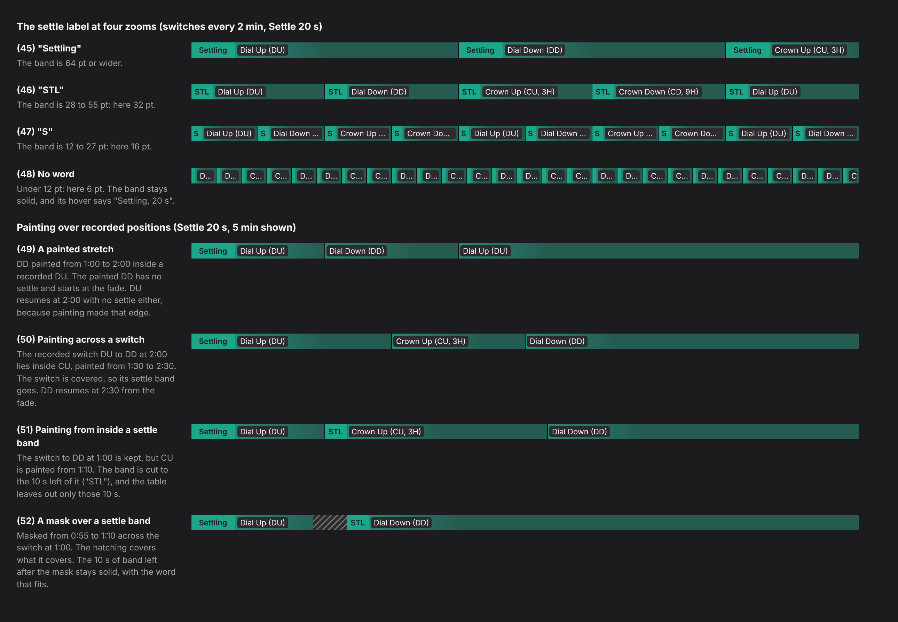

A change of position made on the Position card, or by the guided Positions Test, is a **recorded switch**. The watch settles after it, so the track starts that stretch with a solid band as long as the Settle setting, the same Settle the Positions Test table leaves out. The band is named so that it reads as settling, not as a stronger reading.

- **The word fits the band** (marks 45 to 48). It is in dark text directly on the solid teal, with no plate, at 5.3:1 in dark mode and 6.7:1 in light:
  - **(45)** "Settling" when the band is 64 pt or wider;
  - **(46)** "STL" from 28 pt;
  - **(47)** "S" from 12 pt;
  - **(48)** no word under 12 pt. The band stays solid, and its hover always says "Settling, 20 s" (the Settle in use).
- **The position's name starts after the band,** on its plate, so the two never overlap.
- **The band follows the Settle setting.** Changing Settle on the Positions Test pane redraws every band and the table together.

**Painting** with the Position Brush is a correction after the fact, so it never makes a settle band. The track is two layers: the recorded switches underneath, and the painted stretches on top. What shows at any moment is the painted position where there is one, otherwise the recorded one. Every edge follows one rule: **an edge made by a recorded switch starts solid for its Settle; an edge made by painting starts at the fade.**

- **(49) A painted stretch** inside a recorded one starts at the fade. Where the recorded position resumes after it, that edge was made by painting too, so it also starts at the fade.
- **(50) Painting across a switch** covers the recorded switch, so its settle band goes. The recorded position resumes at the painted end, from the fade.
- **(51) Painting that starts inside a settle band** keeps the switch and cuts the band at the paint. The label then fits what is left ("STL" for 10 s). The table leaves out only the band that shows. If the band is too short for the position's name, the name is in the hover.
- **Painting the same position as the recorded one** changes nothing there. The recorded layer shows through, settle band and all.
- **Removing a painted stretch** is right-click > Remove Painting on the stretch. The app has no Undo. It shows the recorded layer again, with its switches and settle bands as they were. Painting never deletes a recorded switch, it only covers it, and both layers are saved with the take, so Remove Painting works after the take is closed and reopened.
- **(52) A mask over a settle band** hatches what it covers. The part of the band after the mask stays solid, with the word that fits it. A mask never moves a switch.
- **A gap in the recording** (a break or pause) is not a switch. A stretch that carries on after a gap gets no new settle band.
- **At the start of a take,** the position set before Listen counts as a recorded switch at 0:00, so the take opens with a settle band, as today.

---

## 12. Tables and lists

- Rows are 28 pt. Numbers are right-aligned in tabular figures, with units in the column title.
- Sort by clicking a column title (click again to reverse). Filter as Excel does: each column title has a ▾ that opens its filter, allowing several values at once. While a column's filter is on, its ▾ becomes a funnel.
- Drop any separate control that duplicates a column filter.
- Selecting a row never inserts anything between rows. Actions on the selection sit in the toolbar or a context menu.

**Example: Settings > Calibres.** Today:

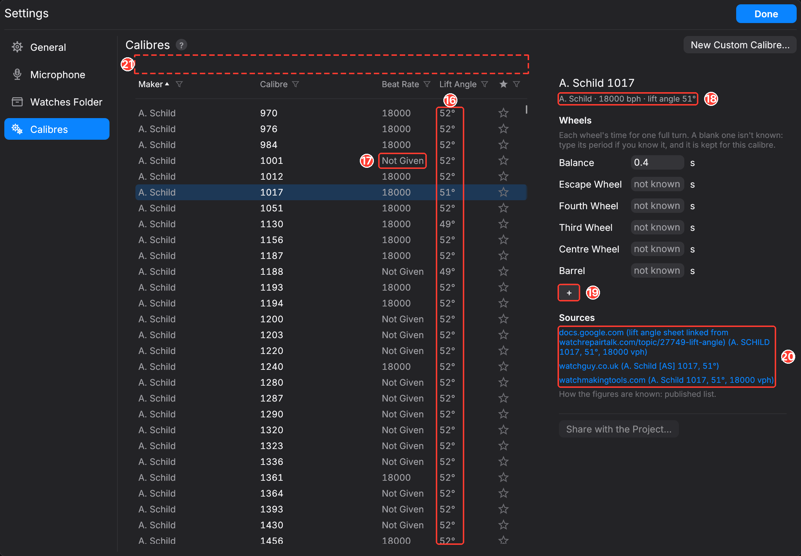

- **(16)** Lift Angle repeats "°" in every cell, and Beat Rate's unit is nowhere. Both columns are left-aligned, so digits don't line up.
- **(17)** "Not Given" is written out in hundreds of rows. The eye reads it as data.
- **(18)** The line under the title repeats the selected row word for word.
- **(19)** A bare "+" is the only way to add a wheel. It doesn't say what it adds.
- **(20)** Sources are full raw strings run together as links. They are hard to scan, and they wrap.
- **(21)** There is no search field over 4,537 calibres, and no count. An earlier search field was removed on purpose, because it did the same job as the search inside each column's filter. That saved space but left no quick way to find a calibre by typing.

The same page following the rules:

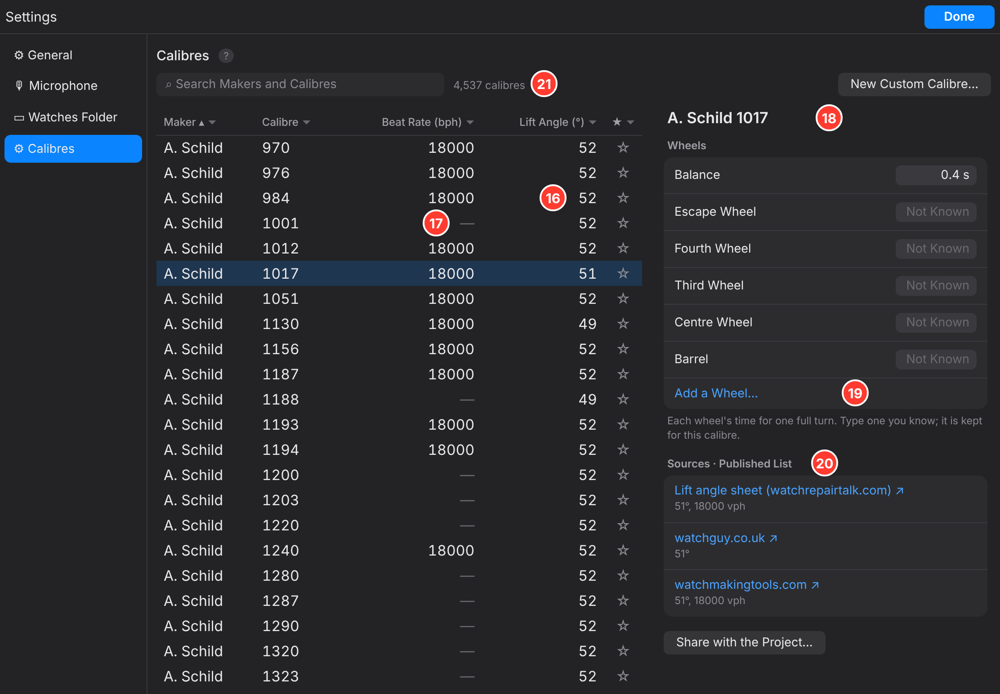

- **(16)** Units go in the column title: "Beat Rate (bph)", "Lift Angle (°)". Numbers are right-aligned in tabular figures.
- **(17)** A missing value is a dim "—". The "?" explains it once.
- **(18)** The detail panel shows only the name. Every fact in the row stays in the row.
- **(19)** The Wheels group ends with an inline action (section 8), "Add a Wheel…". Empty fields read "Not Known", dimmed.
- **(20)** Sources form a grouped list, as in Settings. Each source's name is the link, and the full URL is hidden. Under the name is what the source says. The group title says how the figures are known.
- **(21)** One search field over the table, with the count beside it, and the page's one action at the right. It searches Maker and Calibre together. The column filters stay for picking values.

---

## 13. Before a UI PR

- [ ] Checked at 2560 × 1440, 1280 × 820 and 800 × 600, in dark and light, with a long device name.
- [ ] Nothing appears, disappears or resizes in a way that moves another control.
- [ ] No banner. Each message is in a chip, a status item or a sheet's status line.
- [ ] No fact shown twice.
- [ ] Every icon is clickable and has a hint, and every label is words.
- [ ] Each control's kind matches section 8.
- [ ] Toolbar zones are as in section 9.
- [ ] Title Case for names, and sentences in sentence case.
- [ ] No text walls.
- [ ] Colours are the palette's, and a quantity's colour is used only for it.
- [ ] Dialog buttons are at the bottom right, with the default rightmost.
- [ ] Every count says what it counts, and every scale that isn't shared is stated.
- [ ] Screenshots in the PR, before and after.

---

## Addendum: the guide applied to Watches

This addendum shows the guide's rules at work on one real part of the app: Watches. It keeps everything a user can do there today, and each change cites the section it comes from.

Watches is a view of its own, filling the window ([App Structure](app-structure.md), section 4). The mock-ups are drawn as the view, cropped to its top left. At full width the list keeps its width, and the watch and its takes table take the rest. "Toolbar" below means the view's toolbar, on the mode row (section 2).

### Today

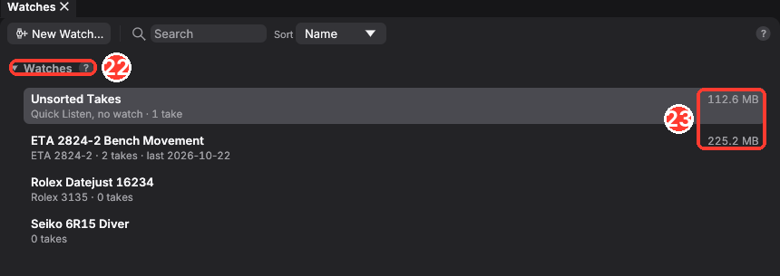

- **(22)** The whole list sits under one fold-away heading, "Watches". Folding it hides every watch, and the heading adds nothing the pane's tab doesn't already say.
- **(23)** Sizes show on some rows and not on others (blank below 1 MB), so the column comes and goes.

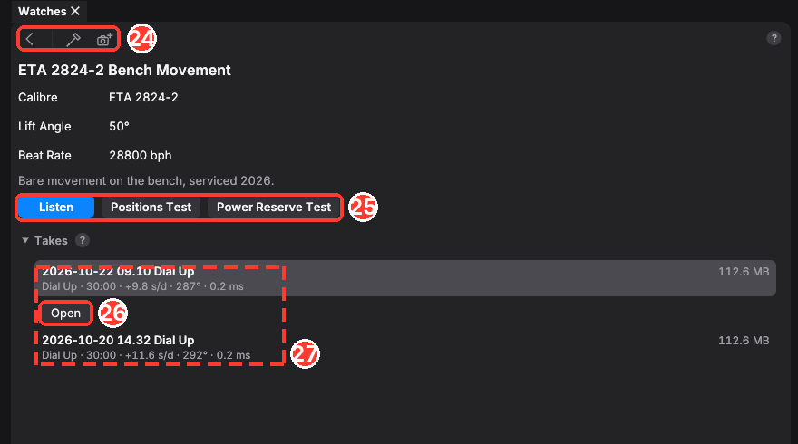

- **(24)** Back, Edit… and Add Photos… are icons, and Edit… is a screwdriver: a cute icon, not a standard one (section 8).
- **(25)** The three ways to start a take look like tabs. Nothing says how they differ, and Listen is lit blue like a selected tab, as if it were already chosen and the other two were pages.
- **(26)** Picking a take inserts an Open button between rows, which pushes the rows below it down (sections 4 and 12).
- **(27)** Each take's figures are run together in one dotted line ("Dial Up · 30:00 · +9.8 s/d · 287° · 0.2 ms"). A watch's history can't be compared down a column or sorted.

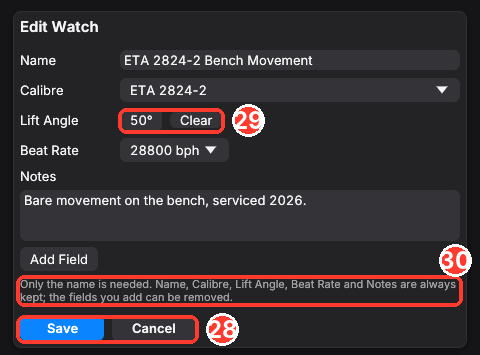

- **(28)** Save and Cancel sit at the bottom left, with the default first (section 10, Sheets and dialogs).
- **(29)** "Clear" beside the lift angle doesn't say what it clears to. It leaves the lift angle not set.
- **(30)** The rules for fields are a paragraph in small print.

### The design

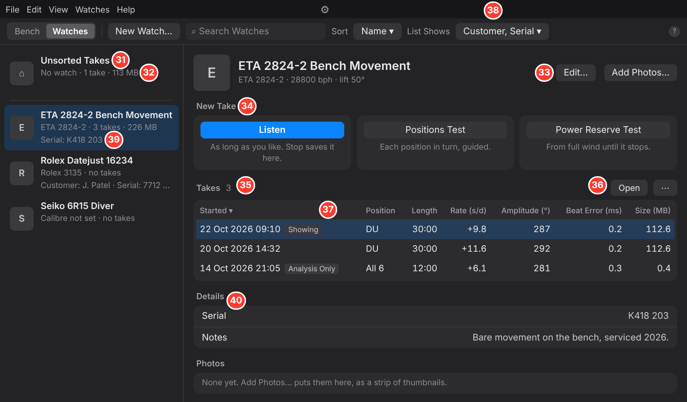

**The list and the watch sit side by side** whenever there is room: from about 600 pt, so at 2560 × 1440 and 1280 × 820. At 800 × 600 the view shows one at a time, with "‹ All Watches". Picking a watch no longer hides the others, so moving between watches is one click, not two.

- **(31)** Unsorted Takes stays first, above a hairline, and the fold-away heading goes. Each row has a tile (first photo, or the initial), the name, and a caption: calibre, takes and size.
- **(32)** Every row states its size in its caption, so there is no column that comes and goes (sections 4 and 12).
- **(33)** Edit… and Add Photos… are word buttons on the watch's header (section 8: labels are words). The header carries the watch's figures once: calibre, beat rate and lift. Nothing else in the view repeats them.
- **(34)** **New Take** is a group of three equal choices, each with a one-line caption of what it does. Listen is the default command (section 8), so it is the one blue button, as Done is on a sheet. The three are drawn as separate buttons in separate boxes, each with its caption, so they no longer read as tabs, and blue means "Return does this", not "this page is showing". Starting any of them works as today: it asks first only about unsaved sound, and it saves into the watch on Stop. Stop is on the Bench: starting a take switches there, and while a watch's take or a test runs, the New Take buttons stay in place, disabled, with the hint "Stop the take on the Bench first." ([App Structure](app-structure.md), section 3).
- **(35)** **Takes are a table** (section 12): Started, Position, Length, Rate (s/d), Amplitude (°), Beat Error (ms), Size (MB). Numbers are right-aligned in tabular figures, with units in the titles. Clicking a title sorts by it, so the best or worst rate, or the newest, is one click away. Started is written in full, "22 Oct 2026 09:10", so takes from different years can't be confused.
- **(36)** **Open** and a "⋯" menu sit at the right of the Takes title and act on the picked take. Nothing is inserted between rows. Double-click and Return still open a take. The "⋯" menu, also the right-click menu, keeps today's items in today's order:
  1. Open
  2. Show in Finder
  3. Keep Analysis Only…
  4. Move to Another Watch ▸ (File Under a Watch ▸ in Unsorted Takes)
  5. Delete…
- **(37)** A take's state is a small tag after its date, and each tag is a plain fact. **Showing** marks the take open on the Bench now (today's wording is "On Show"). The Bench holds one take, so at most one take in the library is Showing, and none while a Quick Listen take is live. **Analysis Only** marks a take kept without its sound. **Files Missing** marks a take whose sound or analysis files aren't in its folder, for example after a half-finished copy or sync (today's wording is "Incomplete"). While Keep Analysis Only… runs, its progress and Cancel take that take's tag slot, so the row keeps its height.

Details and Photos are their own groups, as in Settings (section 10). They come after Takes, so a watch's history is never below the fold ([App Structure](app-structure.md), section 7, mark 11). Details lists the watch's added fields, then its Notes. The photo strip behaves as today: clicking opens a photo in the viewer, and right-click offers Open, Show in Finder and Delete…. With no photos, the group says how to add them.

### Making added fields earn their place

Added fields (Customer, Serial, Purchased and so on) only get used if they pay back. A watchmaker with many customers' watches should be able to find one by the customer's name, and see who it belongs to without opening it. The design gives fields three jobs:

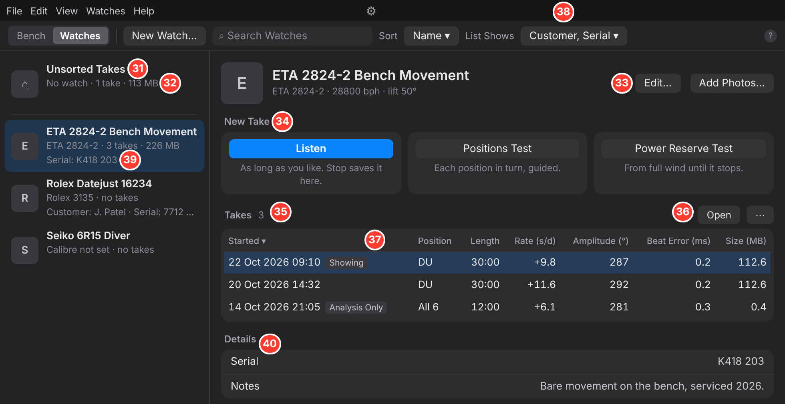

- **(38)** **List Shows ▾** in the toolbar picks which added fields appear in the list, for every watch at once. Each watch shows the ones it has, on a third caption line. One choice for the whole list keeps rows alike. When any field is shown, every row keeps room for the third line, so heights match: a watch with none of the shown fields (Seiko here, and Unsorted Takes) has the line reserved and empty.
- **(39)** The list row shows those fields as "Name: value", separated by dots, and cut with "…" when long.
- **(40)** The watch's **Details** group lists all its added fields, then Notes, so they're readable without opening Edit….
- **Sort ▾** also offers each added field by name (Sort by Customer, for example), after Name, Last Take and Size.

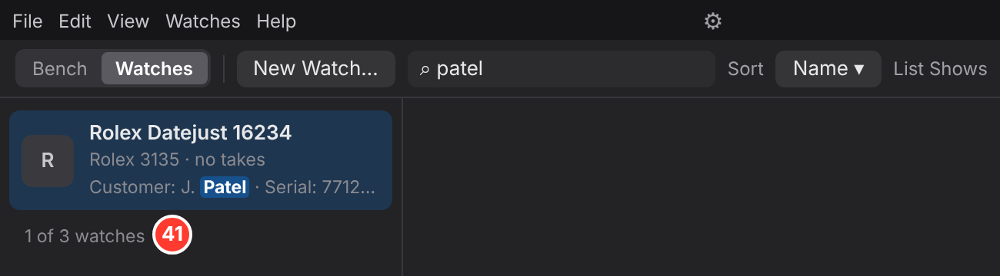

- **(41)** Search already matches field values in today's code (`watches.rs`, `shown()`). The design makes the match visible: the field that matched is shown on the row, even when List Shows doesn't include it, with the matching text highlighted in the accent, as a selection is (section 7: the accent is for interface). A count, "1 of 3 watches", says how much the search hid.

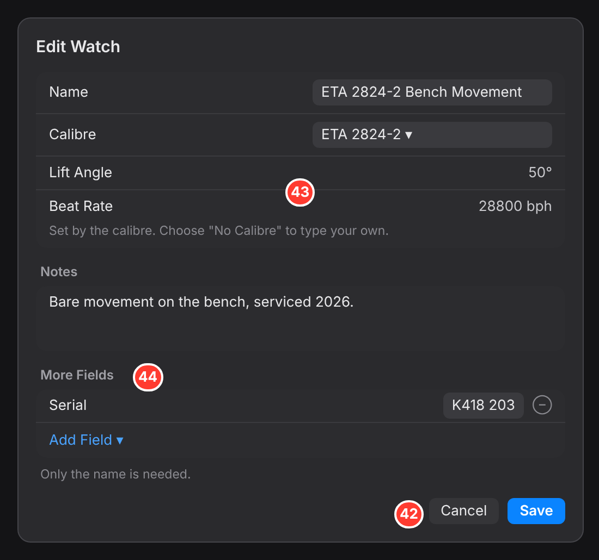

- **(42)** Buttons at the bottom right: Cancel, then Save as the default. Return saves and Esc cancels.
- **(43)** **Calibre or figures, never both.** With a calibre picked, Lift Angle and Beat Rate show the calibre's figures, read-only, with the caption "Set by the calibre". With No Calibre, both are fields the user types. This is the same rule as the Calibre card ([App Structure](app-structure.md), section 5). One gap remains: when the calibre table lacks a figure (many rows say "Not Given" for beat rate), that one figure stays a field, and Beat Rate offers Auto. "Clear" goes.
- **(44)** Fields a user adds sit in their own group, **More Fields**, each with a remove button, and Add Field ▾ is the group's last row, an inline action (section 8). Name, Calibre, Lift Angle, Beat Rate and Notes are always there and can't be removed, so the long rule shrinks to "Only the name is needed."

### Everything Watches does today, and where it goes

| Today | In the Watches view |
|---|---|
| New Watch…, search (name, calibre, notes, fields), Sort by Name, Last Take or Size | Same, in the toolbar, plus List Shows ▾ and Sort by any added field. Search shows the field that matched. When the window is narrow, Sort and List Shows fold into "⋯" first. |
| Unsorted Takes: back to Quick Listen, and its takes | Same, first in the list. Its takes use the same table. |
| Pick a watch: Listen and the tests take it | Changes. Picking a row only selects it and shows its details. The watch on the mic is set only by New Take here, or by the Watch line on the Bench (App Structure, section 6), so browsing never changes a running take's watch. Starting a take from New Take switches to the Bench (App Structure, section 3). |
| ‹ All Watches | Only at 800 × 600, where list and watch can't sit side by side. |
| Edit…, Add Photos… | Word buttons on the watch's header. |
| Listen, Positions Test, Power Reserve Test, and Stop while one runs | The New Take group starts a take. Stop moves to the Bench; while a take runs, the group is disabled with a hint (App Structure, section 3). |
| Photos strip and its menu | The Photos group, unchanged. |
| Takes: Open, double-click, and the right-click menu | The Takes table, with Open and "⋯" at its title. |
| On Show, Analysis Only, Incomplete, and Keep Analysis Only… progress | Tags in the Started column, worded Showing, Analysis Only and Files Missing. |
| Read only when another copy of the app has the folder open | Same controls dimmed, each with a hint saying why. A status-bar item says it once (section 3). |
| Folding groups | Only Notes, Photos and Takes fold. The list doesn't. |

Two behaviours change on purpose: **‹ All Watches** in a wide window, since list and details are both in view; and picking a row, which no longer sets the watch on the mic.
