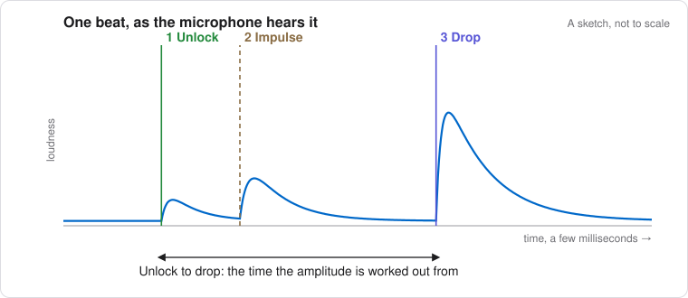

# 1. How a Timegrapher Hears a Watch

A timegrapher measures the timing of sounds from the escapement. It cannot
see the balance, measure mainspring torque, or inspect a tooth. Yet those
sounds contain enough information to estimate rate, beat error and
amplitude, and to follow small changes as the watch runs.

Understanding which event each number represents makes the instrument
much more useful. It also helps distinguish a change in the watch from a
change in the way the microphone hears it.

## The Beat

This guide describes a **Swiss lever escapement**. Its balance and
hairspring form an oscillator. The balance makes one complete oscillation
when it travels from one extreme to the other and back again. Each half
oscillation is a **vibration**, or **beat**. A 4 Hz balance therefore makes
eight beats per second: 28,800 beats per hour (bph).

During most of its arc the balance is free of the escapement. As it
approaches the middle of its swing, the impulse pin (also called the
roller jewel) enters the pallet fork. The balance first supplies the
energy needed to unlock the escapement; the escape wheel then supplies an
impulse through the pallets and fork to sustain the balance's motion.
On the next vibration the action repeats in the opposite direction,
using the other pallet stone.

Timegrapher calls the alternating groups **Tick** and **Tock**, shown in
blue and orange. These are software labels, assigned when the beat
sequence is acquired. They do not identify the entry and exit pallets.
The labels can exchange on a new acquisition.

## The Three Sounds of a Beat

The familiar tick contains several closely spaced impacts. Timegrapher
uses the conventional three sound groups:

1. **Unlock.** The impulse pin contacts the inside of the fork and starts
   moving the pallet lever. The locking face of the engaged pallet stone
   moves past the escape-wheel tooth, releasing it. The first acoustic
   group marks the start of this process, not simply the instant the
   tooth becomes free.
2. **Impulse.** The escape-wheel tooth acts on the **impulse face of the
   pallet stone**. Energy passes through the pallet lever and fork to the
   impulse pin, and hence to the balance. The second sound group includes
   contact at the tooth and stone and the fork's contact with the pin.
3. **Drop and locking.** After the tooth leaves the impulse face, the
   escape wheel advances freely through the drop angle until another
   tooth meets the locking face of the opposite pallet stone. The lever
   completes its travel to the banking. These impacts form the third,
   usually strongest, sound group, labelled **Drop** in the app.

Strictly, *drop* is the escape wheel's free movement between release and
locking, whereas the microphone hears the impacts at its end. Keeping
that distinction in mind avoids treating an acoustic label as an exact
mechanical boundary. The three groups need not appear as three clean
peaks: the case, holder and microphone alter their relative prominence.



Witschi describes the acoustic groups in its [training course](https://www.welwynwatches.co.uk/uploads/9/1/4/3/9143536/witschi_training_course.pdf).
For the mechanical sequence, including the distinction between drop,
locking and run to the banking, see Horopedia's [Swiss lever escapement,
sections 6 and 9](https://horopedia.org/distribution-mechanism-swiss-lever-escapement/).

## Beat Rate

**Beat Rate** is the nominal frequency of the movement, expressed in bph.
**Rate**, discussed next, is its departure from that nominal frequency.
They answer different questions.

| Balance frequency | Beat rate | Nominal time between beats | Full oscillation period |
| --- | --- | --- | --- |
| 2.5 Hz | 18,000 bph | 200 ms | 400 ms |
| 3 Hz | 21,600 bph | 166.67 ms | 333.33 ms |
| 4 Hz | 28,800 bph | 125 ms | 250 ms |
| 5 Hz | 36,000 bph | 100 ms | 200 ms |

With **Beat Rate: Auto**, the app chooses the nearest standard beat rate
from the first usable beats. Check the result against the movement. A
stable-looking trace at the wrong nominal beat rate is not a valid
measurement.

## Rate

Rate is the gain or loss the watch would accumulate in a day **if the
measured behaviour continued**. A reading of +10 s/d means gaining;
−10 s/d means losing. It is a frequency measurement expressed in familiar
watchmaking units, not a prediction of tomorrow's performance on the wrist.

If the nominal beat interval is `P₀` and the fitted interval is `P`, then:

```text
rate = 86,400 × (P₀ / P − 1) s/d
```

At 28,800 bph, +10 s/d corresponds to an interval about 14.5 microseconds
shorter than 125 ms. Measuring one interval would be fragile. Timegrapher
fits many beat times together, with a separate alternating offset for
Tick and Tock, so beat error does not become a rate error. It also rejects
poorly matched beats and large timing outliers. The [Paper Strip](06-paper-strip.md)
lets you inspect the timing pattern behind that fit.

The reference clock matters. Audio samples are timed by the input's
sample clock, which can differ from true elapsed time. An error of 20 ppm
introduces about 1.73 s/d of rate error. A perfectly straight trace can
therefore have a consistently biased rate. [True Clock](05-readings.md#true-clock)
explains the correction and its limits.

## Amplitude

Amplitude is the balance's angular excursion from its equilibrium
position to a turning point. A balance at 270° amplitude travels roughly
540° from one extreme to the other; 270° is not the total arc of an
oscillation, nor an angle travelled by the pallet lever.

Timegrapher infers amplitude from **lift time** and **lift angle**. The
lift angle is the balance's angular travel through the escapement action,
set by the movement's geometry. The instrument estimates the corresponding
time from the first and third sound groups. A balance with a larger
amplitude crosses this small central arc faster.

The calculation models the balance's motion as sinusoidal and the lift
interval as centred about equilibrium. With amplitude `A`, lift angle
`L`, lift time `t`, and full oscillation period `T`:

```text
L = 2 A sin(π t / T)
A = L / [2 sin(π t / T)]
```

Use the same units for `t` and `T`; the sine's argument is in radians.
`L` and `A` may both be in degrees. Notice that `T` is **two beats**, not
one. This is the model implemented by Timegrapher's
[amplitude calculation](../../crates/timegrapher-core/src/amplitude.rs).
It is an acoustic estimate under that model, not an optical observation
of the turning point.

For the example summary in [chapter 7](07-sound-of-the-beat.md),
`t = 8.48 ms`, `T = 250 ms` and `L = 55°`:

```text
A = 55 / [2 sin(π × 8.48 / 250)] ≈ 259°
```

Two practical consequences follow. First, amplitude scales directly with
the entered lift angle. Changing 52° to 55° multiplies every result by
55/52; a displayed 260° becomes 275°. The often quoted “about four degrees
of amplitude per degree of lift angle” is only a rough example: the
sensitivity is `A/L`, or five degrees at 260° and 52°.

Second, a misplaced edge can matter considerably. For small lift times,
`A ≈ L T / (2πt)`, so a 1% error in lift time produces approximately a
1% error in amplitude in the opposite direction. An unlock detected too
late makes the interval too short and the inferred amplitude too high.
Inspect the profile when amplitude changes abruptly, especially if only
one side changes.

The Swiss lever sound model should not be assumed to work for a co-axial,
detent, cylinder or other escapement. Detecting a regular beat does not
validate its amplitude estimate.

## Beat Error

Beat error measures the asymmetry between successive Tick-to-Tock and
Tock-to-Tick intervals. In the convention used here, if those intervals
are `a` and `b`:

```text
beat error = |a − b| / 2
```

For example, alternating intervals of 124.7 and 125.3 ms give **0.30 ms**
beat error, not 0.60 ms. Their mean is still 125 ms, so this example has
zero rate error. The timing fit estimates the same alternating offset
over many beats rather than relying on one pair.

The principal reading uses the **unlock** timing. The app also reports a
value labelled **from the drop**, based on the detected beat reference
near the dominant sound group. If the two sides have different
unlock-to-reference delays, the values differ. That difference is useful
information about the sound and its extraction; by itself it says
nothing about the escapement.

The cards show the magnitude because Tick and Tock are arbitrary labels.
Some advanced analyses retain the sign to preserve changes through zero;
[Steadiness](09-steadiness.md#which-readings-are-analysed) explains this.

## Precision, Stability and Accuracy

These are three different properties. A watch can maintain a very steady
+20 s/d, and a measurement can report a small ± while using the wrong lift
angle. The ± estimates short-range measurement scatter under a statistical
model. It does not include every source of error, describe the watch's
whole range of variation, or guarantee that another measurement will
fall inside it.

Use the cards for the current result, the strip and profiles to check
how it was obtained, and the charts and advanced panes to understand how
it changes. The following chapters connect those views.

---

Next: [Your First Measurement](02-first-measurement.md)
