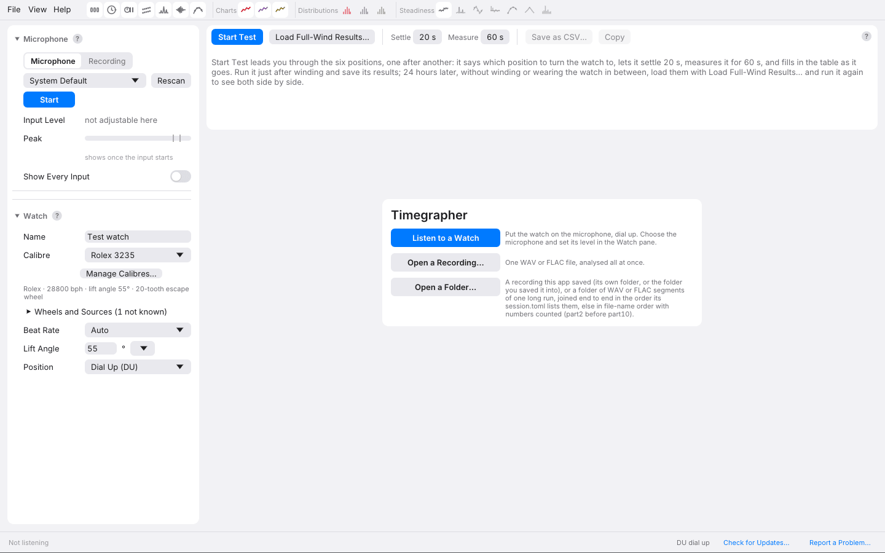

# 2. Your First Measurement

For the first run, choose one watch, one position and a quiet few minutes.
The aim is to get a recording you trust, with enough context that you can
repeat it later. You can explore the more elaborate analyses once the
basic signal and settings are right.

## What You Need

Use the build for your computer from the
[Releases page](https://github.com/peterhudson/timegrapher/releases/latest).
The release's **Start Here** page gives its system requirements and first
launch instructions; [Installing and updating](../install.md) has the
platform details. The app is available for macOS, Windows and Linux.

A contact microphone in a watch holder is the usual input. A suitable
piezo pickup and preamplifier can also work. An ordinary microphone may
hear the dominant tick while missing the much quieter first sound group,
so successful rate detection does not guarantee a useful amplitude
measurement.

Use a mechanical watch with a Swiss lever escapement for this first test.
Wind it fully using the normal procedure for that movement and note the
time. Find its nominal beat rate and, if possible, its lift angle. The
calibre list is a convenient starting point, but check the source when
you have a technical sheet for the exact movement.

## Install and Open

The macOS download is a disk image; drag the app to Applications. On
Windows and Linux, extract the whole download and run the app from the
extracted folder. Keep its accompanying files together. The download
also contains **Command Line** and **Documentation** folders, plus
**Claude Desktop** on macOS and Windows.

Follow **Start Here** for the exact build. The builds are unsigned, so
the operating system may require an explicit first-launch approval.
Allow microphone access when prompted.

The welcome screen offers **Listen to a Watch**, **Open a Recording…**
and **Open a Folder…**. The Watch pane at the left holds the input and
movement settings. The app does not acquire the microphone simply by
opening; starting capture or enumerating inputs does access audio devices.

## Make the First Recording

1. Place the watch **dial up**, with firm, repeatable contact against the
   pickup. Keep a loose bracelet from rattling against the holder.
2. Select the input in the **Microphone** section of the Watch pane. On
   Linux, the system input through PipeWire or PulseAudio is often the
   convenient starting point if the watch microphone is already selected
   in the desktop sound settings.
3. Under **Watch**, enter a name, choose the calibre if known and confirm
   the lift angle. With **Not Set**, the default is 52°; treat amplitude
   as provisional until that value is confirmed. Leave **Beat Rate** on
   **Auto** initially and select **Dial Up (DU)**.
4. Click **Listen to a Watch** or **Start**. The first readings normally
   appear after several seconds of usable beats. Confirm that the
   detected beat rate matches the movement.
5. Watch the **Peak** meter. Clipping means the input is overloading;
   reduce gain and allow the clipped beats to leave the averaging window.
   [Chapter 3](03-microphone.md) explains level, gain and signal checks.
6. Leave the watch and table undisturbed for about a minute. Compare the
   readings with the strip and Tick Tock Profile. Look for a stable beat
   sequence and plausible, repeatable Unlock and Drop markers.

The default **Average Over** is 10 seconds. Expect some movement in the
figures; a changing last digit alone tells you little. A repeated pattern,
a sudden step, or an unstable edge is more informative. The ± figures
estimate short-range precision under a model; they do not certify that
the settings or the signal are correct.

## What to Look at First

Read the rate together with its beat count and jitter. Then check the
amplitude's lift angle and separate Tick/Tock estimates. Finally read the
beat-error caption: the usual value is from the unlock, but the app can
show a drop-based fallback if the unlock result is unavailable.

The **Paper Strip** shows timing one beat at a time. The **Tick Tock
Profile** shows the sound features behind the amplitude and beat error.
The ordinary **Rate**, **Amplitude** and **Beat Error** charts show their
history. Use the **?** beside a pane or card for its local explanation:
hover for a short hint, click for the longer text.

Do not regulate from the first number that appears. Let the signal settle,
confirm the context and see whether the rate itself is steady. A later
[Positions Test](10-positions.md) will show whether the dial-up result is
representative of the other positions.

## Save Something You Can Compare

Click **Save…** and choose the parent folder for the session. The saved
take includes the audio and measurement context, so you can reanalyse it
later. If you continue recording, use **Save Again** to update the saved
copy. Save is a snapshot; it is not a promise that a previously saved
folder continuously follows new audio.

**Stop** releases the microphone while retaining the session for review.
**Resume** continues that session; **New Session** prepares a separate
one. With the desktop update accompanying this guide, New Session also
works while listening and capture continues into the new session. The
app asks about unsaved audio before discarding it. See
[Sessions and Recordings](11-sessions-and-recordings.md) for the timeline
and file details.

## Try a Recording First

Without a microphone, open a WAV or FLAC file with **Open a Recording…**,
or a saved take with **Open a Folder…**. The public
[test corpus](https://github.com/peterhudson/timegrapher-corpus) provides
sample recordings. **Analyse All** makes the full history available;
**Replay** reveals it progressively, as a live capture would. Neither
mode needs the microphone.

---

Previous: [How a Timegrapher Hears a Watch](01-how-it-works.md) ·
Next: [Setting Up the Microphone](03-microphone.md)
