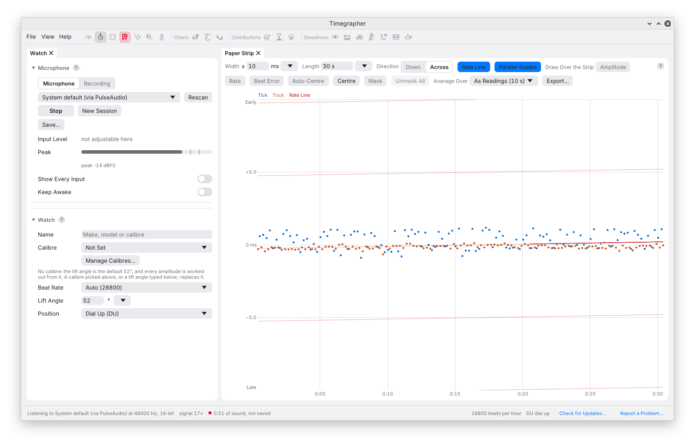
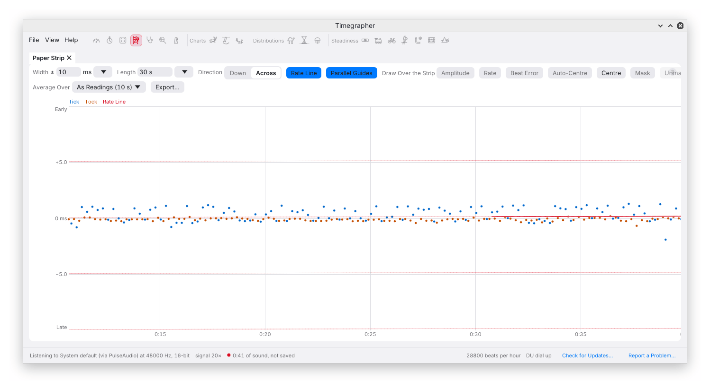

# 3. Setting Up the Microphone

The useful signal is not just the loud tick. Amplitude depends on locating
a quiet early sound and the later drop group consistently. A setup that
produces a convincing rate can still be poor for amplitude or beat error.

Start with stable contact, sufficient headroom and as little processing
of the sound as possible. Then use the profile to check the result.

## The Microphone Section of the Watch Pane

Choose **Microphone** at the top of the Watch pane for live capture.



| Control | Use |
| --- | --- |
| Input menu | Select the microphone; until enumeration, it may show the last selection or **System Default** |
| **Rescan** | Refresh the input list after connecting a device |
| **Start**, **Stop**, **Resume** | Acquire the input, release it, or continue the session |
| **Input Level** | Adjust capture gain where the platform and device support it |
| **Peak** | Read the largest sample magnitude over the last half second |
| **Show Every Input** | Include the additional system device names |

Opening the input menu, rescanning or starting capture can query audio
devices. The app avoids doing that automatically at startup because even
querying a device can briefly open it.

It requests 48 kHz, prefers 16-bit samples where offered, and mixes the
input to mono. Check the status line for the format actually opened; the
request and the device's selected format need not be identical.

### Which Input to Choose on Linux

**System default (via PipeWire)** or **via PulseAudio** uses the source
selected by the desktop sound server and can coexist with other programs.
Confirm that the desktop has selected the watch microphone rather than
the laptop microphone or a monitor source.

A device marked **(direct)** accesses the sound card through ALSA. It may
be unavailable while the sound server or another program holds it. If a
direct input fails, try the system input and check the desktop routing.
On macOS and Windows, select the microphone by name.

Avoid acquiring the same input from another recorder during an important
take unless you have confirmed that sharing works with that configuration.
For reviewing existing files, use Recording mode, which does not acquire
the microphone.

## Setting the Level

The Peak meter is in **dBFS**, decibels relative to digital full scale.
0 dBFS is the maximum. −10 dBFS corresponds to about 32% of full-scale
sample amplitude; −6 dBFS is about 50%. The scale is logarithmic, not a
percentage slider.

Aim for clear beats with headroom for the loudest expected event. The
`doctor` command uses about −10 dBFS as its target when suggesting gain
changes. This is a useful starting point, not a requirement to make every
watch reach precisely the same peak.

**Clipping** occurs when the input cannot represent the signal's full
excursion. The waveform is flattened, and the app marks the meter red
when samples reach its clipping threshold. An amber banner reports the
share of beats containing clipped samples within the reading interval.

Clipping can distort the edges used for amplitude and beat error. Rate
may remain relatively stable because the beat sequence is still clear,
but it is not immune to distorted timing or failed detection. Reduce gain,
then check a fresh, unclipped interval. Turning gain down after capture
cannot repair a clipped recording.

At the other extreme, low signal relative to background noise makes edge
placement uncertain. Increasing digital gain raises both the signal and
noise; improving contact or reducing vibration can be more effective.

### Changing Gain

On **Linux**, release the **Input Level** slider to apply the change.
For the system input it controls the sound server's input volume; for a
direct device it uses an available capture mixer control. If the app says
**not adjustable here**, use desktop sound settings or the device's
hardware control.

On **macOS**, use System Settings → Sound → Input. On **Windows**, use
the input device's properties in System → Sound. The available controls
depend on the device and driver.

## Automatic Gain and Other Processing

Automatic gain control changes gain as signal level changes. Noise
suppression, gating and speech-oriented processing can also reshape a
watch beat or suppress its quiet onset. Disable these features where the
input or operating system offers them, then check the signal again.

When Timegrapher can read an enabled automatic-gain switch, it shows
**Automatic gain: on** and **Turn It Off**. Absence of that message is
not proof that every stage of the input path is unprocessed; the app may
not have access to a particular control.

`timegrapher doctor` also measures whether the background rises between
beats. That can support a suspicion of gain control, but the acoustic
measurement alone does not uniquely identify its cause.

## The Signal Figure

The status line's **signal**, for example **30×**, compares a typical
beat peak with the typical level between beats.



Noise alone can give a ratio around 2×, and the engine does not log beats
below its 4× threshold. This is a linear envelope ratio, not an SNR in dB
and not a quality percentage. A strong hum, resonant holder or repeated
knock can still make unsuitable input. Look at the profile and regularity
of detection as well as the ratio.

## Checking from the Command Line

`doctor` reports peak and RMS level, clipped samples, beat detection,
background rise and a quick timing estimate. It can inspect a file
without acquiring the microphone:

```sh
timegrapher doctor --file watch_DU.flac
```

For a live setup check, stop capture in the app first if the device cannot
be shared, then use:

```sh
timegrapher devices
timegrapher doctor --device "USB"
```

Use the device name reported on your machine. With no `--device`, doctor
uses the default input. On Linux it can report relevant mixer controls
and proposed adjustments. It makes those changes only when you supply
`--apply`; read the proposed changes before using it. See
[doctor](14-command-line.md#doctor).

## When Capture Stops

If the input fails or stops delivering audio for three seconds, capture
stops and a banner explains why. This is different from receiving audio
containing silence: silence may keep the input running while the readings
say **No regular beat found**.

For repeatable comparisons, keep the watch's seating and clamping pressure
consistent, isolate the stand from desk vibration, and avoid typing or
handling nearby during the measured interval. If you change coupling or
gain, note it as a change in measurement conditions.

---

Previous: [Your First Measurement](02-first-measurement.md) ·
Next: [The Window](04-the-window.md)
