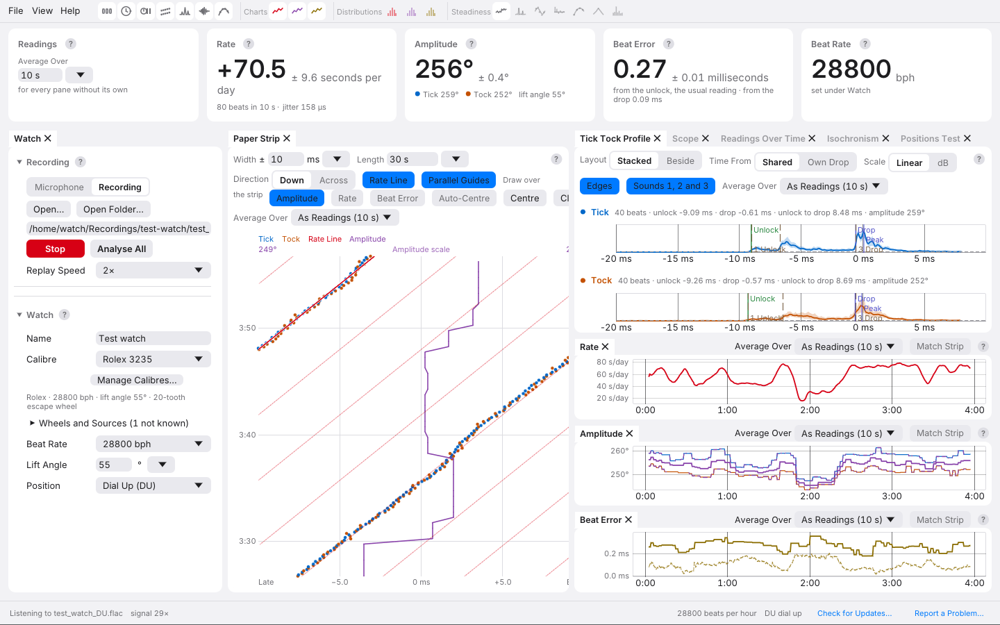

# 4. The Window

This chapter is a tour of the app's window: where things are, how to get
help on any of them, and how to arrange the panes the way you like.

From top to bottom:

1. **The menu bar**, with the pane icons beside the menus.
2. **The readings**: five cards across the top. See
   [Readings](05-readings.md).
3. **The time slider**, once you have stopped listening or opened a
   recording, to look back through the session.
4. **The panes**: the Watch pane, the Paper Strip, the Tick Tock Profile,
   the charts and the others described below.
5. **The status line** along the bottom.

## The Menu Bar

**File**

- **Open Recording…** (Ctrl+O) and **Open Folder…** open a recording,
  analysed all at once. See
  [Sessions and Recordings](11-sessions-and-recordings.md).
- **Save…** (Ctrl+S) copies the session into a folder of its own;
  afterwards it becomes **Save Again**, which brings that copy up to date.
  **Save As…** (Ctrl+Shift+S) copies it to a new folder.
- **New Session** clears everything for the next watch. Pressed while
  listening, listening carries on into the new session.
- **Quit** (Ctrl+Q).

**View**

- A tick for the readings and for each pane, to show or hide it.
- **Steadiness**, a submenu with a tick for each Steadiness view.
- **Reset Panes** puts every pane back where it started.
- **Appearance**: **Auto** follows your computer's light or dark setting;
  **Light** and **Dark** override it.

**Help**

- **Check for Updates…** asks GitHub whether a newer version has been
  published, and says what it found.
- **Check for Updates at Start** (on unless you turn it off) makes the
  same check, quietly, each time the app starts, and shows a banner only
  when there is a newer version. The banner's **Download** button opens
  the release's page in your browser; nothing is downloaded or installed
  by the app. The request carries no account or identifier.
- **Report a Problem…** makes a report to attach to a GitHub issue. See
  [Problems and Reports](14-problems-and-reports.md).
- **Add to Applications Menu** (Linux only) puts the app and its icon in
  your desktop's applications menu.

## The Pane Icons

Beside the menus is a row of icons, one for each pane. Click an icon to
show or hide its pane. Rest the pointer on an icon to see the pane's name.
An icon is lit while its pane is showing. The icons are grouped: the
panes of the main view first, then **Charts**, **Distributions** and
**Steadiness**.

## The Panes

| Pane | What it shows | Chapter |
| --- | --- | --- |
| **Watch** | The microphone or recording, and the watch's name, calibre, beat rate, lift angle and position | [3](03-microphone.md), [9](09-calibres.md), [10](10-positions.md) |
| **Paper Strip** | One dot per beat, the classic timegrapher trace | [6](06-paper-strip.md) |
| **Tick Tock Profile** | The typical sound of a Tick and of a Tock, with the marks the readings come from | [7](07-sound-of-the-beat.md) |
| **Scope** | The sound itself, beat by beat | [7](07-sound-of-the-beat.md) |
| **Rate**, **Amplitude**, **Beat Error** | Each reading over time | [8](08-over-time.md) |
| **Rate Distribution**, **Amplitude Distribution**, **Beat Error Distribution** | How each reading's values spread (hidden at first) | [8](08-over-time.md) |
| **Readings Over Time**, **Periods**, **Cycle**, **Autocorrelation**, **Allan Deviation**, **CUSUM**, **FFT** | The Steadiness views: how each reading changes over the session | [8](08-over-time.md) |
| **Isochronism** | The rate against the amplitude as the watch runs down | [8](08-over-time.md) |
| **Positions Test** | The guided test through six positions | [10](10-positions.md) |

### Arranging the Panes

- **Move** a pane by dragging its tab: drop it beside, above or below
  another pane, or onto another pane's tab to stack them as tabs.
- **Resize** panes by dragging the gaps between them.
- **Hide** a pane with the **×** on its tab, its icon, or the View menu.
  It comes back where it was.
- **Reset Panes** in the View menu puts them all back.

The app remembers the arrangement between runs.

### Toolbars

Each pane's own settings sit in a toolbar across its top, with the pane's
**?** at the right. The charts carry theirs in the tab bar. A choice
between two options, such as **Stacked** and **Beside**, switches to the
other option wherever you click it, so you can flip back and forth without
moving the pointer.

## Help Everywhere: the ? Buttons

Every card and pane has a **?** beside its name:

- **Rest the pointer** on it to see the short answer in a line or two.
- **Click** it to open the whole explanation in place. Click it again, or
  anywhere else, to close it.

Every setting also shows a short hint when the pointer rests on it. The
explanations behind the **?** buttons are the app's own reference; this
guide covers the same ground at more length, with pictures.

## The Status Line

Along the bottom of the window, from left to right:

- what the app is listening to or showing, with the sample rate and bit
  depth the input opened at;
- **signal**, how far the beats stand above the background (see
  [Setting Up the Microphone](03-microphone.md#the-signal-figure));
- how much sound the session holds, and whether it has been saved;
- any message the app has for you;
- the beat rate in use and the position;
- **Check for Updates…** and **Report a Problem…**.

## Banners

Messages that need your attention appear as banners over the top of the
main area, so nothing below them moves:

- **red** for a problem, such as an input that stopped; it stays until
  you dismiss it or start again;
- **amber** for clipping, above the readings, while the readings include
  clipped beats;
- a banner when the app finds a newer version, or asks whether the watch
  was moved (see [Positions](10-positions.md#when-the-beats-stop)).

## What the App Remembers

Between runs the app keeps your views: the Paper Strip's direction, width,
length and overlays; the Tick Tock Profile's layout and scale; which panes
are shown and where; the averaging time; folded groups in the Watch pane;
the appearance; the last microphone (used again when it is plugged in);
and the window's size and place.

It keeps nothing about the watch: the lift angle, beat rate, calibre and
position start fresh each time, because the next watch on the microphone
may be a different one.

---

Previous: [Setting Up the Microphone](03-microphone.md) ·
Next: [Readings](05-readings.md)
