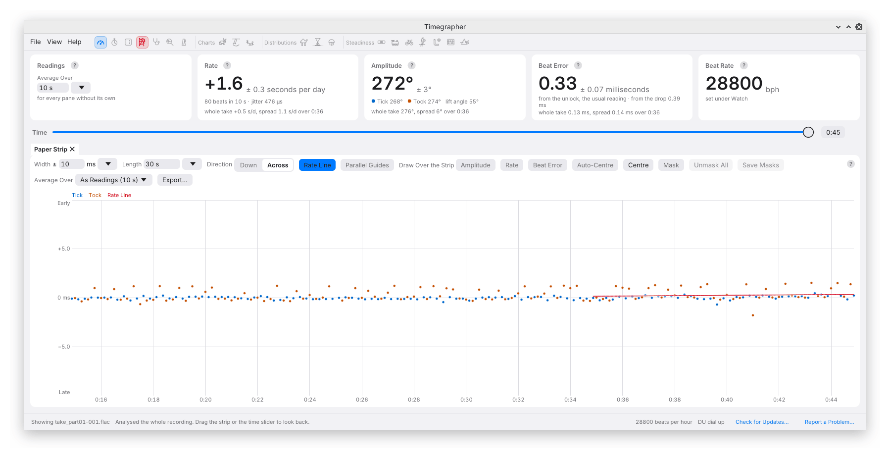

# 5. Readings

The cards across the top answer a specific question: what do the most
recent usable beats tell us? When you review a recording, “recent” means
the beats leading up to the selected time. Before comparing two figures,
check their time span, lift angle, position and clock reference.

## Average Over

**Average Over** sets the interval used for the readings. The default is
10 seconds. Choose a preset from 2 to 60 seconds, or enter a duration
from 1 second to an hour.

A longer interval makes a stable watch easier to measure precisely, but
also blends changes together. If the rate alternates between +2 and
+12 s/d, a long average may sit near +7 s/d even though neither state is
near +7. A short interval exposes the change at the cost of more scatter.
Keep the averaging time consistent when comparing positions or work done
before and after a service.

Early in a session, or after a break, the app uses the available beats
and shows their count and span. It does not fit across a pause, a known
position boundary or a gap of more than two seconds. Settling time after
a position change is excluded.

This setting also supplies the default interval for the ordinary charts,
Distributions (when their **Values** is **Readings**), Tick Tock Profile,
and the fitted line and overlays on the Paper Strip. A pane can use its
own interval through **Average Over** in its toolbar (for the charts, in
their tab bar); its tab then identifies that interval. Changing the setting
on the Readings card returns those panes to the shared value. Profiles
are limited to 60 seconds.

**Steadiness and Isochronism use their own fixed intervals.** Moving this
control does not smooth away a cycle in those analyses. See
[Which readings are analysed](09-steadiness.md#which-readings-are-analysed).

## Rate

The large figure is the rate in seconds per day on the input's sample
clock. Positive means gaining and negative means losing. It is fitted to
beat times with a separate Tick/Tock offset; it is not an average of
individual reciprocal beat intervals.

Below it are the beats used and the interval they cover (the actual
span, when it is shorter than Average Over), and **jitter**. Jitter is
how far individual beats land from the fitted line, in microseconds,
after the rate and the Tick/Tock offset have been fitted. Think of
it as the thickness of each strip line rather than the distance between
the two lines. Watch behaviour, noise, acoustic coupling and beat
extraction can all contribute. It is not a direct measurement of balance
poise or a fault score.

After a sufficiently long run has stopped, at the end of the take, the
cards can also show a **whole take** mean and spread for the current
position. This spread is the standard deviation of the chart readings;
it describes variation over the take, rather than uncertainty in the
current figure.

### True Clock

The sample clock determines how many recorded samples represent a second.
A small clock error produces a rate offset that no amount of averaging
will remove. One ppm is approximately 0.0864 s/d. In this app's convention,
a card **20 ppm slow** makes the uncorrected watch rate read about
**1.73 s/d fast**, so correcting it lowers the result by that amount.

To measure and keep the input's correction:

1. Check that the computer's system clock is synchronised to a reliable
   time service, normally NTP.
2. Listen for at least 20 minutes. The app compares captured audio time
   with system time; the watch's rate is not the reference.
3. When the fit's estimated scatter is below 0.5 ppm, the Rate card offers
   **Keep** beside the measured input-clock error. Capture delivery
   irregularities can make this take longer.
4. Click **Keep** to store the correction for that input.

The offer also comes back when an input already has a kept error but the
newly timed one is more than 2 ppm from it. The line then gives how far
apart the two are and the day the kept one was measured, because an input
reached by a shared name, such as the system default, may be another
sound card.

The card then adds **True Clock**, the corrected rate, with the day the
correction it uses was kept. The large figure
continues to use the sample clock. This lets you compare it with another
analysis that uses that same clock, provided the same recording interval
and settings are selected.

The name True Clock means *corrected using the available calibration*.
The 0.5 ppm criterion is precision of the fit, not proof of absolute
accuracy. A poorly synchronised system clock, changing input path or
sample-clock drift can compromise the correction. Recheck it when the
input configuration changes. A stored correction is a fixed offset;
a long recording's clock log can support a correction that follows drift.

In the current app, **Steadiness and Isochronism remain on the sample
clock**. Positions Test results can use the stored correction. The command
line can also apply a correction automatically or from a supplied log,
so compare the reported clock basis rather than assuming every screen
uses True Clock. See [clock](14-command-line.md#clock).

## Amplitude

The large amplitude is the median of the available short-window mean
amplitudes within the averaging interval. The app also shows the Tick and
Tock estimates and the lift angle used. Each side is inferred from its
acoustic lift time using the model in
[chapter 1](01-how-it-works.md#amplitude).

The two side readings are useful checks. The microphone and edge
selection can produce a persistent difference on their own; the profile
and Scope show what each side's marks stand on. The amplitude measured on the displayed
profile need not exactly equal the card: measuring an edge on a longer
combined profile and summarising measurements from short windows are
different operations.

Lift-angle error scales all amplitudes. At 260° with a 52° setting,
a one-degree change in lift angle changes the result by 5°. A tiny ±
does not make an assumed lift angle accurate.

## Beat Error

The usual large reading is the magnitude of the **unlock-based** beat
error. Beneath it, **from the drop** gives the magnitude based on the
beat reference near the dominant drop sound. If an unlock-based result
is unavailable, the large figure can fall back to the drop-based result;
the caption says **from the drop**. Read that caption before recording a
result for comparison.

The strip's line separation corresponds to the latter reference. It need
not equal the usual unlock-based value. The distinction and the
half-difference convention are explained in
[chapter 1](01-how-it-works.md#beat-error).

## What the ± Means

The ± figures estimate precision from changes between successive
short-window readings. Amplitude and unlock beat error use their short
windows; rate uses a history of 10-second fits, thinned to remove their
ordinary overlap and scaled to the selected averaging time. The live
rate history reaches back to a break or gap, up to five minutes.

This calculation deliberately reduces the contribution of slow drift.
It answers a narrower question than “how much did the watch vary?” A
small ± can coexist with a clear trend or a large periodic swing. It also
cannot separate the watch's short-term variation from measurement noise.

The estimate assumes a noise model. Neighbouring readings share some of
their behaviour, so the ± can look smaller than it should. It is neither a guaranteed bound nor a stated
95% confidence interval. Lift angle, clock calibration and systematic
edge-selection errors are outside it. The
[precision reference](../measurement-precision.md) gives the formula and
its assumptions.

An absent ± may mean there are too few readings. The app also omits very
small rate and beat-error estimates at its display thresholds; absence
must not be read as zero uncertainty.

## Beat Rate

With **Beat Rate** under Watch set to **Auto**, this card reports the
nearest standard rate found from the sound and says **found from the
beats**. A manual selection says **set under Watch**. Check it against the
movement, particularly with unusual beat rates or a poorly detected beat.
Changing it restarts the readings.

## What Limits a Reading

The cards name known limitations beside their titles. Hover over a note
for its explanation. Typical examples are:

| Note | What to check |
| --- | --- |
| **6 s of beats** | Fewer than 10 seconds of beats support the result; allow a longer stable interval |
| **540 of 600 expected beats found** | Fewer than 95% were found; inspect coupling, noise and gaps |
| **3% of beats clipped** | Clipping exceeds the 1% reporting threshold for the amplitude and beat-error caveat |
| **lift angle 52°, the default (calibre not set)** | Confirm the movement's lift angle before relying on amplitude |
| **21600 bph heard** | Compare the detected rate with the one selected under Watch |
| **2 pauses** | Check which uninterrupted stretches support the result |
| **8 s masked out** | Part of the averaging time was masked on the [Paper Strip](06-paper-strip.md#mask-and-unmask-all) and left out |
| **input clock not measured** | The rate can include sample-clock error; see [True Clock](#true-clock) |

These are observations about the measurement, not movement tolerances.
The clipping banner is more sensitive than the card caveat: it appears
when any beats in the reading contain clipped samples, including **under
1%**. Reduce the level and wait for those beats to leave the averaging
interval.

## No Regular Beat Found

Once there are at least 10 seconds of sound, if the timing scatter reaches
2% of the nominal beat interval, the app
withholds the readings and reports **No regular beat found**, together
with the scatter. At 28,800 bph, 2% is 2.5 ms. This is a detection
criterion, not an acceptable beat-error limit.

Check that the watch is running, that the input is correct, and that the
watch is coupled firmly enough for the beat to stand above the noise.
A moving peak meter proves that sound is arriving; it does not prove that
the sound contains a usable watch beat.

---

Previous: [The Window](04-the-window.md) ·
Next: [The Paper Strip](06-paper-strip.md)
