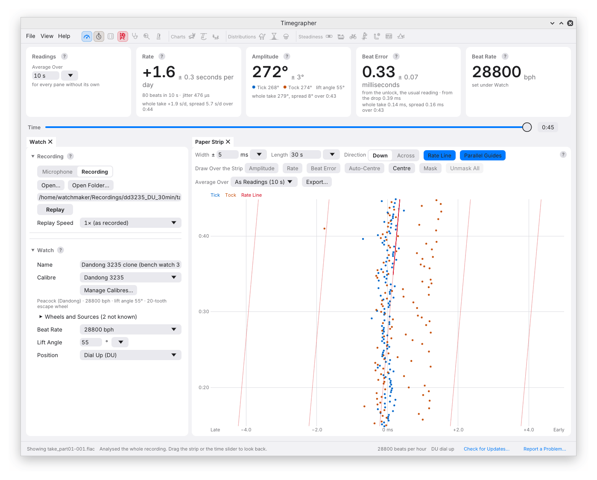
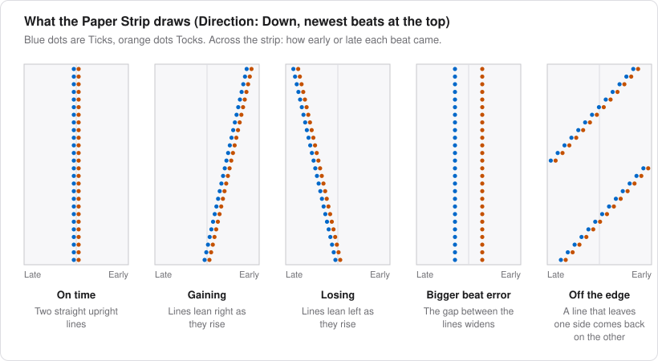
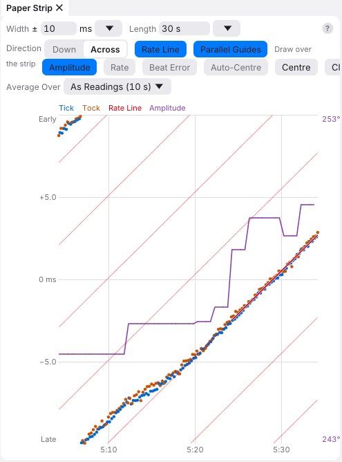

# 6. The Paper Strip

The Paper Strip gives you the closest view of the timing data: one dot
per detected beat. Its two dimensions answer “when in the recording?”
and “how early or late relative to the nominal beat sequence?” Once those
axes are clear, the slope, separation and thickness of the lines tell
different parts of the story.



## How to Read It

With **Direction: Down**, the newest beats are at the top and older beats
move down. Across the strip is timing displacement in milliseconds;
**early is to the right**. At 28,800 bph the reference sequence has one
beat every 125 ms.

A watch at nominal rate maintains a constant timing displacement, so its
trace is vertical. A gaining watch becomes progressively earlier: its
trace leans right as you follow it upwards towards newer beats. A losing
watch leans left. Compare the sideways displacement over a stated time,
not the visual angle alone, because changing either scale changes that
angle.



Tick and Tock are blue and orange. Their separation corresponds to the
alternating error of the detected beat reference, near the drop. This is
the card's **from the drop** value, which need not equal the usual
unlock-based beat error. A zero-error example has coincident reference
lines; separate colours do not require a nonzero gap.

Thickness within each line reflects timing scatter. A narrow trace can
be far from the correct rate; a thick one can average near zero. Curvature
indicates that the rate is changing, while an abrupt shift may reflect
handling, a tracking change or a real timing event. The pattern alone
does not choose among those causes.

When a line reaches an edge it wraps to the other side. That discontinuity
is a display wrap, not a beat that suddenly arrived a strip-width early.
Widen the view if wrapping obscures the pattern.

With **Direction: Across**, time runs left to right, newest beats are on
the right, and early is upwards. A gaining watch therefore rises to the
right.



### Relating a Slope to Rate

For small rate deviations, 1 ms of timing drift over 10 seconds corresponds
to approximately 8.64 s/d:

```text
rate magnitude ≈ 86.4 × timing drift in ms / elapsed seconds
```

Assign the sign from whether newer beats are earlier or later. This is a
useful visual check, not a replacement for the fit through many beats.
Auto-centring translates the picture without changing the relative drift.

## The Toolbar

### Width and Length

**Width** is the timing range on either side of the centre. It accepts
±0.1 ms to ±60 seconds, entered in milliseconds, with presets for common
views. The larger widths let a long run drift by seconds without repeated
wrapping. A narrow width reveals
small separations and bends; a wide width makes a fast or slow trace
wrap less often.

**Length** is the visible duration. Enter seconds or a duration such as
`5 min`, `2h` or `1:30:00`, or choose a preset. Choose width and length
together: a long trace at very narrow width may wrap so often that its
underlying pattern becomes hard to follow.

### Rate Line and Parallel Guides

**Rate Line** draws the fitted rate as a thin red line over the interval
used for that fit. Dots following the line support a roughly constant rate
over that interval. Dots bending away from it show structure that a
single rate number cannot describe.

**Parallel Guides** extends that slope across the strip as faint red
lines. Compare the trace with them to see local departures. Rate Line and
Parallel Guides switch on and off independently.

### Draw Over the Strip

You can overlay **Amplitude** in purple, **Rate** in red and **Beat Error**
in yellow. Each uses its own labelled scale and shares the strip's time
axis. Their heights are not measured on the strip's millisecond scale,
and their vertical positions should not be compared with each other as
though they had the same units.

An amplitude overlay is useful when a timing bend and an amplitude change
seem to occur together. Follow that observation into the separate charts
and profile before assigning a cause.

### Auto-Centre, Centre and Clear

**Auto-Centre** keeps the newest beats near the centre; dragging across
the trace turns it off. **Centre** centres the newest beats once.
**Clear**, available while listening, restarts the readings and strip.
Use it deliberately: it changes the displayed analysis history, whereas
Centre only moves the view. It is not the command for saving or starting
a separate recording.

### Average Over

**As Readings** uses the interval on the Readings card; choose another
interval for this pane if needed. This controls the fitted Rate Line and
reading overlays. The beat dots themselves remain individual beats.

## Using the Mouse

| Action | Result |
| --- | --- |
| Mouse wheel | Change visible duration |
| Ctrl + mouse wheel, or pinch | Change timing width |
| Drag along time | Review an earlier interval, including during capture |
| Drag across time's direction | Shift the timing trace |
| Double-click | Return to the newest beats and centre them |

Use Cmd on macOS. Hovering shows the recording time and marks the same
moment on the ordinary charts. To compare them directly, use **Across**
with **Match Strip** on the charts; see
[Over Time](08-over-time.md#match-strip).

## Positions on the Strip

Position changes divide the strip into labelled stretches with alternating
shading. Repeated position labels remain visible even when the ends of a
stretch are outside the window. Settling beats are faint because they are
excluded from the readings.

During a Positions Test, the strip also distinguishes settling,
measurement and unused test intervals. An unused interval may still
contain perfectly audible beats: the label explains which sound
contributed to the test result. See
[Positions](12-positions.md#what-the-strip-shows-during-a-test).

---

Previous: [Readings](05-readings.md) ·
Next: [The Sound of the Beat](07-sound-of-the-beat.md)
