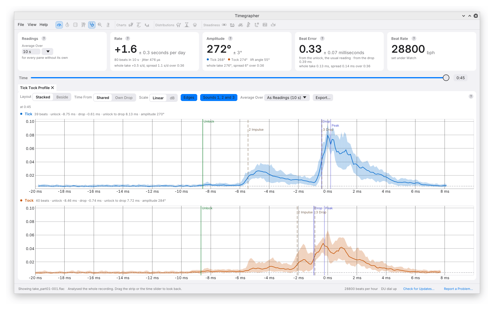
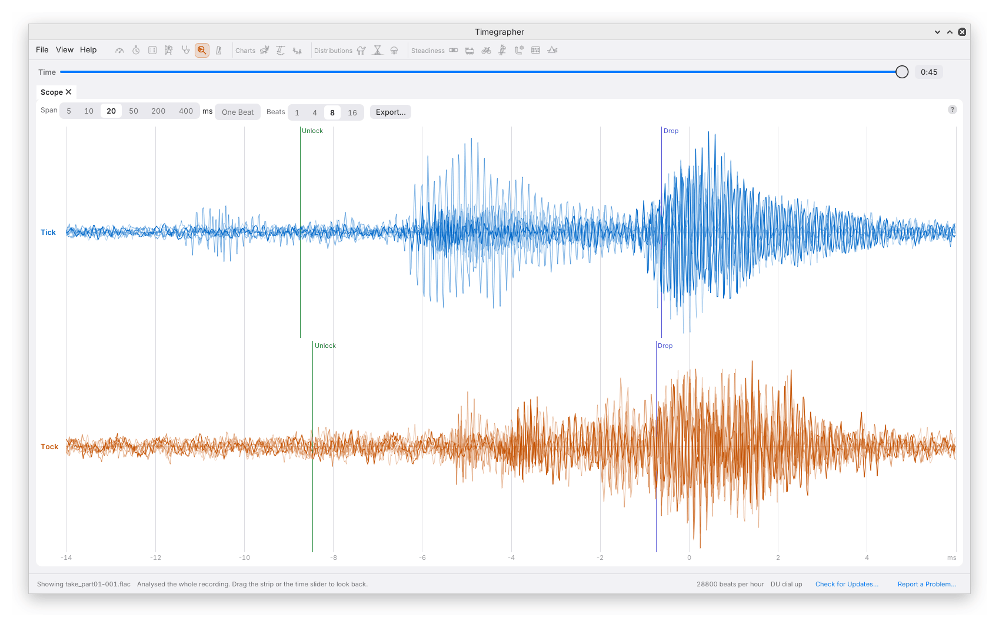

# 7. The Sound of the Beat

When an amplitude or beat-error reading surprises you, look at the sound
from which it was measured. **Tick Tock Profile** shows a representative
beat from each side. **Scope** shows individual filtered waveforms. The
profile makes the main features easier to see; the Scope reveals how
much individual beats differ.

These are acoustic views. Their vertical axes describe the recorded
signal, not the balance's angular motion or the force on a pallet stone.

## The Tick Tock Profile

Beats are aligned on their detected timing reference, near the dominant
drop sound, and combined separately for Tick and Tock. The trace is the
mean of the middle half of the envelope values at each time point: a
trimmed mean that reduces the influence of unusually loud or quiet beats.
The shaded band extends from the 10th to the 90th percentile at each
point. It shows beat-to-beat variation, not a confidence band for the
line or a range of balance amplitudes.

The horizontal axis is milliseconds within a beat. The vertical axis is
the signal envelope, a smoothed measure of its size. This is why the
profile looks like a series of humps while the Scope shows rapid positive
and negative oscillations.

Both sides share a vertical reference. A quieter Tock remains visibly
quieter than the Tick. Use the difference to assess coupling and sound
shape; loudness alone is not a measure of how much energy that side
imparts to the balance.

### The Marks

The solid markers show the edge detector's estimates:

| Marker | Meaning |
| --- | --- |
| **Unlock** | Estimated onset of the first sound group |
| **Drop** | Estimated onset of the dominant drop group |
| **Peak** | Peak of that group (named Drop Peak when you rest the pointer on it) |

The unlock-to-drop interval supplies the amplitude estimate. Unlock
timing, combined with the alternating beat timing, supplies the usual
beat-error estimate. These edges are estimates on a combined acoustic
profile, not directly observed positions of the escapement parts.

The dashed **1 Unlock**, **2 Impulse** and **3 Drop** markers belong to a
separate description of sound shape. They mark halfway up each sound
group's rise. They therefore need not coincide with the solid onset
markers. If a sound cannot be separated from its neighbour, its marker
may be absent. The horizontal dashed line is the estimated noise floor.

The mechanical meaning of these sound groups, including the impulse
face of the pallet stone, is explained in
[How a Timegrapher Hears a Watch](01-how-it-works.md#the-three-sounds-of-a-beat).

### Reading the Figures

At 28,800 bph with a 55° lift angle, a summary above a profile might
read:

> Tick 40 beats · unlock -9.09 ms · drop -0.61 ms · unlock to drop
> 8.48 ms · amplitude 259°

The negative times are offsets before the detected beat reference. The
reference is close to the drop; it is not constrained to coincide with
the subsequently measured Drop edge. Subtracting the two offsets gives
8.48 ms, and the lift-time formula gives the profile's amplitude.

The card summarises amplitudes measured in short windows. The profile
measures edges on the combined waveform for its selected interval. Those
operations need not give exactly the same amplitude, especially if the
shape changes within the interval. A persistent large disagreement is a
reason to inspect shorter intervals and individual beats.

### The Toolbar

- **Layout: Stacked / Beside** places Tick above Tock or alongside it.
- **Time From: Shared / Own Drop** changes their horizontal alignment.
  Shared offsets the two sides by half the signed beat-reference error
  in opposite directions. Own Drop aligns their individual detected beat
  references at zero, making shape comparisons easier. Despite the name,
  the measured solid Drop edges can sit slightly away from zero. The
  summary's numerical offsets remain relative to each side's own
  reference in either mode.
- **Scale: Linear / dB** changes the vertical scale. dB expands the quiet
  detail, especially the unlock. It uses a common reference derived from
  both profiles' upper envelope bands, not dBFS and not a separate
  normalisation of each side to 0 dB.
- **Edges** and **Sounds 1, 2 and 3** show or hide the two sets of markers.
- **Average Over** follows the Readings card unless a separate interval
  is selected. The profile uses at most 60 seconds.

Changing these display settings does not alter the captured sound.

### Looking Back

Scrubbing a live-captured session shows the stored profile nearest before
the selected moment; profiles are retained at two-second intervals. For
a recording opened with **Analyse All**, the profile is calculated from
the file when you settle on a moment. This is particularly useful for
comparing the sound just before and just after a step in amplitude.

### A Practical Check for an Amplitude Jump

Suppose Tick amplitude jumps upward while Tock amplitude barely changes.
First shorten the ordinary chart's averaging interval and locate the
change. Compare the profiles on either side of it. Has the Tick's Unlock
marker moved from a small early feature to a larger later one? That
shortens the measured lift time and raises inferred amplitude even if
the balance's motion has not changed by that amount.

Next use the Scope with several beats overlaid. Look for a repeated early
sound, a changing noise floor, clipping or a disturbance. If adjusting
coupling or gain makes the apparent jump disappear on a repeat recording,
that is evidence about the measurement. If the same change persists with
clear, repeatable markers, that is consistent with a change in the watch
rather than the measurement. The
profile helps you decide which question to ask next; it cannot identify
a defective part by itself.

## The Scope

The Scope displays individual waveforms, high-pass filtered at 1 kHz to
reduce low-frequency rumble. It is not the unfiltered saved audio and is
not the smoothed envelope used in the profile. It starts as a tab beside
Tick Tock Profile.

**Span** controls the time shown around the detected beat reference:

| Span | Interval shown |
| --- | --- |
| **5 ms** | 3.5 ms before to 1.5 ms after; a close view of the drop group |
| **10 ms** | 8 ms before to 2 ms after |
| **20 ms** | 14 ms before to 6 ms after; usually the useful starting view of a complete sound group |
| **50 ms** | 15 ms before to 35 ms after; includes more ringing after the beat |
| **200 ms** | 20 ms before to 180 ms after; may include the following beat, depending on beat rate |
| **400 ms** | A continuous grey row containing several beats; how many depends on beat rate |
| **One Beat** | A separate button: from 15 ms before one reference to 15 ms before the next |

At every span except 400 ms, Tick and Tock occupy separate rows; from 5
to 50 ms the profile's Unlock and Drop markers are shown for reference. Those markers still come from the
combined profile; they are not new edge measurements on every waveform.

**Beats** overlays the latest 1, 4, 8 or 16 beats, with older ones fainter.
One shows a particular event; several reveal repeatability. A broad band
of traces may reflect varying timing, signal level or shape. Zooming out
to a longer span helps separate ringing after one beat from another event.

While listening, the Scope follows the latest beats. When reviewing a
session it reads the beats up to the selected time from the recording.
The command-line [profile](14-command-line.md#profile) and
[shape](14-command-line.md#shape) commands provide saved plots and numerical
sound-shape measurements for closer comparison.

---

Previous: [The Paper Strip](06-paper-strip.md) ·
Next: [Over Time](08-over-time.md)
