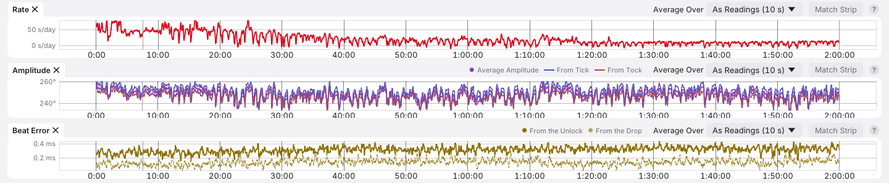
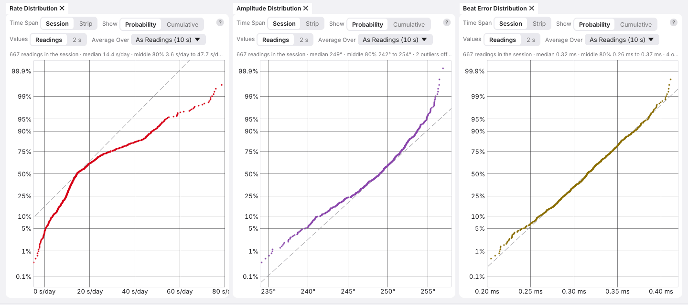

# 8. Over Time

The reading cards say what the watch is doing now. The panes in this
chapter say what it has done over the whole session: how each reading
moved, how its values spread, and whether the changes have a structure,
such as a cycle that repeats with the turn of a wheel.

The screenshots in this chapter come from a two-hour recording of one
watch lying dial up, opened as a folder and analysed all at once (see
[Sessions and Recordings](11-sessions-and-recordings.md)).

## The Charts

Three charts, **Rate**, **Amplitude** and **Beat Error**, draw each reading
against time. Each point is a reading over the averaging time.

- Each reading keeps its colour across the app: **rate red, amplitude
  purple, beat error yellow**. A second line of the same reading is told
  apart by its dashes: the amplitude from the Ticks dashes purple over
  blue and from the Tocks purple over orange, and the beat error from the
  drop is a fainter dashed yellow. A chart with more than one line has its
  key at the right of its tab bar.
- The beat error is charted as a size, as on its card.
- The vertical scale runs from the 2nd to the 98th percentile of the
  values, kept within reach of the median, so neither one glitch nor a few
  seconds of knocking flattens the lines.

### Moving Around

| Action | Does |
| --- | --- |
| Mouse wheel | Zooms time around the pointer |
| Ctrl and the mouse wheel | Zooms the vertical scale |
| Drag | Pans |
| Double-click | Fits the whole session again and, while listening, follows new beats |
| Click a moment | Shows that moment on the Paper Strip and in the readings |

The three charts' time axes move together. Once a chart has been panned or
zoomed, a **Follow Live** button (**Show Whole Session** for a recording)
appears on it and does the same as a double-click. With the pointer
anywhere over a chart, a vertical line marks that moment and a box lists
every line's value there.

### Match Strip

**Match Strip**, in each chart's tab bar, shows the same stretch of time
as the Paper Strip and moves with it. With the Paper Strip lying across
and the charts under it, every time axis then lines up, and the pointer's
moment is marked on all of them. In that mode the strip sets the time, so
only the vertical scale can be dragged or zoomed. With Match Strip off,
the charts show the whole session.

### Average Over

**As Readings** unless you pick a time of its own for the chart. Changing
the averaging time, or the lift angle, works every point out again, back
to the start of the session.

## Distributions

An average gives one number. The Distributions show how a reading's values
spread around it, which can show whether the watch keeps to one state or
moves between two, such as a high and a low amplitude. They are hidden at
first: turn them on with their icons, under **Distributions** at the top,
or in the View menu.

Each has its own toolbar:

- **Time Span**: **Session** covers everything since the session started;
  **Strip** covers the Paper Strip's length.
- **Show**:
  - **Probability** (the default) is a normal probability plot, the
    probability paper of flood-frequency analysis. Each value is plotted
    against its rank, on a vertical scale spaced in standard deviations and
    labelled in percent (Hazen plotting positions). Values from one steady
    state, scattered about one mean, fall along the dashed straight line,
    drawn through the median with a slope from the middle half of the
    values. Two states draw two straighter stretches joined by a bend, or
    an S across the line; a gap between two clusters shows as a flat step.
    The ends curling away from the line are a few unusual readings.
  - **Cumulative** draws the share of values at or below each value on a
    plain scale: one state rises in one steep stretch, two states rise
    twice with a flatter stretch between.
- **Values** (amplitude and beat error): **Readings** counts each reading,
  averaged over Average Over, as the charts are; **2 s** counts each 2
  seconds of beats, the finest the engine measures, which catches quicker
  changes with more scatter. The rate always counts readings.

The scale leaves out the most extreme 0.5% at each end, so a few stray
readings can't squeeze the rest together. The line above the plot gives
the count, the median, the middle 80%, the outliers left off and the
peaks, when there is more than one.

Neither plot keeps the time order, so a slow swing between two states
shows only as a bend. The strip and the charts show **when** it happens.

## Steadiness

The Steadiness views test how the rate, the amplitude and the beat error
(from the unlock) each change over the session: cycles, steps, trends,
and how each reading relates to the one before. They are the same tests
as `timegrapher series` on the command line.

They need about 5 minutes of beats in one position, and say more the
longer the session: a cycle has to come round several times to count.
They run over the whole session in the background, again every minute
while it grows. For a recording, they cover what has been replayed, or all
of it once it is opened. Rates are on the sound card's clock.

Each view is a pane of its own, with its icon under **Steadiness** at the
top, so two can sit side by side. At first they are tabs beside the Tick
Tock Profile, with only **Readings Over Time** shown. **Rate**,
**Amplitude** and **Beat Error**, in each view's toolbar, choose which
series it shows.

### What the Tests Say

Each series gets a sentence saying what the tests found, with no verdict
word or colour: a cycle (named after the wheel whose turn it matches; the
fourth wheel of most watches turns once a minute), two levels the readings
switch between, a level that steps and stays, a slow trend, correlation
between readings, or none of these. Under it are the statistics: the
number of readings, median, standard deviation, the scatter from one
reading to the next, the lag-1 correlation and Ljung–Box p-value, and the
trend and period when found.

For example, on the two-hour recording the Rate's sentence reads:

> Rate repeats every 60 s (the fourth wheel), 11.7 s/d peak to peak. Its
> level also moves over the take, between +8.4 s/d and +49.7 s/d.

That is a statement of what was measured. Whether a cycle of that size
matters for this watch is for you, or the
[watchmaker skill](../../skills/watchmaker/SKILL.md), to judge.

The wheel names come from the calibre. With a calibre picked under Watch,
cycles are named after its own wheels (see
[Calibres and Lift Angles](09-calibres.md)); with **Not Set**, after the
wheels most calibres at that beat rate share.

### The Views

- **Readings Over Time**: every reading in time order (10-second rate
  readings, 2-second amplitude and beat error readings), with the
  stretches of constant level the change finder found and, for two
  states, the two levels dashed.
- **Periods**: how strongly the readings repeat at each period, on a
  logarithmic axis, with the 1% false-alarm line dashed, the escape,
  fourth and centre wheels' periods marked, and the strongest component
  labelled. **Log Scale** draws the scores on a log scale, so a small peak
  beside a tall one still shows.

- **Cycle**: the readings folded at the cycle the tests found: every cycle
  as dots and the median shape as a line.
- **Autocorrelation**: how much a reading resembles the one a lag later,
  with the band independent readings stay inside dashed, the repeat
  marked, and the Ljung–Box p-value.
- **Allan Deviation**: the scatter of averages against the averaging time,
  on logarithmic axes, against the dashed line independent readings
  follow. The lowest point is the averaging time that gives the most
  repeatable reading.
- **CUSUM**: the running sum of distances from the mean, which stays
  inside the dashed lines unless the level changes; the largest excursion
  is labelled.
- **FFT**: the plain amplitude spectrum of each series, like Witschi's
  FFT: the size of the sine wave at each period, in the series' own units.
  The rate's is the swing, peak to peak, it makes in 10-second rate
  readings, in s/d. **Timing** draws the rate as the beat timing's own
  spectrum, in milliseconds, instead.

In Periods and FFT each wheel's period is a bold line, and half of it
(twice a turn) a fainter dashed line marked ×2. The plots don't pan, zoom
or show values under the pointer.

## Isochronism

The Isochronism pane, a tab beside the Steadiness views, shows how the
rate changes with the amplitude as the mainspring lets down:

- **The curve**: the rate in each 2° band of amplitude (the median as a
  dot, with a bar over the middle half of the readings), the curve through
  them, and an upright line where it turns, if it does. It needs the
  amplitude to fall through at least three 2° bands with 10 readings in
  each, which a session of some hours from full wind gives.
- **Full Wind Against 24 Hours Later**: the first half hour of the session
  against the half hour 24 hours later in one position (or the session's
  last half hour, if it is shorter): rate, amplitude and beat error, and
  how much each changed. It needs at least 2 hours.

Until there are 5 minutes of beats in one position, the Steadiness and
Isochronism panes say so. During a Positions Test they say that the test
never stays that long in one position.

## Over Days: the Command Line

For runs of many hours or days, `timegrapher long` analyses a recording in
bounded memory, calibrates the sound card against internet time, and writes
an HTML report with rate and amplitude over time and the periodic changes
it found, named after the wheels they match. See
[The Command Line](12-command-line.md#long) and [Long runs](../long-runs.md).

---

Previous: [The Sound of the Beat](07-sound-of-the-beat.md) ·
Next: [Calibres and Lift Angles](09-calibres.md)
