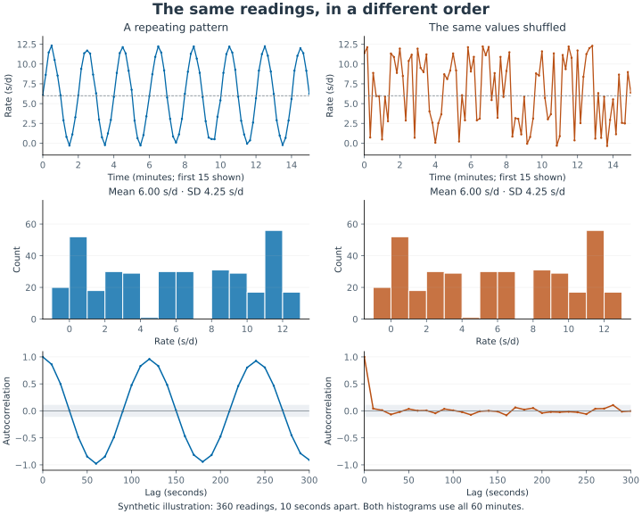
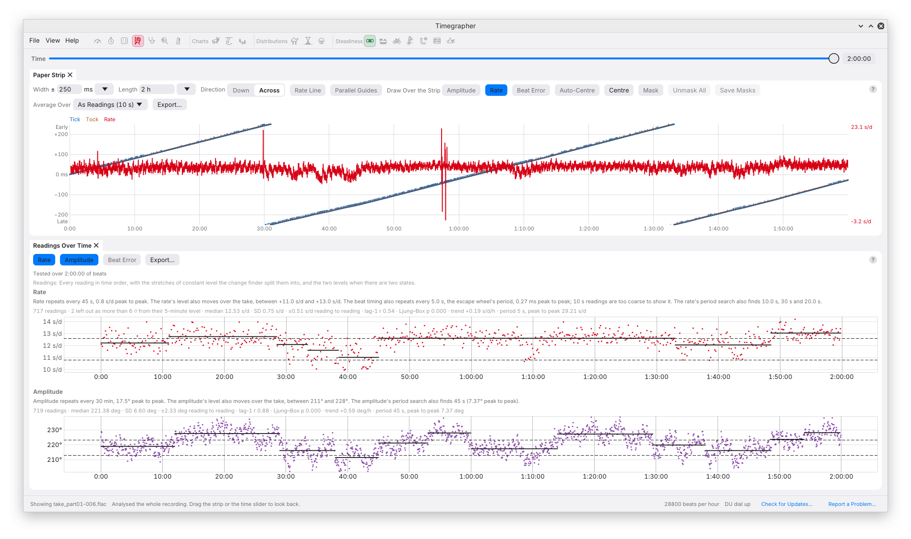
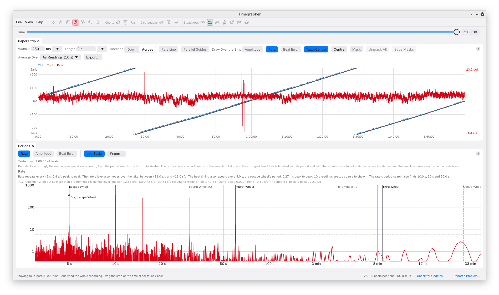
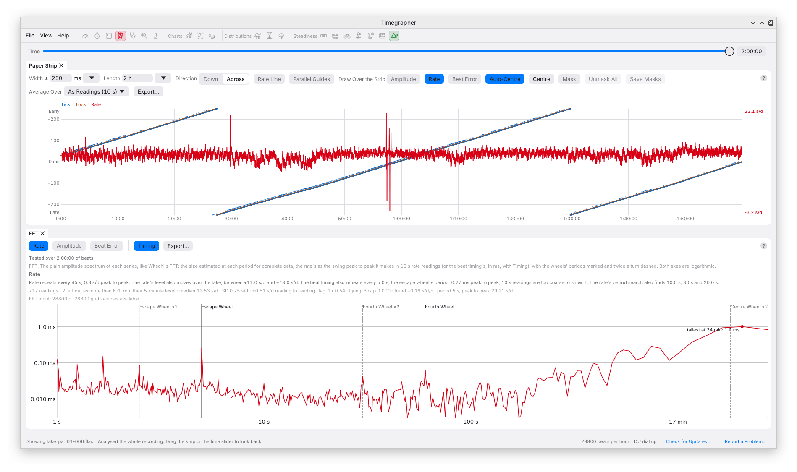

# 9. Steadiness: Reading the Structure in a Recording

Suppose a watch averages +6 s/d. That could describe a nearly constant
+6, a smooth oscillation between 0 and +12, or a take that spent half its
time at each level. The mean alone cannot distinguish them. Steadiness
examines the order of the readings to help you make that distinction.

Open the panes under **View → Steadiness**, or use their toolbar icons.
Each pane has **Rate**, **Amplitude** and **Beat Error** switches; show one
series for a larger plot or several to compare patterns. The seven panes
can be arranged side by side.

Go to [Readings Over Time](#readings-over-time), [Periods](#periods),
[Cycle](#cycle), [Autocorrelation](#autocorrelation),
[Allan Deviation](#allan-deviation), [CUSUM](#cusum) or [FFT](#fft).



In this synthetic example, the right-hand series contains exactly the
same values as the left, rearranged. Their histograms, means and SDs are
identical. Only the original order retains the two-minute pattern. The
panes below examine that information about time which a distribution
leaves out.

## Prepare a Recording That Can Answer the Question

Use one position, stable microphone contact and enough time for the
suspected behaviour to repeat. Five minutes unlocks the analysis; it does
not make every period measurable. A one-minute pattern has only five
cycles in that take. A ten-minute pattern needs a much longer recording.
For a suspected minute-scale pattern, half an hour is a useful first
experiment, followed by a repeat recording if the pattern matters.

Set the calibre and check its wheel periods in **Wheels and Sources**.
Leave the watch and stand untouched. Note winding state and anything that
could change during the run, such as temperature or an engaged chronograph.
Save the audio so that a suspicious interval can be examined again.

The app starts the background analysis at about five minutes of eligible
data and reruns it for each additional minute. While a new calculation
runs, the previous result remains visible. Read **Tested over…** to see
how much data the displayed result covers. For **Analyse All**, the input
is the full recording; during Replay it is the portion replayed so far.

## Which Readings Are Analysed?

Steadiness does not use the current chart zoom, the strip's visible
interval, or the Readings card's **Average Over**. Its inputs are:

| View or calculation | Input in the desktop app |
| --- | --- |
| Headline statistics, Autocorrelation, Allan Deviation and CUSUM | Non-overlapping 10-second readings for all three quantities; amplitude and unlock beat error are averaged from their short windows |
| Readings Over Time | 10-second rate fits; 2-second amplitude and unlock beat-error windows |
| Cycle | 10-second rate readings; 2-second amplitude and unlock beat-error windows |
| Periods and FFT | Beat-timing residuals for the rate-related search; short-window amplitude and unlock beat error for the other series |

No reading is averaged over part of its span. A 10-second amplitude or
beat-error reading needs every 2-second window it spans, and a rate
reading needs beats in each 2-second piece and must not reach into a
pause or a masked stretch from either side. A reading at such an edge,
or with a window missing, is left out, so expect a few fewer readings
beside each pause and mask.

This explains why the amplitude dots can look noisier than the statistics
above them suggest. The plot and the statistical summary deliberately use
different time resolutions.

**Beat error here retains its sign.** The ordinary cards and charts show
its magnitude. A signed value crossing zero is not a negative amount of
mechanical error; it says the relative timing of the software's two sides
has reversed. Do not attach an entry/exit pallet identity to the sign,
or compare signs across unrelated acquisitions without checking the
side assignment.

When a session includes position changes, the app analyses only the
currently selected position, excluding settling. Separate visits to that
position are joined with short five-second separators; readings do not
fit across the joins. The resulting analysis time is a constructed
sequence, not uninterrupted wall-clock time. Pauses, handling and joins
can still affect the statistics and spectrum. Use a continuous recording
for questions about long-term drift, cycle coherence or run-down.

These panes use the **sample clock**, even when the Rate card also shows
True Clock. The command-line `series` command uses the same analysis
methods, but its clock correction and input selection may differ.

## Read the Headline and Its Statistics Together

The headline summarises detected structure: two levels, a repeating
cycle, sustained level changes, a trend or correlation. It may describe
more than one. None of those descriptions is a service verdict.

The small statistics line gives the number of readings, median, **SD**,
**reading-to-reading** scatter, lag-one correlation, Ljung–Box p-value and
any trend or period. Hover over truncated text to read it in full.

**SD** measures spread around the whole-series mean. Reading-to-reading
scatter measures adjacent differences:

```text
short-term scatter = sqrt(mean((x[i+1] − x[i])²) / 2)
```

For independent observations with a constant level, the two scales should
be broadly comparable. If the level drifts slowly, neighbours remain
close while the whole series spreads widely, so SD can be much larger.
The ± printed before “reading to reading” is this scatter, not the
standard error printed on a reading card.

The tests can exclude isolated readings more than six robust standard
deviations from a five-minute local level. The count is reported. If more than 3% would
be excluded, none are excluded by that rule. The display is not proof that
all disturbances have been removed, and the Readings plot can still show
points that are not used in a particular statistical summary.

## Readings Over Time



This is the first pane to inspect. Horizontal position is analysis time;
vertical position is the reading in s/d, degrees or milliseconds. The
points show the data, and solid level segments show the change-point
model. Dashed horizontal levels appear when the two-state analysis finds
two clusters.

The level finder works on 30-second block medians and looks for sustained
segments of at least five minutes. It does not label every short jump.
Nor does a staircase of fitted levels prove that the physical process
changed in steps: a smooth drift can be approximated by several levels.
Check the points and the ordinary charts.

For a take that seems to switch between two amplitudes, compare the
Tick and Tock traces on the ordinary Amplitude chart. A switch confined
to one side, accompanied by a jump in the Unlock marker, raises a
measurement question before it establishes a change in balance motion.

## Periods



**Periods** asks which repeating patterns stand out against the surrounding
spectral background. The horizontal axis is period in seconds on a
logarithmic scale: moving right means a slower repetition. The vertical
axis is a dimensionless search score, not s/d, degrees, or the amount of
a fault. **Log Scale** changes how that score is drawn; it does not change
the search or its threshold.

The search removes a slow trend, estimates the local spectral background,
and scores a candidate together with possible harmonics. Summing harmonics
helps detect a repeated short disturbance whose shape is not sinusoidal.
The dashed threshold corresponds to a nominal **1% whole-search
false-alarm model** after allowing for the periods and harmonic combinations
searched.

Crossing that line means the candidate is strong under the search's
reference model. It does not mean there is a 99% probability that a wheel
is faulty, or even a universally calibrated 99% probability of a real
cycle. Correlated noise, gaps and changing behaviour can affect that
model. The engine also checks how much variation the folded component
explains. See the [period-search assumptions](../measurement-precision.md#period-search-reference-model)
for the exact distinction between the plotted score and the
trial-adjusted significance.

A high score can accompany a small, repeatable effect. Use **FFT** or the
reported peak-to-peak size to judge magnitude, then **Cycle** and the time
chart to inspect its consistency.

### Wheel Labels and Harmonics

A bold vertical line marks a catalogue wheel period. Its fainter **×2**
line marks half that period: twice per revolution, hence twice the
frequency. A 60-second fundamental can also produce components at 30,
20 and 15 seconds if its waveform contains harmonics. Several peaks need
not mean several defective wheels.

With a selected calibre, the labels use its train data and your additions.
Without one, the app uses common possibilities, including both 15- and
20-tooth escape wheels. For a conventional Swiss lever escapement, the
escape wheel advances one tooth per complete balance oscillation:

```text
escape-wheel period = teeth × 7200 / bph seconds
```

At 28,800 bph, 15 teeth give 3.75 seconds and 20 teeth give 5 seconds.
A conventional seconds-carrying fourth wheel turns in 60 seconds, but
you should verify the actual movement rather than infer its construction
from the name of the hand it drives.

A match is a **period association**. It can focus an inspection, but it
cannot tell whether the cause is a damaged tooth, eccentricity, changing
load, a harmonic of another process, or a recording artefact. Preserve
that distinction when making bench notes: “60 s component, consistent
with the listed fourth-wheel period” states what was established.

### Resolution and Duration

Longer recordings help distinguish neighbouring periods. A useful nominal
scale is `P² / T`, where `P` is the period and `T` the recording length.
For a 60-second pattern in 30 minutes this is about two seconds. It is a
frequency-resolution scale, not a confidence interval for the fitted
period. Reported decimal places do not by themselves establish accuracy.

Sampling and averaging also limit the shortest useful period. A series
sampled every 10 seconds cannot uniquely represent frequencies above one
cycle per 20 seconds, and averaging attenuates fast variation even before
that limit. This is why the rate-related period search uses beat timing,
and why the amplitude and beat-error cycle analysis retains 2-second
windows. The engine imposes further sampling and cycle-count requirements;
the range plotted is not the range every series can resolve equally well.

## Cycle

Cycle makes a proposed repetition visible. For a period `P`, it groups
each reading by its position within a cycle:

```text
phase time = elapsed time modulo P
```

If `P` is 60 seconds, readings at 12, 72 and 132 seconds land near the same
horizontal coordinate. The dots show the individual cycles' binned
values; the line is their median shape. The x-axis runs through one
cycle in seconds and the y-axis retains the series' units. The phase
origin is a recording reference, not a known angular position of a tooth.

Read the label at the bottom of the plot. The app first tries a cycle
found in that series, then one found in another series, and finally a
known wheel period that fits the data. **Folded at the rate's… cycle** or
**Folded at the fourth wheel's… turn** is an exploratory comparison. The
existence of the plot does not establish that the selected quantity has
an independently detected cycle.

A narrow, repeatable shape supports a coherent pattern. A flat line with
widely scattered dots gives little support for that period in this
quantity. A broad or blurred shape can mean a wandering period, changing
level, poor signal, or a period that is slightly wrong. Inspect separate
parts of the recording before interpreting the folded shape as an
unchanging mechanical signature.

The period chosen by the headline and the strongest Periods peak can
differ. Candidate cycles come from several tests and are compared by how
well their folded shapes explain variation. Those tests share the same
data; agreement among them is useful consistency, not independent
experimental replication.

## Autocorrelation

Autocorrelation compares a series with a delayed copy of itself. The
horizontal axis is the delay, or **lag**, in seconds. The vertical axis
is the estimated correlation `r`. At zero lag a varying series correlates
with itself at 1. Positive values mean high readings tend to accompany
high delayed readings; negative values mean highs tend to accompany lows.

Three patterns are useful:

- A quick fall towards zero suggests little persistence beyond the
  shortest lags examined.
- A slow positive decay suggests memory, which may come from wander or
  drift as well as the measurement process.
- Alternating troughs and peaks suggest repetition. A simple 60-second
  sinusoid tends to be negatively correlated around 30 seconds and
  positively correlated again near 60 seconds.

The dashed band is approximately `±1.96/√n`, using the finite reading
count. It is a pointwise reference for independent readings, not a
simultaneous guarantee that every lag lies inside it. Looking at many
lags creates opportunities for chance crossings; gaps and nonstationary
behaviour complicate the reference further.

The **Ljung–Box p-value** combines the first ten lags when available. A
small p-value is evidence against the reference of uncorrelated readings
at those lags. It is not a probability that the watch needs servicing.
Consider the size and shape of `r`, the recording length and the time
chart as well. A long recording can make a small correlation statistically
conspicuous without making it mechanically important.

## Allan Deviation

Allan Deviation asks a practical question: **how much do adjacent averages
differ when I average for longer?** Its x-axis is averaging time `τ`; its
y-axis is scatter in the selected quantity's units. Both axes are
logarithmic. The rate is shown in s/d, not fractional frequency; amplitude
and beat error use the same calculation in degrees and milliseconds.

For adjacent averages `x̄₁` and `x̄₂` of duration `τ`, the calculation is:

```text
Allan deviation(τ) = sqrt(mean((x̄₂ − x̄₁)²) / 2)
```

The app uses overlapping placements of those adjacent blocks, at 10, 20,
40, 80 seconds and successive doublings. A block's average needs every
reading in it, so a block that takes in a pause, a mask or a missing
reading is left out. Longer averaging times have
fewer effectively distinct comparisons, so the far right of a short
recording deserves less weight.

The dashed line starts at the shortest measured averaging time and falls
as `1/√τ`. That is the reference behaviour for independent reading noise:
four times as much averaging gives half the scatter. It is not a
manufacturer's tolerance line. A curve that flattens or rises indicates
that averaging longer is no longer removing the variation in the same
way. Drift and cycles can both do this. A cycle of period *P* puts a
bump in the curve, highest near 0.37 *P*: an 8-minute cycle peaks near
180 seconds.

The annotated minimum is the lowest sampled deviation among points with
enough comparisons. Use it as a guide to repeatability **for this
recording**, not as a universal optimum. An average spanning a whole
cycle can appear especially repeatable because it cancels that cycle,
even though the shorter-term variation is substantial. Returning to the
time chart prevents that useful numerical result from becoming a
misleading description of the watch.

The mathematical convention is described in NIST's
[Handbook of Frequency Stability Analysis, §5.2.4](https://nvlpubs.nist.gov/nistpubs/Legacy/SP/nistspecialpublication1065.pdf).
The details above, including missing-data handling and the minimum
annotation, describe this app's implementation.

## CUSUM

CUSUM is a cumulative sum of departures from the series' mean. Each
above-average reading adds to the curve and each below-average reading
subtracts from it. Horizontal position is time; vertical position is a
normalised cumulative value, **not accumulated seconds gained by the
watch**.

The app calculates:

```text
C[k] = sum(x[i] − mean(x), i ≤ k) / (s_short × sqrt(n))
```

Here `s_short` is the reading-to-reading scatter and `n` is the number of
finite readings. Because the departures are measured from the same
whole-series mean, the curve returns to zero at the end.
That return does not mean the watch recovered its original rate.

Suppose the first half of a take is at +2 s/d and the second at +12 s/d.
The mean is near +7. CUSUM slopes downward during the first half and upward
during the second, making a V whose corner is near the change. Reversing
the order makes a tent. Smooth drift makes a broad curve rather than a
sharp corner, and a cycle can create repeated bends.

The dashed ±1.36 lines are an approximate 95% reference under the
independent, constant-level model. Crossing them indicates a departure
from that model; correlation can also cause crossings. The label near
the largest excursion is a useful place to investigate, not an exact
mechanical event time. Check the ordinary chart, strip and profile there.

## FFT



FFT shows the **size** of spectral components, whereas Periods shows how
strongly they stand out against a model of the spectral background. Both
axes in FFT are logarithmic, with period increasing to the right.

Read the units carefully; the current display uses different size
conventions:

| Series and mode | Vertical value |
| --- | --- |
| **Rate**, Timing off | Estimated **peak-to-peak** swing in 10-second rate readings, s/d; only periods of at least 20 seconds are shown |
| **Rate**, **Timing** on | Sine-wave amplitude of beat-timing variation, ms: **half** its peak-to-peak excursion |
| **Amplitude** | Sine-wave amplitude of the amplitude variation, degrees: **half** peak to peak |
| **Beat Error** | Sine-wave amplitude of the signed unlock-error variation, ms: **half** peak to peak |

Thus an amplitude-spectrum peak of 3° represents an approximately 6°
peak-to-peak sinusoidal component. That is variation of balance amplitude;
it is not the balance amplitude itself. A non-sinusoidal pattern spreads
its variation across several harmonics, so its full excursion is not
necessarily twice the tallest single peak.

For rate, timing displacement and rate variation are related by a time
derivative. If timing varies sinusoidally with amplitude `a` milliseconds
and period `P` seconds, the app's displayed rate swing uses:

```text
rate peak to peak = 2 × (2πa/P) × 86.4 × |sin(πW/P)/(πW/P)|
W = 10 seconds
```

The last factor models attenuation by averaging. This is a conversion of
the timing spectrum, not a direct FFT of the displayed card readings.
With **Timing** on, faster timing components become visible without that
conversion; it is the useful mode for escape-wheel-scale patterns that
10-second rate readings would suppress.

The spectrum is detrended and uses a Hann window to reduce leakage from
strong components. Its amplitude scaling assumes complete regular input.
The line **FFT input: … grid samples available** reports the actual
support. Missing grid values are filled at the centred mean, and the
normalisation is **not corrected for gaps**. Gaps can reduce peak heights
and alter their shapes. Do not infer that one take has less mechanical
variation merely because its incomplete spectrum is lower.

That support count is a count of analysis-grid samples, not the percentage
of watch beats detected. The [spectrum reference](../series.md) and
[measurement-precision notes](../measurement-precision.md#existing-period-and-spectrum-probes)
explain the distinction.

## Working Through a Suspected One-Minute Pattern

Imagine the Rate chart rises and falls about once a minute. These are
illustrative steps, not a diagnosis of the watches in the screenshots.

1. Check the strip for a matching gradual bend, and the profile for
   stable sound extraction. Check clipping, gaps and handling first.
2. Read Periods for a component near 60 seconds. Compare it with the
   selected calibre's listed wheel period and its harmonics.
3. Read FFT for its magnitude, recording whether it is s/d peak to peak
   or timing amplitude in ms.
4. Inspect Cycle to see whether successive repetitions follow a similar
   shape. Read whether the period was found in that series or borrowed.
5. Compare amplitude and beat error. A shared period is useful evidence
   of related behaviour, but shared sound extraction can also link them.
6. Repeat in the same position and then, as a separate experiment, in
   another position. Compare like clock references, wind states, settings
   and recording lengths.

A defensible result might be: “In DU, a component near 60 s persisted over
30 minutes and a repeat take, with a rate swing of approximately 6 s/d
peak to peak. It matches the listed fourth-wheel period.” Determining
*why* it occurs still requires the movement, its condition and further
bench observations.

To practise on a pattern whose answer is known, write a synthetic take
with `timegrapher synth --scenario fourth-wheel FOLDER` and open the
folder in the app with the ETA 2824-2 as its calibre. Its rate swings
2 s/d peak to peak every 60 s. The `control` scenario hides nothing and
shows what the views give for noise alone; the others are listed in
[Synthetic Takes](14-command-line.md#synthetic-takes).

The Steadiness plots currently have fixed navigation: no pan, zoom or
pointer value readout. Use the ordinary charts for time selection and
`timegrapher series --json --views` when you need the numerical arrays.

---

Previous: [Over Time](08-over-time.md) ·
Next: [Isochronism](10-isochronism.md)
