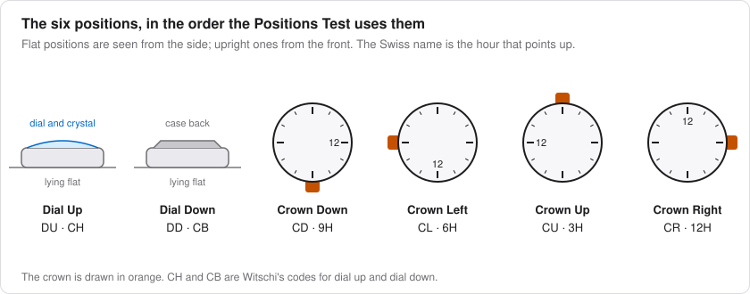
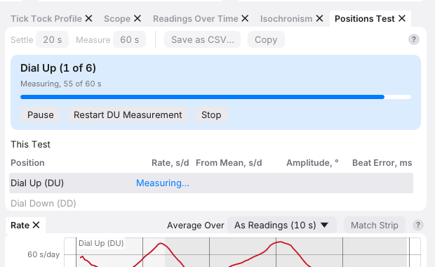
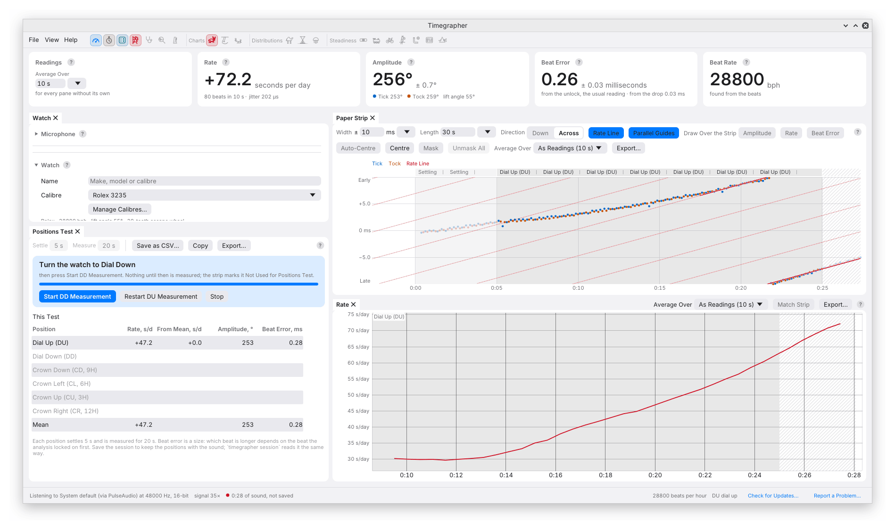
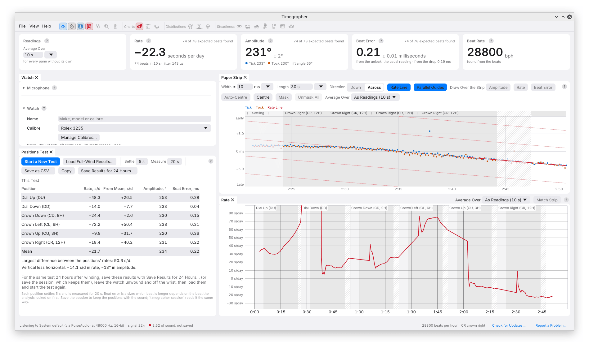

# 10. Positions and the Positions Test

A positional test measures the same watch under different orientations to
gravity. It can reveal differences that a single dial-up rate conceals.
To make those differences interpretable, keep winding state, settings,
settling time and measurement duration comparable, and maintain good
microphone contact after every turn.

Gravity changes the loading of pivots and the behaviour of an imperfectly
poised balance and hairspring assembly. A positional difference is useful
evidence, but the timing table alone does not identify which of those
mechanisms produced it.

## The Six Positions

| Position | App code | Swiss code | Orientation |
| --- | --- | --- | --- |
| Dial Up | **DU** | CH | Dial faces upwards |
| Dial Down | **DD** | CB | Dial faces downwards |
| Crown Up | **CU** | 3H | Watch upright, crown upwards |
| Crown Down | **CD** | 9H | Watch upright, crown downwards |
| Crown Left | **CL** | 6H | Watch upright, crown left as viewed from the dial |
| Crown Right | **CR** | 12H | Watch upright, crown right as viewed from the dial |

The hour codes identify the dial numeral pointing upwards. Their mapping
to crown directions assumes a crown at 3 o'clock. For a crown at another
location, or a pocket watch described by pendant position, record the
physical orientation explicitly; do not apply the table's equivalence
without checking it. The app's combined names use the conventional
3-o'clock-crown mapping.

## Setting the Position by Hand

Select **Position** under Watch when you turn the watch. During capture,
this starts a new labelled stretch. The strip and charts retain the
previous stretches, but current readings and profiles start with the
new position.

The first **10 seconds** are excluded as settling time and drawn faintly.
Their audio is still recorded. This is the ordinary manual-position
behaviour; the guided Positions Test has its own Settle control.

Distributions and Steadiness select the currently chosen position. If
you record DU, then DD, then DU again, both DU stretches can contribute.
That is useful for a positional summary, but is not equivalent to an
uninterrupted run. See [Steadiness](08a-steadiness.md#which-readings-are-analysed)
before interpreting its time axis or long-term statistics.

### When the Beats Stop

If beats disappear for more than three seconds and then return during
capture without a marked position change, the app asks whether the watch
was moved. Choose the new position or **Not Moved**. The prompt expires
after a minute. A loss of beats may also be a coupling or detection issue;
the app cannot know from silence alone whether the watch changed position.

## The Positions Test

The **Positions Test** pane guides you through six measurements, using
the same settling and measuring intervals in each. It is initially a tab
beside Tick Tock Profile and is also offered above the welcome screen.

### The Toolbar

**Settle** defaults to 20 seconds and accepts 5–600 seconds. **Measure**
defaults to 60 seconds and accepts 20–3600 seconds. The app remembers
these settings. Choose a longer interval when the watch takes time to
settle or when a short reading would sample only part of a visible cycle.
Use the same choices for comparisons.

For context, Witschi's [2025 measurement tips, about p. 34](https://www.witschi.com/wp-content/uploads/firmwares/8Z1UtLGf/20251118_witschi_testing-methods-for-mechanical-watches_en.pdf)
specify 20 seconds of stabilisation and at least 40 seconds of measurement
per position. The app's defaults are consistent with those timings; they
are not a guarantee that every movement has settled after 20 seconds.

**Start Test** begins a test and starts capture if necessary. After a
completed test it becomes **Start a New Test**. The toolbar also offers
**Load Full-Wind Results…**, **Save as CSV…**, **Copy** and, for the first
half of a paired test, **Save Results for 24 Hours…**.

### Running the Test

1. Wind the watch fully, record that time and place it dial up.
2. Click **Start Test**. The banner identifies the position and shows
   progress through settling and measurement.

   

3. When prompted, turn the watch to the next position, check its seating,
   and click the named button, such as **Start DD Measurement**. The
   measured interval does not start while the app is waiting for that
   confirmation.

   

4. Continue through **DU, DD, CD, CL, CU, CR**, the app's order, then click
   **Finish** after the last measurement.

A knock or a poor seating need not spoil the entire test. **Restart
[position] Measurement** repeats settling and measurement for that
position. **Pause** discards the position's partial measurement; **Resume**
starts that position's settling and measurement again. **Stop** ends the
test and clears its table, while retaining the captured session and
position history.

### What the Strip Shows During a Test

The strip and charts distinguish **Before Test**, **Settling**, measured
position intervals and **Not Used for Positions Test**. The latter
includes time spent turning the watch, pauses and abandoned partial
measurements. Beats outside the accepted measurement intervals are faint.

These labels explain the result's selection, not whether the excluded
audio contains a regular beat. The sound remains useful for checking a
transition or understanding why a measurement was restarted. Test marks
remain until a new test or session.

## The Results

Each row gives rate, **From Mean**, amplitude and beat-error magnitude.
From Mean is that position's rate minus the mean of the measured positions.
Rates use the stored input-clock correction when available; confirm the
clock basis when comparing with the main Rate card's large figure.

The summary includes:

| Quantity | Calculation and meaning |
| --- | --- |
| **Mean** | Mean of the available positions' values; positions have equal weight |
| **Largest difference between the positions' rates (D)** | Maximum rate minus minimum rate |
| **Vertical less horizontal (DVH)** | Mean of the four vertical positions minus mean of the two horizontal positions, for rate and amplitude |

For example, if horizontal rates average +4 s/d and vertical rates average
−2 s/d, rate DVH is **−6 s/d**. If the fastest position is +8 and the
slowest −4, D is **12 s/d**. Neither is the uncertainty of the mean.

The equal-position mean is a bench characteristic, not a prediction of
wrist performance: a wearer does not spend equal time in all six static
positions. Also check each row before interpreting a small overall mean;
large positive and negative deviations can cancel.

The app lists detected conditions such as clipping, a short beat span or
no regular beat. It does not assign pass/fail limits. Use the movement's
specification and the test conditions for that judgement.

**Save as CSV…** writes the watch identity, settings, test timing, rows,
summary and conditions. **Copy** places a tab-separated version on the
clipboard. Save the audio session as well when you want to retain the
evidence behind the table.

## Full Wind Against 24 Hours

A paired test compares the same positions at two winding states:

1. Run the first test after winding and choose **Save Results for 24
   Hours…**. Saving that session also keeps `positions-test.json`.
2. Let the watch run without further winding or wear for the intended
   interval, recording
   any interruption or accidental winding.
3. Choose **Load Full-Wind Results…** and select the earlier results.
   Confirm the watch, calibre and time shown in the **Full Wind** table.
   **Remove** sets that reference aside.
4. Run **Start Test** again with the same settings and order. The banner
   reports elapsed hours from the earlier test.

The additional table shows each position at full wind and later, with
changes calculated as **later minus earlier**. **Im** is the rate change
with the largest absolute magnitude among the eligible positions,
excluding crown right/12H; it retains that change's sign. **Ie** is the
absolute change in mean rate over the common positions. Witschi describes
the Im exclusion in its [discussion of NIHS 93-10](https://www.witschi.com/wp-content/uploads/firmwares/8Z1UtLGf/20251118_witschi_testing-methods-for-mechanical-watches_en.pdf).
This guide uses that published explanation, not a claim that the app
performs a complete standards certification test.

For example, changes of +2, −5 and +3 s/d among the eligible positions
make Im −5 s/d. Ie can be much smaller if changes cancel in the mean.
Retain the position rows, not just those two summary values.

A comparison made after 18 or 27 hours is still useful, but record the
actual interval. Loading a file labelled Full Wind cannot establish that
the watch was fully wound when those readings were taken.

## From the Command Line

`timegrapher record` captures positions into a session folder, and
`timegrapher session` generates an HTML report from its manifest and
recordings. It also reports X, D, DV, DH, DVH, Di, Im and Ie; the
[session reference](../sessions.md) defines their selections and
calculations. An app-saved session carries the corresponding measurement
intervals, so compare the same stretches and settings when checking the
two interfaces.

---

Previous: [Calibres and Lift Angles](09-calibres.md) ·
Next: [Sessions and Recordings](11-sessions-and-recordings.md)
