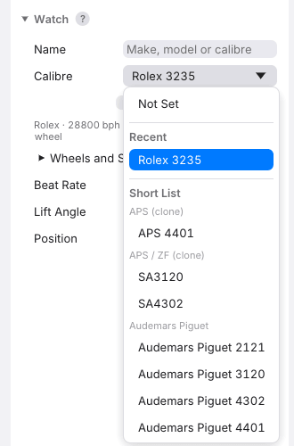
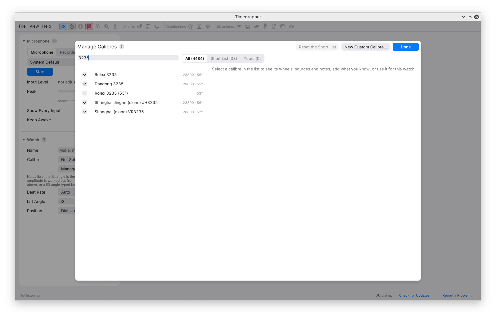
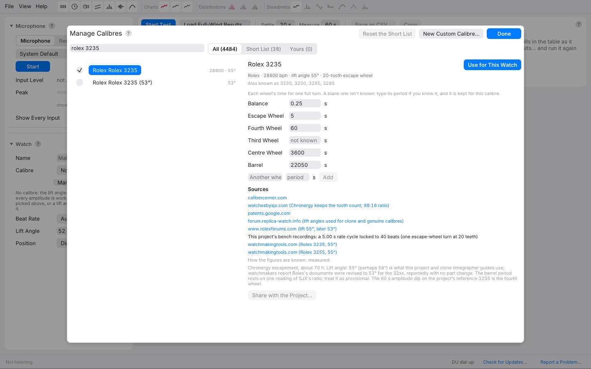

# 11. Calibres and Lift Angles

Selecting a calibre supplies context that the microphone cannot discover
on its own. The lift angle sets the amplitude scale, and the train's wheel
periods give possible mechanical associations for repeating patterns.
Both deserve the same care as the physical setup.

The catalogue contains thousands of entries with sources and notes. It
is a reference to inspect, particularly when variants, replacement
movements or conflicting published lift angles are involved.

## Choosing the Calibre

The **Calibre** menu under Watch offers **Not Set**, **Recent**, a
**Short List** grouped by maker, and **Your Calibres**. Use **Manage
Calibres…** to search the full catalogue.



Choosing an entry fills in its lift angle when one is known, supplies its
wheel periods for analysis labels, and shows its maker, beat rate and
other available details. A discrepancy between the catalogue beat rate
and the detected beat rate is reported below the menu. The desktop's
**Beat Rate** control remains a separate choice; confirm what it says.

Open **Wheels and Sources** to inspect the wheel periods and their basis.
A period calculated from tooth counts is different evidence from one
estimated from a recording. Neither a familiar calibre number nor a neat
wheel label validates an otherwise doubtful measurement.

With **Not Set** and the default 52° lift angle, the amplitude card names
that assumption. Setting a calibre is specific to the watch being tested;
a fresh launch does not assume it is still the same watch.

## Manage Calibres



**Manage Calibres…**, at the foot of the calibre menu and as a button
under it, opens Settings at **Calibres**. **All**, **Short List** and
**Yours** filter the catalogue. The search
matches words against the calibre number, aliases and maker names, so a
maker qualifier can distinguish movements sharing a number. Select an
entry to inspect it; **Use for This Watch** applies it. **Done**, Escape
or a click outside closes Settings.

### Reading a Calibre's Entry



The details include aliases, nominal beat rate, lift angle, escape-wheel
tooth count where known, and periods for the balance and train wheels.
Hover over a wheel for the basis of its value. A blank value means it is
not supplied; it does not mean the wheel has no relevant period.

Read **Sources**, provenance and notes before resolving a disagreement.
A maker's technical document for the exact variant is more useful than
an unexplained number copied between lists. If two published sources
differ, record which value you used and why. Do not choose a lift angle
because it produces the amplitude you hoped to see.

For an otherwise identical measurement:

```text
new amplitude = old amplitude × new lift angle / old lift angle
```

For example, 260° at 52° becomes 275° at 55°. Rate and the acoustic
interval have not changed. This simple check is useful when comparing
a saved session with a bench instrument configured differently.

### The Short List

Use the checkbox beside an entry to include it in the Short List.
**Tick All** and **Untick All** apply to a maker, and **Reset the Short
List** restores the supplied selection. These preferences and recent
picks are retained between runs.

## Adding What You Know

In an entry, a blank wheel period can be filled in and is marked as yours.
**Clear** removes that addition. To add a named period, type the wheel's
name and period and press **Add**.
Use **New Custom Calibre…** for a movement that needs its own identity,
maker, beat rate or lift angle. Custom entries also offer **Delete
Calibre**.

If you derive a period, keep the calculation and source. For a simple
gear mesh, rotation period is inversely proportional to angular speed:
a driven member's period equals the driving member's period multiplied
by the driven tooth count divided by the driving tooth count. Identify
the wheel and pinion on each arbor carefully before applying that relation
to a train. Do not substitute the period of a tooth engagement for one
complete wheel revolution.

**Share with the Project…** prepares a GitHub issue in the browser with
your additions. Review it and supply the source before submitting. The
app does not post it automatically.

Your additions are stored in `calibres.json` in the
[settings folder](16-problems-and-reports.md#settings-logs-and-updates).
The command-line tool and MCP server read that catalogue too. Keep a
copy if those additions form part of your bench records.

## Setting the Lift Angle by Hand

Enter **Lift Angle** under Watch and press Enter, or choose a preset.
Amplitude history is recalculated using that angle. The recording itself
is unchanged, so a corrected setting can be applied to an old take.

Use the movement's **balance lift angle**, not the pallet lever's lift,
locking angle or drop angle. Those are different geometric quantities.
[How a Timegrapher Hears a Watch](01-how-it-works.md#amplitude) explains
why the balance angle belongs in the formula.

## Beat Rate

**Auto** chooses a standard rate from the sound. The desktop offers
manual standard rates from 12,000 to 72,000 bph; changing the setting
restarts the readings. Confirm the detected or selected number when an
amplitude seems implausible, since the oscillation period enters the
amplitude calculation too.

## From the Command Line

`timegrapher calibres` lists the catalogue; a name or `--search` narrows
it. Settings have command-specific meanings. In particular, `analyze`
can take beat rate and lift angle from `--calibre`, while `long` and
`series` take its lift angle and wheels but not its beat rate (`--lift`
overrides the lift angle; 52° when neither gives one). See [Common Options](14-command-line.md#common-options).

---

Previous: [Isochronism](10-isochronism.md) ·
Next: [Positions and the Positions Test](12-positions.md)
