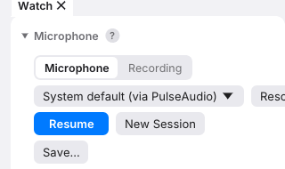
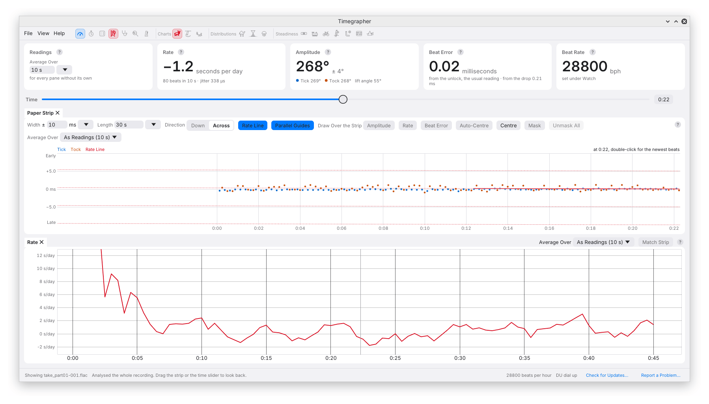
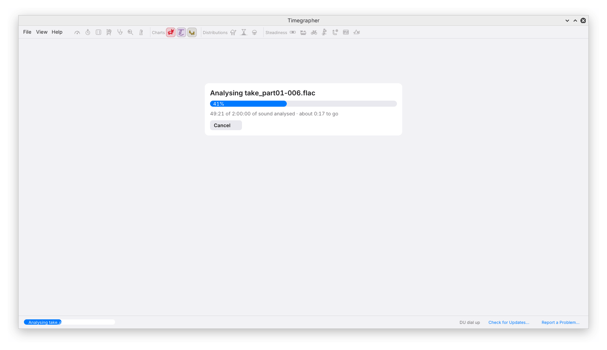

# 13. Sessions and Recordings

A saved recording lets you return to a result, inspect the sound behind
it, or apply a corrected lift angle without asking the watch to repeat
its behaviour. Save the context with the audio: a file of clear ticks is
much less useful if its position, winding state or settings are unknown.

## A Session from the Microphone

**Start** or **Listen to a Watch** begins capture. The app retains audio
and analysis as the session grows. **Stop** releases the microphone and
keeps the session available for review. **Resume** continues it, and
**New Session** clears the current session after any required save prompt.
It is also available while listening: microphone capture continues into
a fresh session. It stops a replay.

A pause is an analysis boundary. Current readings do not reach back across
it. The strip and charts omit stopped time, so their elapsed time is not
necessarily the wall-clock time between the first and last capture.
Keep that distinction in mind for an overnight run or a comparison made
many hours after winding.

Use the Position control for a position change within one session. A new
watch is a good reason for a new session, with its identity and settings
checked afresh.

### Looking Back

After stopping, use the **Time** slider below the readings or drag along
the Paper Strip. The cards, profile and Scope follow the selected moment.
If capture stopped during settling after a move, the app can retain the
last reading from before the move and labels it accordingly.

Steadiness and Isochronism are different: moving the time cursor does not
restrict them to the selected moment. They analyse the eligible history
for the chosen position. See [Steadiness](09-steadiness.md).

## Saving

You can save while listening or after stopping:

| Action | Result |
| --- | --- |
| **Save…** | Choose a parent folder; the app creates a session folder inside it |
| **Save Again** / Ctrl+S | Update the previously chosen saved copy |
| **Save As…** / Ctrl+Shift+S | Make a copy at a new destination and use that destination for subsequent Save Again actions |

Use Cmd on macOS. A save captures the session available at that point.
If recording continues, save again to include the new audio and context.
A successful earlier save does not mean the destination is continuously
updated in the background.

New Session, opening or replaying another recording, and closing the app
prompt before unsaved audio is discarded. Those prompts are useful, but
saving deliberately is the better way to preserve an important take.

### What a Saved Take Holds

The folder name includes its start time in UTC and, when supplied, the
watch name and calibre, with spaces turned into underscores. For example:
`2026-10-08T21-30-00_Test_watch_Rolex_3235`.

| File | Purpose |
| --- | --- |
| `audio-001.wav`, … | Captured sound in segments of at most an hour; resuming after a pause starts a new file |
| `clock.csv` | Periodic pairs of captured-audio time and computer time, for clock analysis |
| `session.json` | App context, watch details, positions, pauses and end-of-session readings |
| `session.toml` | Analysis manifest used by the command line, including recording intervals, masked stretches and settings |
| `positions-test.json` | Full-wind Positions Test results when available, for a later comparison |

Keep the folder together. Copying only the WAV files loses context that
can affect interpretation. Position is recorded in the manifests rather
than encoded as a single label in the folder name, since one take can
contain several positions.

During capture, the app flushes the audio files periodically, approximately
every ten seconds. This improves recoverability after interruption; it
is not a guarantee that the last samples or all metadata survive a crash.

## Opening a Recording

The app reads **WAV** and **FLAC**. Select **Recording** in the Watch pane
and use **Open…** or **Open Folder…**. The File menu and welcome screen
provide equivalent opening actions. You can also enter a path and press
Enter, or drop a supported file or folder onto the window where the
desktop supports it. Linux drag-and-drop currently works through X11,
not Wayland.

Opening a recording analyses the whole input. A progress view reports the
duration processed and offers **Cancel**.

### The Watch's Details

If an associated `session.toml` lists the input, the app restores its
watch name, calibre, lift angle, beat rate and position intervals. Check
these details after opening, especially for folders assembled outside
the app.

Without a matching manifest, defaults apply: no watch name or calibre,
52° lift angle, automatic beat rate and Dial Up unless a recognised
position token is found in the file or folder name. For example, `DU`
in `watch_DU_01.flac` can supply the position. A filename is a useful hint,
not evidence that the watch was actually held that way.

### A Folder of Segments

Segments open as a single recording. The app follows the order in the
manifest when one is supplied, otherwise natural filename order:
`part2` precedes `part10`. File modification dates do not determine order.
If dates suggest an inconsistency, the app reports it so that you can
check the sequence.

Natural sorting cannot recover missing metadata. For a folder assembled
by hand, verify order, continuity and position changes before using its
long-term plots. Renaming segments carelessly can turn a real timeline
into an artificial one.

## Replay

**Replay** feeds a recording through the live-style display progressively.
It does not require the microphone. A folder replays its segments in
sequence. **Replay Speed** ranges from 0.5× to 16× and controls display
progress, not the audio time scale used to calculate the watch rate.

**Stop** stops replay. **Analyse All**, available during or after replay,
returns to full-recording analysis without reopening the file and keeps
the current Watch settings. Compare the same selected interval when
checking Replay against Analyse All: a trailing live-style reading and
a whole-take summary answer different questions.

Selecting Recording while a stopped microphone session is retained does
not by itself discard that session; switching back to Microphone restores
it. Opening another input is the action that may require the save prompt.

## Long Takes

For a long measurement, establish the signal and settings first, and
save early. Keep enough disk space for the raw audio and saved copy.
Avoid moving the watch, changing input routing or adjusting gain midway
unless that change is part of the experiment and is recorded.

**Keep Awake**, under Microphone in the Watch pane, is on unless you
switch it off. While the app listens it asks the computer not to go to
sleep on its own; the screen can still lock and switch off. If the
system refuses, a note under the switch says so, and the computer may
sleep during the take.

Listening carries on while the window is hidden behind other windows,
minimised, or with the screen locked or off: the sound is saved and read
as it arrives, and the window shows everything heard once it is back.
While a file dialog is open (Open, Save, choosing a folder), the sound
waits in memory and is saved and read when the dialog closes.

If the computer does sleep (a laptop's lid closed, Sleep chosen from a
menu, or Keep Awake off), the sound's timestamps jump when it wakes. A
jump of more than 5 seconds is left out of the take as a break, as after
Stop and Resume, and listening carries on. A message gives the length:
"The sound's timestamps jumped by …, as they do when the computer
sleeps."

A shorter hole, such as a dropout in the sound or a knock that costs
part of a beat, shows in the beats rather than the timestamps. The app
treats it as a jump too: no reading or amplitude window reaches across
it, and Tick and Tock are told apart again by their sound, so a dropout
does not swap their names. For a few seconds after such a jump, while
the sides are checked, the beat error, each side's amplitude and the
Tick Tock Profile stay blank. When the two sides sound too alike to tell
apart, they keep the names the beat count gives them, as at the start of
every session. A hole that costs close to an odd number of beats can
leave no step to see, and then the names can swap unnoticed; the
[app reference](../app.md) gives the limits.

The app's live readings never reach across a pause, a break, a jump or
a masked stretch. A Positions Test's reading of a position with a mask
in it does cover it, and so do the command line's whole-take figures
(`analyze`, `session`, `long`) and the readings `long` and `series`
make for each slice. They measure the beat error on each side
apart and then combine the sides. When both sides give the same
sign, the combined figure is their average, weighted by beats. When the
sign turns over from one side to the other, as it can when the names
Tick and Tock change places at a jump, the sides are combined by their
sizes instead and the figure is given as positive: a watch at 0.6 ms on
both sides reads 0.6 ms rather than a near-zero average of +0.6 and
-0.6. Only a stretch of at least 10 seconds of beats counts towards that
decision.
Where Tick and Tock were named across a break by the beat count rather
than told apart by their sound, `analyze`, `long` and `series` say so: a
`sides_by_count` caveat in the JSON, and in `long`'s and `series`'s text a **Sides**
line.

A continuous run is especially valuable for
[Isochronism](10-isochronism.md). For reports over hours or days, the
command-line [long](14-command-line.md#long) and
[series](14-command-line.md#series) commands process the saved input in
bounded memory. A suitable clock log can correct the time basis during
that analysis.

## If Saving Fails

If writing or finalising captured audio fails, capture stops and the app
shows the scratch folder with a persistent warning. Copy that folder to
a safe location before attempting recovery; some files may be incomplete.
Resume and Save are unavailable for that failed session so an earlier
saved take is not silently replaced. Resolve the storage problem, then
start a new session.

When reporting a failure, include the exact message and whether the earlier
saved copy still opens. See [Problems and Reports](16-problems-and-reports.md).

---

Previous: [Positions and the Positions Test](12-positions.md) ·
Next: [The Command Line](14-command-line.md)
