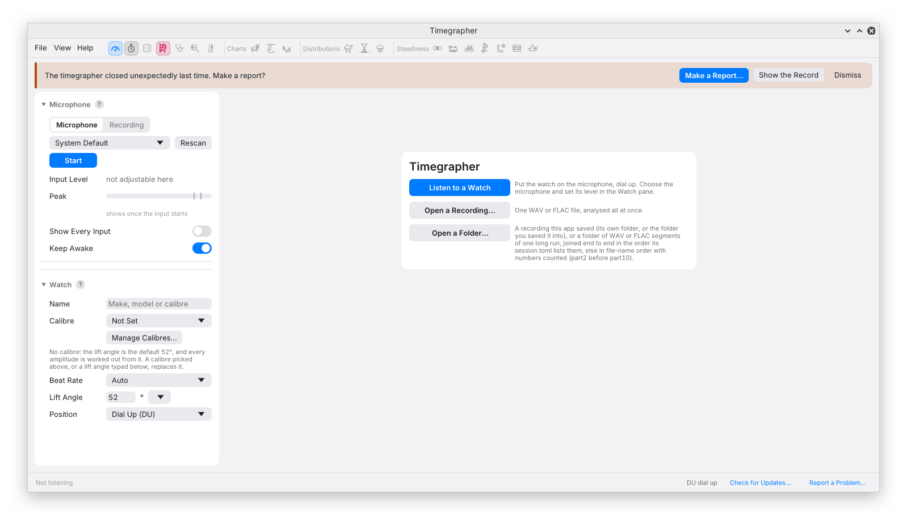

# 14. Problems and Reports

When a reading looks wrong, preserve the evidence before changing the
setup. Save the recording, note the time of the suspect interval, and
record the beat rate, lift angle, position and winding state. A number
without its sound and settings is much harder to investigate.

## No Input, No Sound, or No Regular Beat

These are different failures:

| What you see | What to check first |
| --- | --- |
| The input is absent or will not open | Connection, permissions, selected device and whether another program has exclusive access |
| Capture is running but the Peak meter barely moves | Input gain, cable and pickup coupling; confirm that this is the intended microphone |
| The Peak meter responds, but no regular beat is found | Watch running, correct nominal beat rate, periodic background noise, clipping and poor acoustic contact |
| Readings appear, but amplitude is absent | Whether Unlock and Drop can be located consistently in the beat profiles; a usable rate does not guarantee a usable lift-time measurement |

Press **Rescan** after connecting an input. On macOS, check the app's
Microphone permission in System Settings. On Windows, check microphone
access for desktop apps in Settings. On Linux, try **System default (via
PipeWire)** if the sound server already holds the hardware; a **(direct)**
input may then be unavailable.

If the device stops delivering audio callbacks for about three seconds,
the app stops listening and displays an error. This is a capture failure,
not a rule that three seconds of quiet audio stops a recording. See
[Setting Up the Microphone](03-microphone.md) and
[No Regular Beat Found](05-readings.md#no-regular-beat-found).

## The Amplitude Looks Wrong

First check the **lift angle** against a credible source for the movement.
The software cannot recover a missing lift angle from the recording. A
wrong setting can give a smooth, repeatable, wrong amplitude.

Then inspect the [Tick Tock Profile](07-sound-of-the-beat.md). Is the Unlock
marker attached to a plausible first group on both sides? Does it jump
when the displayed amplitude jumps? Are the peaks clipped? A change in
holder contact or gain can alter the envelope enough to move a detected
edge. Reduce clipping and improve coupling, then repeat the measurement
without changing several things at once.

If amplitude changes while the profile remains consistent, compare the
rate, position and winding history. That is a better basis for a
mechanical investigation than rejecting the reading simply because it
is outside an expected range. No single amplitude range suits every
movement and condition.

## Two Instruments Disagree on Rate

Compare the same watch position and state of wind, using comparable
measurement intervals after settling. A live value and a whole-recording
average can both be correct for their respective intervals.

Then check the clock basis. Every instrument has a reference clock;
20 ppm of reference error is about 1.73 s/d. In the desktop app, distinguish
the sample-clock rate from **True Clock**. A stored correction may belong
to a different input, sample rate or operating condition. The
[clock discussion](05-readings.md#true-clock) explains what the calibration
establishes and what it does not.

If the discrepancy remains, compare saved audio with explicit settings.
The [command-line chapter](12-command-line.md#analyze) gives a way to make
the interval, lift angle and correction unambiguous. Include both
instruments' settings when reporting the comparison.

## A Steadiness Result Seems Implausible

Begin with **Readings Over Time**. Look for handling, position joins,
gaps, loss of lock, and a marker that changes identity. Then ask whether
the reported pattern has enough repetitions to be convincing.

A peak close to a wheel period is a candidate for investigation. It is
not a component diagnosis. A **Cycle** plot can fold at a reference period
even when no significant cycle was detected, and a low Allan-deviation
point can result from averaging over a cycle. The
[Steadiness chapter](08a-steadiness.md) explains these cases and the
individual panes. For unexpected rate-versus-amplitude behaviour, check
the recording design and bin coverage in [Isochronism](08b-isochronism.md).

## The App Will Not Start

The distributed builds are unsigned. The download's **Start Here** page
and [Installing and Updating](../install.md) explain the operating-system
warnings and how to open a build you obtained from the project.

If the window fails to open, graphics support may be the problem,
especially in a virtual machine or remote session. The app first tries
OpenGL, then its alternative graphics backend. Keep the error text and
log when reporting a startup failure.

On Linux, an AppImage that reports missing FUSE can be run with
`--appimage-extract-and-run`. See the installation guide for the package
appropriate to your distribution.

## If the App Closes Unexpectedly

A recorded crash produces a banner at the next start:

**Show the Record** opens the crash record. **Make a Report…** copies the
record and opens a GitHub issue form for you to paste it into. **Dismiss**
closes the banner. Opening the form does not submit a report.

If a recording was in progress, check the scratch files before starting a
replacement session; [Sessions and Recordings](11-sessions-and-recordings.md)
explains how they relate to saved copies. Do not assume that the latest
seconds were flushed before a crash.

## Make a Useful Report

Choose **Report a Problem…** from Help or the status line. Select **Bug**,
**Reading**, **Setup** or **Idea**, and describe the observation. For a
measurement issue, a useful note says what you measured, what you expected,
and why. For example:

> The amplitude changes from about 260° to 310° near 02:15, while the
> watch remains dial up. Lift angle is set to 55°. The Tick Unlock marker
> moves at the same time; Tock does not. The attached excerpt includes
> both sides of the change.

**Include the Sound** adds an excerpt of up to five minutes. For a live
session it comes from the latest audio; for an opened recording, use
**Ends At** and the waveform handles to select the relevant interval.
Keep enough sound before and after the event to show its context.

Play the excerpt and check it for voices or other private audio. Confirm
that you listened, then save the report. Offering your own recording to
the public test corpus under **CC0** is a separate, optional choice; it is
not required to report a bug.

Saving creates a zip and opens its folder and the relevant GitHub form.
Review the bundle, attach it to the issue, and submit the issue yourself.
For a wrong reading, the audio is often the most useful evidence: a
screenshot alone cannot show which acoustic edge the engine should have
followed.

The bundle can include the excerpt, replay analyses, captured app settings
and readings, recent log and crash files, and stored clock corrections.
It replaces recognised home-folder, user-name and host-name strings in
text. That redaction does not remove voices from audio or guarantee that
every personal detail in a note or filename is anonymous. See
[Reporting a Problem](../reports.md) for the exact contents and replay
procedure. `timegrapher report` provides the same general workflow from
the [command line](12-command-line.md#report).

The project's [issue forms](https://github.com/peterhudson/timegrapher/issues/new/choose)
cover bugs, readings and suggestions. To contribute a useful reference
recording, see [Contributing Recordings](../contributing-recordings.md).

## Settings, Logs and Updates

| System | Settings folder |
| --- | --- |
| macOS | `~/Library/Application Support/timegrapher` |
| Windows | `%APPDATA%\timegrapher` |
| Linux | `~/.config/timegrapher` |

The folder includes `logs/timegrapher.log` and rotated logs, crash records,
`calibres.json` for custom catalogue entries, and `clocks.json` for stored
clock corrections. Saved recordings are wherever you chose to save them.
These are separate from the application installation.

**Help → Check for Updates…** checks the project's releases. **Check for
Updates at Start** controls the automatic startup check. Download and
install a newer build using its installation instructions; updating keeps
your settings and recordings. On macOS, replace the app in Applications;
on Windows and Linux, use the new version's extracted folder. If you
also use the Claude Desktop
extension, update its bundle separately.

---

Previous: [Claude Desktop](13-claude-desktop.md) ·
Next: [Glossary and Sources](15-glossary.md)
