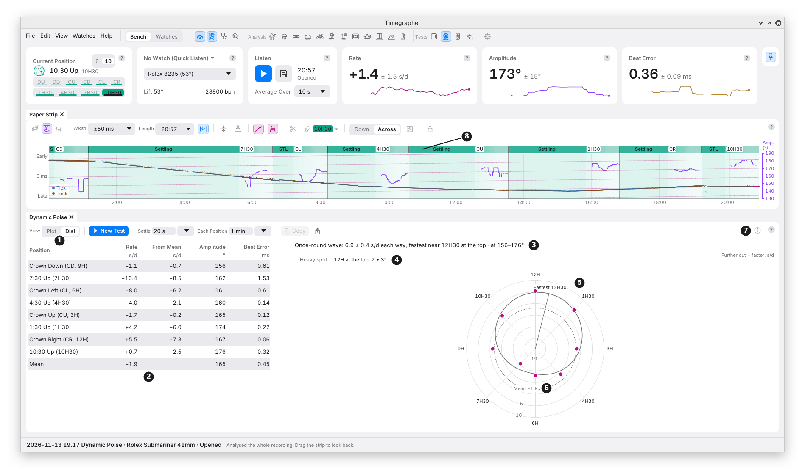

# 20b. Dynamic Poise Test

**What it shows:** the rate in the eight upright positions, 45° apart, as
the watch is turned once round in its own plane; the wave that rate makes
once round, with its size and its fastest hour; and, where the amplitude
allows, which way the balance's heavy spot hangs.

**Why you'd use it:** a balance that is out of poise is heavier on one
side. Standing upright, that heavy spot pulls the balance a little each
swing, and the rate then depends on which hour is at the top. A
Positions Test's four vertical positions show this as a spread between
them (chapter 20). Eight positions, 45° apart, show the whole wave, so
its size and its direction can be fitted rather than guessed from two or
three numbers. That is what you need before poising a balance, and what
you compare after.

The Dynamic Poise pane is a hidden tab beside the Positions Test, its
icon a Ferris wheel (each seat comes to the top in turn), under **Tests**
in the icon bar and the View menu. It needs a stand that holds the watch
upright at 45° steps.

The picture is a saved test of a calibre 3235 (28,800 beats an hour, lift
angle 53°), part let down, at 156° to 176° amplitude, with **Each
Position** at 60 s, opened again from its folder and shown in Dial view.
Its wave is 6.9 ± 0.4 s/d each way, fastest near 12H30 at the top. With
the amplitude below 219.5°, the heavy spot hangs lowest at about the same
hour: "12H at the top, 7 ± 3°" (M13). Info adds "Amplitude also changes
once round, 7 ± 1° each way, so part of the wave may be isochronism."

## The Toolbar

| Mark | Control | What it does | Why you'd use it |
| --- | --- | --- | --- |
| 1 | **View** | **Plot** or **Dial**: the rate along a line, the hour at the top across it, or round a watch face with 12H at the top, further out when faster. The same points, wave and words. Kept between runs. | Plot to read the numbers; Dial to see at a glance which side of the watch is fast. |
| | **New Test** | Sets the test up on a clear Bench at 9H at the top, and starts nothing; **Start Test** on the Listen card starts it. **Cancel Test** takes its place until then. | To begin. |
| | **Settle** and **Each Position** | The seconds the watch settles after each turn, and the seconds each position is measured. Every guided test shares these two (chapter 20): changing them here changes them in the Positions Test and the Complication Test too. | Longer gives a smaller ± (M7), which the fit needs. |
| | **Copy** | The watch, its calibre, the table, and the fit in words, with tabs between the columns. | To paste into a spreadsheet or a message. |
| | **Export…** | Saves the pane as a picture, PNG or SVG. | For a service record or a report. |
| 7 | **Info** (i, at the right) | The fit in full in one paragraph, with its twice-round terms, the heavy spot or why it isn't stated, and any caveat; then a note on the band near 219.5°, and the table's notes. | To read everything the fit found. |

**Dynamic Poise Test**, under **New Take** in the Watches view, sets the
same test up for the watch picked there, and saves the take into it
(chapter 22).

## Running a Test

1. Wind the watch and put it on the stand upright, **9H at the top**
   (crown down), where the test begins. The Current Position card turns
   to **10** (chapter 5), and stays there until you switch it back.
2. Before you start, the banner gives the amplitude so far ("Amplitude
   now …"). If it says the amplitude is near 219.5°, the heavy spot won't
   be stated (below): let the watch down, or wind it fully, first.
3. **Start Test** on the Listen card. The status bar reads "Dynamic Poise
   Test · … · 7H30, 2 of 8" as it goes.
4. When a position is done, the banner names the next one by the hour at
   the top: "Turn the watch 45°, to 7:30 Up (7H30) at the top". Turn it,
   then press **Start 7H30 Measurement**.
5. The order is 9H, 7H30, 6H, 4H30, 3H, 1H30, 12H, 10H30: the same way
   round each time, as the Positions Test turns the watch.
6. After the eighth, the test reads the eight together and stops
   listening, as Stop does.

On the Paper Strip (mark 8), each position's name sits over the stretch
it was measured in, with **Settling** over the time after each turn.

**Pause**, **Restart** and the bar work as in the Positions Test
(chapter 20). On the Paper Strip, the time the test doesn't use is
marked **Not Used for Dynamic Poise Test**.

A Dynamic Poise Test isn't set against a full-wind test, and keeps no
results for 24 hours later: it is one state of wind.

## The Results

A saved test opened again shows its table, picture and fit again, read
from its saved positions.

| Mark | Part | What it shows |
| --- | --- | --- |
| 2 | The table | The eight positions in the stand's order, each with its **Rate** (s/d), **From Mean** (its rate less the mean), **Amplitude** (°) and **Beat Error** (ms), then a **Mean** row. There is no Largest Difference: that is the six positions' figure (M8). |
| | The picture | Each rate at the hour that was at the top, with its ± (one standard error), in magenta. In Plot, along a line from 12H to 12H with a mark every 45° ("Hour at the top"). In Dial, round a watch face with 12H at the top, further out when faster. |
| 6 | The mean | A dotted line in Plot, a dotted ring in Dial, named with its rate. |
| 5 | The fitted wave | Once five positions are in, the wave the rate makes once round, in grey, with a line to its fastest hour. Until then, while a test runs, the space reads "Fitted once 5 positions are measured". A take opened again with fewer upright positions, such as a Positions Test's four, reads "Needs 5 upright positions to fit; this take has 4". |
| 3 | The line over the picture | The wave in one line: its size each way from the mean with its ±, and its fastest hour, then the amplitudes it was measured at. Where the wave isn't clear of its ± (by 2 standard errors), no fastest hour is named. |
| 4 | The heavy spot | A box on the picture: the hour at the top when it hangs lowest, with its ± in degrees, or **Not stated**. In Plot it sits in a top corner clear of the wave and the points, and is left out where they cover both; Info always gives it. |

**Measured and inferred.** The wave and its fastest hour are what the
watch did: a fact, with its ±. The heavy spot is worked out from that
wave and each position's own amplitude, so it rests on the lift angle
(M4) as well. The pane keeps the two apart, and Info says which is
which.

**When the heavy spot isn't stated:**

- **Near 219.5° amplitude.** Poise moves the rate least at 219.5°, and
  the other way above it (M13). Where any position's amplitude may be
  near it, from about 203° to 239° allowing for its ± and for a lift
  angle a few percent out, the box reads **Not stated** and a grey chip
  under the line over the picture says why. The wave is still shown, but poise moves the rate least there, and the
  wave may come mostly from other causes.
- **The wave is within its noise.** The fit can't tell its direction
  from the ±.
- **A position has no amplitude,** or **the readings have no ±.**

For these, Info says which.

**Amplitude round the dial.** Where the amplitude itself changes once
round, clear of its ±, Info adds that part of the wave may be the
watch's isochronism (chapter 19): a lower amplitude at some hours moves
the rate there too, in the same once-round pattern.

## Why This Way

- **Eight positions, not four.** Four vertical positions fix a
  once-round wave with one position to spare. Eight leave five to check
  it, and give a twice-round term (cos 2α and sin 2α) beside it. Poise
  makes only the once-round wave; a large twice-round term points to
  something else, such as the pivots or the hairspring.
- **The fastest hour is a fact; the heavy spot is not.** Below 219.5°
  a watch is fastest with its heavy spot low; above it, slowest. Fully
  wound, a vertical position typically reads 240° to 280° (Witschi,
  _Testing Methods for Mechanical Watches_, 2025, p. 34), above 219.5°.
  There the watch runs fastest with its heavy spot at the top, so the
  fastest hour is opposite the hour at which it hangs lowest. The heavy
  spot is stated only where the amplitude makes the direction clear.
- **Weighted by each position's ±,** so a noisy position counts for
  less, and the wave's ± comes from the fit.

## When You'd Use This

- **Before poising:** to see whether the balance needs it, and which
  side is heavy.
- **After poising:** to compare the wave's size with the one before.
- **When a Positions Test's vertical positions disagree** (chapter 20):
  to see whether the difference follows the hour at the top, as poise
  does.

## What It Helps Find

- **A poise error:** a once-round wave clear of its ±, with the heavy
  spot where the amplitude allows.
- **Something other than poise:** a large twice-round term, or a wave
  that comes with the amplitude changing round the dial.

## What It Can't Tell You

- **How much to take off, or where, in milligrams.** The fit gives the
  heavy spot's hour and the wave's size in s/d, not a mass.
- **Poise at another amplitude.** The poise effect changes size, and
  sign, with the amplitude: a test at full wind and one let down give
  different waves for the same balance.
- **A heavy spot near 219.5°.** There the rate barely depends on poise.
- **Lying positions.** The test is upright only; Dial Up and Dial Down
  are the Positions Test's.

---

Previous: [Positions Test](20-positions-test.md) ·
Next: [Complication Test](20c-complication-test.md)
