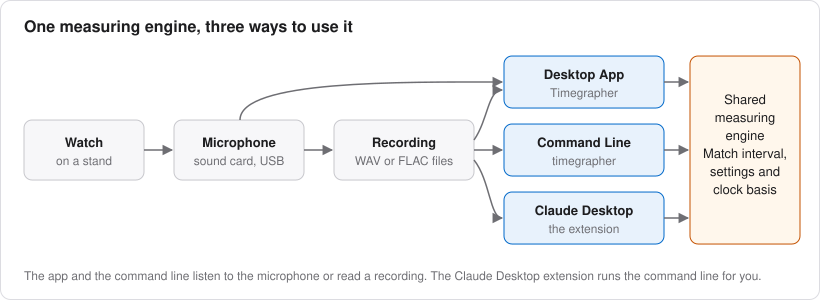

# Timegrapher User Guide

A straight trace is reassuring, but it is only the beginning of what a
recording can tell you. Why are Tick and Tock different? Is that slow
change in rate random, periodic, or related to amplitude? Does a longer
average make a reading more useful, or hide the behaviour you wanted to
measure?

This guide is written for the watchmaker who wants to understand both the
measurement and the watch. It assumes curiosity and some familiarity
with mechanical movements, rather than prior knowledge of signal
processing or statistics. The equations are included where they clarify
what a number means; the practical examples connect them to a decision
at the bench.

Timegrapher measures acoustic events. Rate and beat error come from their
timing; amplitude is inferred using an escapement model and a supplied
lift angle. The detailed mechanical discussion here concerns the **Swiss
lever escapement**. A clean-looking result does not establish that the
same model is valid for a different escapement.

## Three Ways to Use Timegrapher

- **Desktop app:** live measurements, saved recordings, beat profiles,
  charts, positions tests and detailed analysis panes.
- **Command line:** explicit, repeatable measurements and reports from
  recordings or the microphone, including long runs.
- **Claude Desktop extension:** access to the command-line tools through
  a conversation, with help organising tests and interpreting results.

All three share the measuring engine. To compare their results, match
the audio interval, beat rate, lift angle, averaging and clock basis.
Using the same file is necessary, but is not always sufficient.

The instrument provides evidence, not a service verdict. A useful
interpretation also needs the movement, position, state of wind,
temperature, measurement conditions and the question you are trying to
answer. An assistant can help put that evidence together, but neither a
software headline nor an attractive graph replaces the mechanical checks.

## Where to Start

For a first measurement, read chapters 1–3 and then keep chapters 5 and 7
nearby. For a watch already producing reliable readings, begin with
[Over Time](08-over-time.md), then use the dedicated
[Steadiness](09-steadiness.md) and [Isochronism](10-isochronism.md)
chapters alongside those panes. They explain the axes, calculations,
assumptions and limits, with suggestions for a useful follow-up test.

## Contents

| Chapter | What it helps you understand or do |
| --- | --- |
| [1. How a Timegrapher Hears a Watch](01-how-it-works.md) | The escapement's sound groups; the definitions and calculations behind rate, amplitude and beat error |
| [2. Your First Measurement](02-first-measurement.md) | Get a usable recording, verify the settings and save the evidence |
| [3. Setting Up the Microphone](03-microphone.md) | Coupling, gain, clipping, processing and input failures |
| [4. The Window](04-the-window.md) | Find and arrange the controls and panes |
| [5. Readings](05-readings.md) | Averaging, the ± figures, sample-clock error and True Clock |
| [6. The Paper Strip](06-paper-strip.md) | Read slope, spacing, scatter and recurring timing patterns |
| [7. The Sound of the Beat](07-sound-of-the-beat.md) | Inspect the Tick Tock Profile and Scope, and assess the acoustic markers |
| [8. Over Time](08-over-time.md) | Use time charts and distributions without losing the order of events |
| [9. Steadiness](09-steadiness.md) | Readings, Periods, Autocorrelation, Allan Deviation, CUSUM, Cycle and FFT |
| [10. Isochronism](10-isochronism.md) | Design a run-down measurement; interpret amplitude bins, fitted curves and wind comparisons |
| [11. Calibres and Lift Angles](11-calibres.md) | Verify catalogue settings, calculate wheel periods and add a movement |
| [12. Positions and the Positions Test](12-positions.md) | Use unambiguous orientations and compare position tests consistently |
| [13. Sessions and Recordings](13-sessions-and-recordings.md) | Understand saving, pauses, replay, position history and long recordings |
| [14. The Command Line](14-command-line.md) | Run explicit measurements and analyses, with example commands |
| [15. Claude Desktop](15-claude-desktop.md) | Install the extension and use an assistant to investigate recordings |
| [16. Problems and Reports](16-problems-and-reports.md) | Troubleshoot the measurement and preserve useful evidence |
| [17. Glossary and Sources](17-glossary.md) | Check terminology, conventions and supporting references |

## Conventions and Examples

Control names appear in **bold**, with menu paths such as **View → Reset
Panes**. On macOS, read **Cmd** where the guide uses **Ctrl** for an app
shortcut.

**Tick** is blue and **Tock** is orange. They are alternating software
labels, not permanent identities for the entry and exit pallets. The
position names and their assumptions are explained in
[chapter 12](12-positions.md#the-six-positions).

Worked numerical examples illustrate calculations; they are not claimed
measurements of your watch. Screenshots show particular recordings and
software states. Use them to recognise controls and patterns, not as
universal targets for rate, amplitude or beat error. The release you are
running may differ in details as the app develops.

## Further Detail

The guide follows the current implementation, including limits that
matter to interpretation. For more technical detail, consult:

- [Installing and Updating](../install.md).
- [The Desktop App](../app.md), covering controls, settings and files.
- [Test Sessions](../sessions.md), [Long Runs](../long-runs.md) and
  [Time-Series Analysis](../series.md).
- [Measurement Precision](../measurement-precision.md) and
  [Validation](../validation.md).
- [The Agent Interface](../agent-interface.md), [MCP Server](../mcp.md)
  and [Watchmaker Skill](../../skills/watchmaker/SKILL.md).
