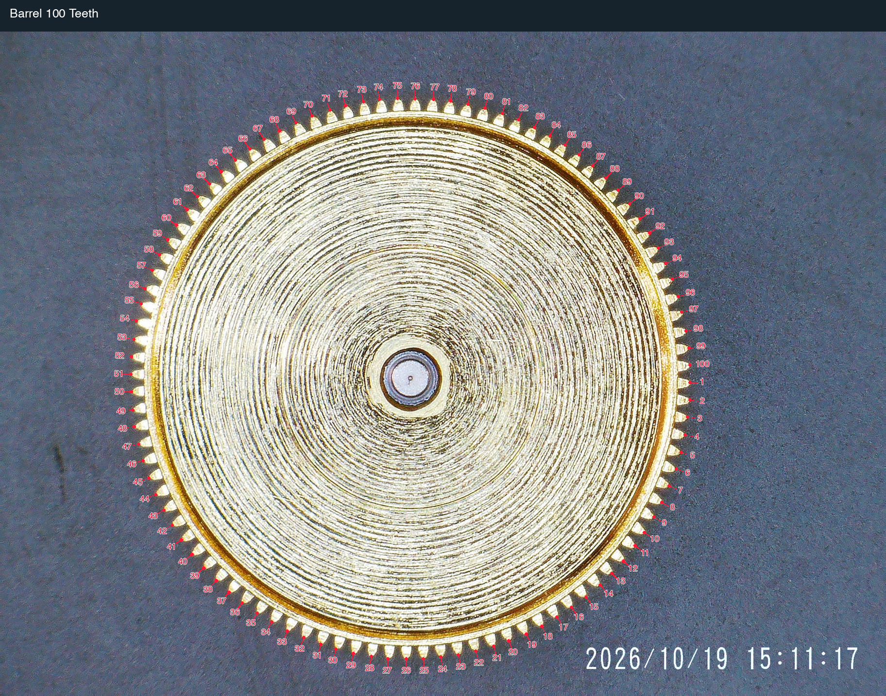
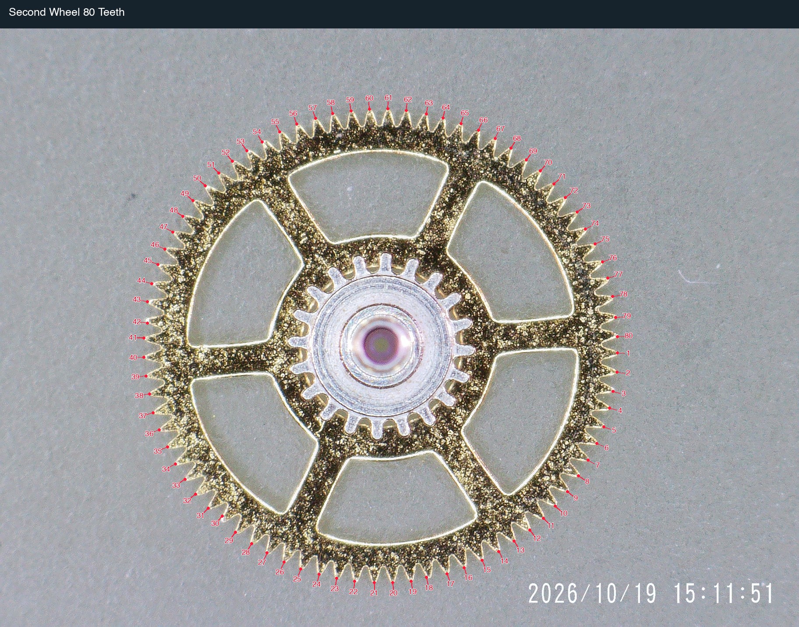
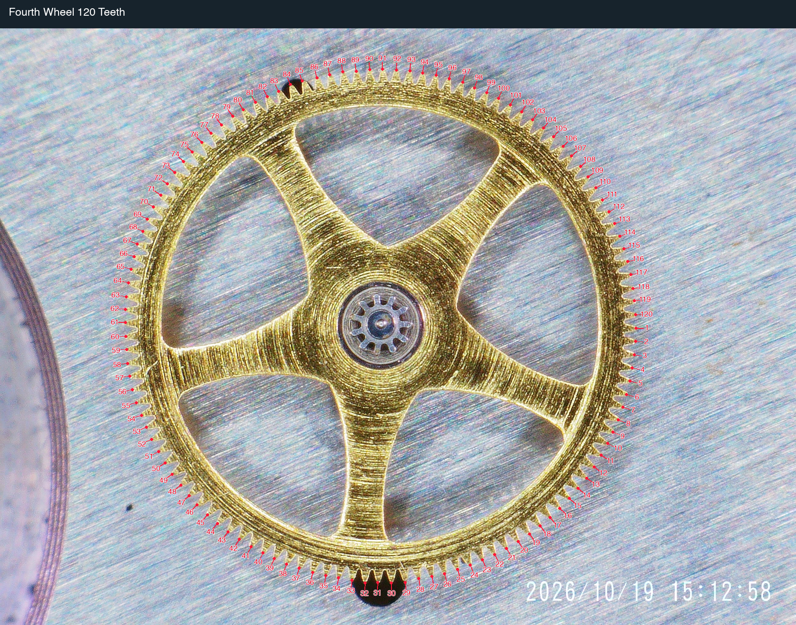
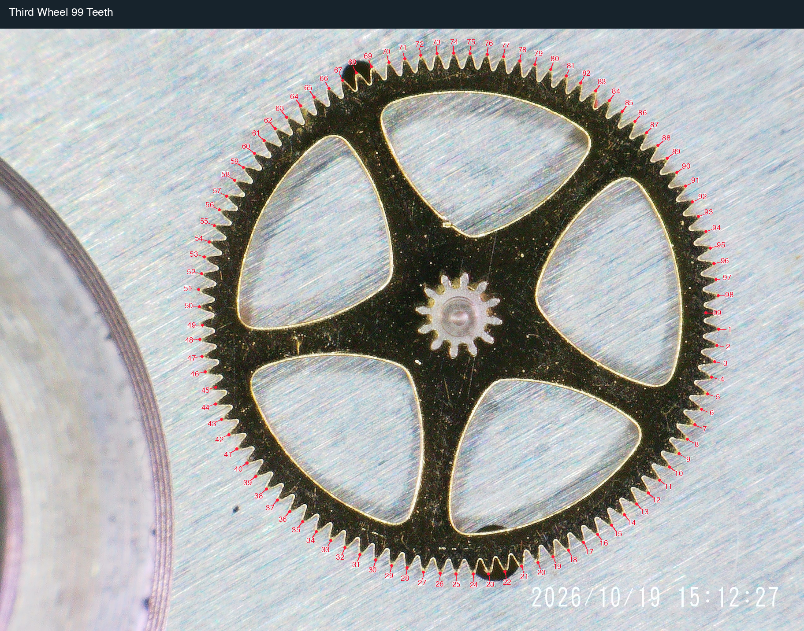
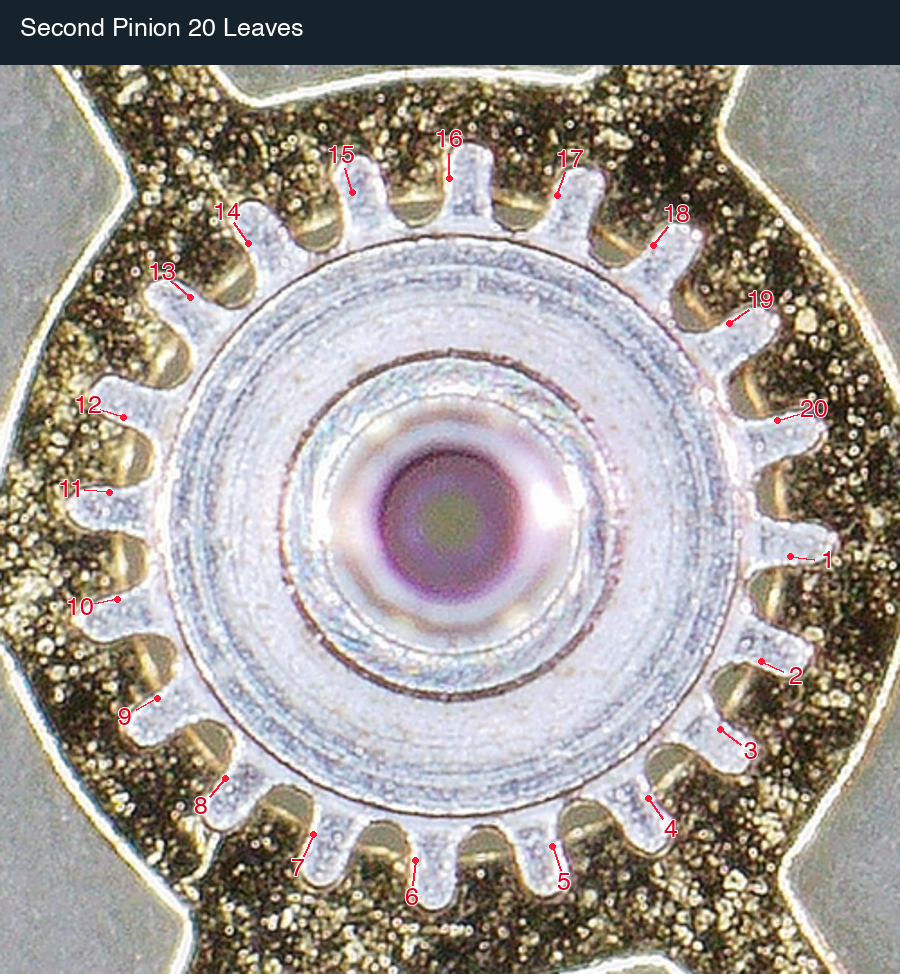
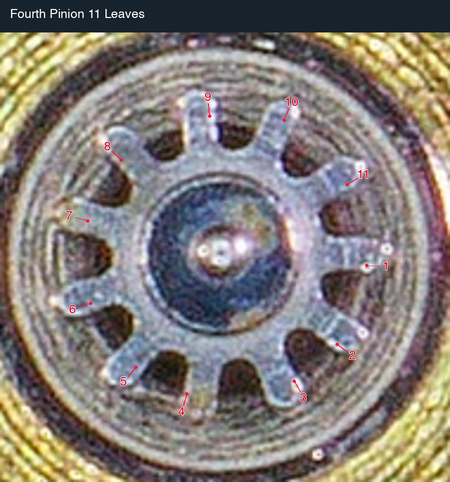
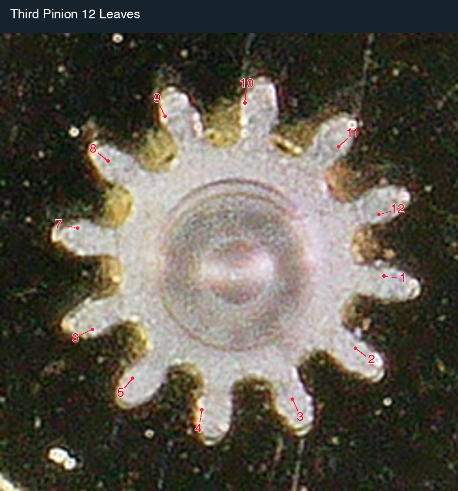

# VR32xx train-wheel counts

Peter Hudson supplied four microscope photographs from a VR32xx movement
on 2026-10-19. The counted wheels give a **540-second third wheel** and a
**18,000-second (5-hour) barrel**. The accepted escape-pair specification is **20 teeth
and 10 pinion leaves**, giving a **5-second rotation**, as confirmed for
database use by Peter. No VR escape-wheel photograph was supplied.

## Counts and periods

| Component | Wheel teeth | Pinion leaves | Seconds per turn | Evidence |
| --- | ---: | ---: | ---: | --- |
| Barrel drum | 100 | — | 18000 | Photographed |
| Second wheel | 80 | 20 | 3600 | Photographed; one-hour period supplied |
| Third wheel | 99 | 12 | 540 | Photographed; corrected filename |
| Fourth wheel | 120 | 11 | 60 | Photographed; one-minute period supplied |
| Escape wheel | **20** | **10** | **5** | Accepted specification; comparison evidence |

The barrel period is the drum's running period, not the winding-arbor
period or the power reserve. Wheel and pinion on each rigid arbor share
the listed period.

## Corrected photograph identities

Peter confirmed that the third- and fourth-wheel file labels were swapped:

| Supplied filename | Confirmed role | Preserved asset filename |
| --- | --- | --- |
| Barrel.JPG | Barrel | originals/barrel.jpg |
| Second Wheel.JPG | Second wheel, 80/20 | originals/second-wheel.jpg |
| Fourth Wheel.JPG | **Third wheel, 99/12** | originals/third-wheel.jpg |
| Third Wheel.JPG | **Fourth wheel, 120/11**, seconds-hand arbor | originals/fourth-wheel.jpg |

The originals are copied without changing their bytes. The manifest keeps
both the supplied names and corrected roles, so the correction is auditable.
The numbered figures use the confirmed mechanical roles.

## Ratio checks

```text
barrel 100 → second pinion 20
second wheel 80 → third pinion 12
third wheel 99 → fourth pinion 11
fourth wheel 120 → escape pinion 10

T_second = 3600 s                  [contributor constraint]
T_third  = 3600 × 12/80 = 540 s
T_fourth = 540 × 11/99 = 60 s      [matches seconds-hand constraint]
T_barrel = 3600 × 100/20 = 18000 s
T_escape = 60 × 10/120 = 5 s
```

The second-to-fourth speed increase is `(80/12) × (99/11) = 60` exactly.
Using the original, reversed labels would instead give
`(80/11) × (120/12) = 800/11`, inconsistent with the supplied one-hour
second and one-minute fourth wheel.

### Basis for the accepted escape pair

Both the photographed [31xx set](31xx-train-wheel-counts.md) and the
[genuine/DD/Jinghe 32xx family evidence](32xx-train-wheel-counts.md) show
**20 escape teeth and a 10-leaf pinion**. Their fourth wheels also have
120 teeth and rotate once per minute. Thus the accepted VR pair agrees
with **both** comparison families, not just one.

At 28,800 beats per hour, eight beats occur each second. A lever escape
wheel advances one tooth pitch in two beats, so a 20-tooth escape wheel
requires `2 × 20 / 8 = 5 seconds` per turn. The 10-leaf pinion
independently gives `60 × 10/120 = 5 seconds` from the fourth wheel.

This agreement does not uniquely measure the missing pair. If E is the
escape tooth count and p its pinion leaves, the constraints imply
`E/4 = p/2`, or **E = 2p**. Other integer pairs could satisfy that equation.
The 20/10 choice additionally uses the contributor's visual recollection
that the escape wheel resembles a 31xx or 32xx, the matching counted
comparison pairs, and his explicit instruction to treat 20/10 as the standard VR32xx
specification. The database uses this accepted pair without a provisional
label. Its provenance remains comparison-based: no VR escape-wheel
photograph was supplied, and it is not represented as a direct count.

## Scope and database changes

The contribution updates **VR3235 / VR32xx** and separates **VR3285** into
its own row with the same contributor-reported family train. These are
family applications of one photographed component set, not independent
measurements of both named variants. No unverified VR3230 or VR3255 entry
is invented.

The existing combined VR3235/SH3235 and SH3285/VR3285 identities are split.
**SH3235, SH3285 and SH3285-2 retain unmeasured train counts**. They do not
receive VR values. Existing lift-angle settings are retained: VR3235 at
52°, VR3285 unspecified. Train counts do not establish lift angle or
physical parts interchangeability.

The genuine/DD/Jinghe 32xx family remains separate: its 98-tooth barrel
and 14-leaf second pinion give a seven-hour barrel. The VR train's
100-tooth barrel and 20-leaf second pinion give five hours, despite matching
third/fourth periods and the accepted escape pair. Neither complete train
should be used as a blanket replacement for the other.

## Evidence assets

Four unchanged 2592 × 1944 [original JPEGs](assets/train-wheels/vr32xx/originals/)
are accompanied by a [SHA-256 manifest](assets/train-wheels/vr32xx/originals/manifest.json)
and [tooth-tip coordinates](assets/train-wheels/vr32xx/tooth-tip-coordinates.json).
The four wheel outlines were detected from their colour boundaries and
checked for one marker per tooth. One third-wheel perimeter marker was
placed manually where the colour detector lost the tooth against the
background. The three pinions were counted from
visible tips, with manual completion of one tip missed by the brightness
detector. All seven final figures were visually inspected.

Coordinates refer to a 1824 × 1368 rendition before cropping or adding
the title band. Pinion images are enlarged crops; no tooth geometry is
reconstructed. Original filenames are corrected only in copied asset
names and labels, never by modifying Peter's source files.















